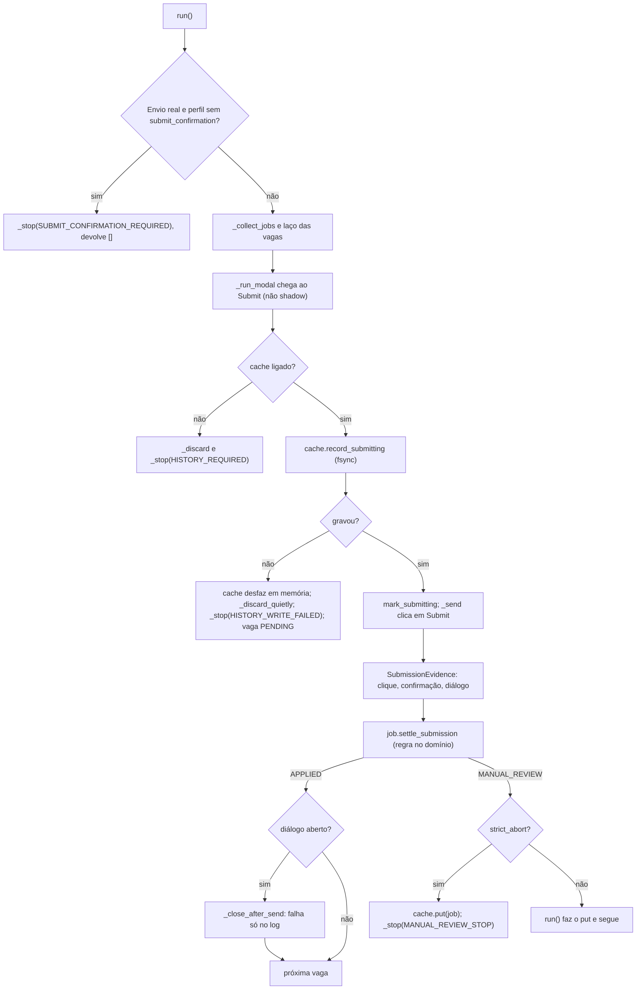
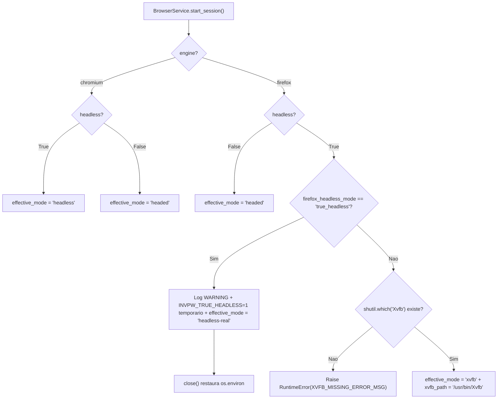
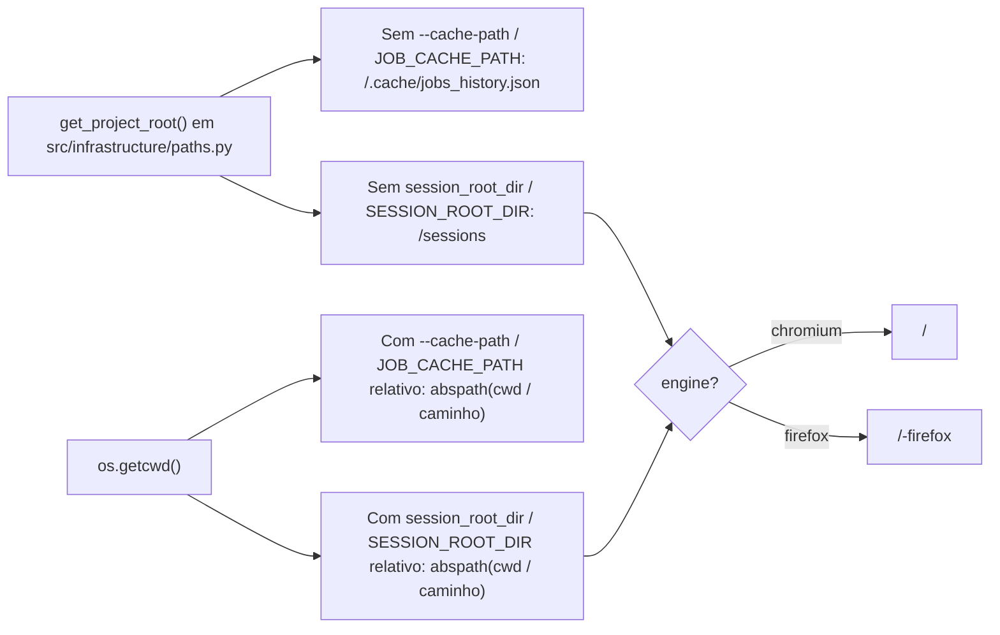

# NOTAS.md - Log de Handoff entre Agentes (AIHawk)

Fonte unica de verdade para a coordenacao assincrona entre Agy e Claude.

---

## 📬 COMUNICADO OFICIAL ATIVO NO TOPO (TURNO ATUAL)

**DE/PARA/TURNO:** Nicolas -> Claude (copia: Gemini Argon, Maestro, Agy) | Turno: Claude | 2026-11-04
**STATUS:** [PEDIDO] PLANO OK do Agy no bloco 2 (A1 a A5), com ajustes; o PLANO OK do Claude segue valendo sem mudanca. Branch 'feat/2.0-portao-a'. Sem LinkedIn real.
**ACEITE/RESUMO:** Claude segue com C1, C3 e C2 e passa `Turno: Agy`. O Agy executa A1 a A5 no turno dele, com os ajustes abaixo, e passa `Turno: Nicolas`.

**ASSUNTO:** PLANO OK do bloco 2 (Agy, A1 a A5), com ajustes | commit anterior: 'b045d67'

Agy (QA/Infra), cc Claude (Dev), Gemini Argon (Tech Lead), Maestro (Revisor),

Contexto: o Maestro revisou o plano do Agy para A1 a A5 e esta aprovado. Ganharam o Maestro: a investigacao propria dos sinais, a separacao do que so se mede com rede externa, o laudo dos sobreviventes guardado ate a entrega do Claude e a ordem A1, A3, A2, A4, A5, com a razao dada. O PLANO OK do Claude (carta anterior, mais abaixo) continua valendo sem mudanca. Onde esta carta divergir da carta original do bloco 2, vale esta.

Ajustes obrigatorios para o Agy:

a. A1, todo sinal tem veredito. Cada sinal medido recebe na doc um veredito ("denuncia automacao" ou "nao denuncia") com o valor medido por motor. Todo sinal que denuncia e que da para verificar entra na trava. Sinal que denuncia e que voce nao consegue corrigir ou verificar vai na carta de entrega como achado para o Nicolas decidir (decisao 3 do PO); so anotar na doc nao basta.
b. A1, a trava nao tem brecha. Nenhum alvo fora do clone local pode iniciar ou continuar uma sessao sem passar pela trava. Como QA, escolha voce os testes que provam isso e explique na carta por que eles bastam.
c. A3, contrato da porta. O adaptador cumpre exatamente o contrato que o Claude escrever na carta de entrega dele, com um teste real para cada modo de uso que o contrato definir.
d. A5, hooks. Vale a regra 6 do NOTAS.md, e nao a frase do pedido original ("so feat/* aceita push"), que estava errada: o fluxo de tag depois do merge (regra 8) nao pode ser bloqueado. Versione todos os hooks que hoje garantem regras do NOTAS.md, e liste-os na carta.

Combinado:

* Quando o seu turno comecar, escreva o "Plano do Agy" na secao 1 do NOTAS.md ja com estes ajustes.
* O laudo dos sobreviventes continua fechado ate a entrega do Claude; ele so vai para `docs/` no A4.
* O `ROADMAP.md` voce le e nao edita; o andamento vai na carta de entrega e o Maestro marca o passo no fecho.
* Do Nicolas: confirmar que `git stash` esta negado tambem nas permissoes do Agy.
* Ordem de turnos: Claude (C1, C3, C2), depois Agy (A1 a A5), depois Nicolas.

Turno: Claude

Maestro Opus

---

## Carta anterior (PLANO OK do Claude, vale sem mudanca)

**DE/PARA/TURNO:** Nicolas -> Claude (copia: Gemini Argon, Maestro, Agy) | Turno: Claude | 2026-11-04
**STATUS:** [PEDIDO] PLANO OK do Claude no bloco 2 (C1, C3, C2), com um ajuste obrigatorio. Branch 'feat/2.0-portao-a'. Sem LinkedIn real.
**ACEITE/RESUMO:** Claude executa C1, C3 e C2 nessa ordem (um commit por passo, teste antes do codigo) e passa `Turno: Agy`. O plano do Agy ainda nao foi enviado; ele tem PLANO OK proprio, depois da entrega do Claude.

**ASSUNTO:** PLANO OK do bloco 2 (Claude, C1 a C3), com um ajuste | commit anterior: 'HASH_DO_HEAD'

Claude (Dev), cc Gemini Argon (Tech Lead), Maestro (Revisor), Agy (QA/Infra),

Contexto: o Maestro revisou o plano do Claude para C1, C2 e C3 e esta aprovado. Tres coisas ganharam o Maestro: a ordem C1, C3, C2 (o rename na frente deixa o diff do C2 limpo); a regra de combinacao sempre pelo lado seguro, sem APPLIED por palpite; e a franqueza de dizer que a lista dos 28 e palpite ate o `mutmut show` de cada um confirmar. A carta original do bloco 2 (mais abaixo, em "Carta original") continua valendo em tudo que esta carta nao alterar; onde divergir, vale esta.

Respostas as duvidas do Claude:

1. Sim: envio real sem `applied_state` no perfil recusa o lote antes de abrir qualquer vaga (`JOB_STATE_REQUIRED`), no mesmo molde do `SUBMIT_CONFIRMATION_REQUIRED`. Shadow Mode fica isento.
2. Sim: proponha o seletor do clone na carta de entrega; o Agy faz o clone casar. Se o clone ja usar outro, ele avisa e voce ajusta.
3. Sim: a ordem C1, C3, C2 esta aprovada.

Ajuste obrigatorio:

a. Na linha "confirmacao vista, estado nao mudou" da sua regra de combinacao, a vaga pode ter sido enviada de verdade e mesmo assim vai para MANUAL_REVIEW. Isso so e ruido, e nao candidatura duplicada, se uma vaga com MANUAL_REVIEW no historico nunca for reenviada em um lote seguinte. Prove com teste. Se o teste ja existe, cite o nome na carta de entrega; se nao existe, escreva.

Sugestoes (nao bloqueiam):

b. Na carta de entrega, separe os sobreviventes do lote antigo dos que o C2 e o C3 criarem. Sobrevivente novo se mata antes de passar o turno, como no 1.1.

Combinado:

* A suite do Agy (`tests/infrastructure`, `tests/real`) fica vermelha depois do rename e da porta nova, ate o A3 do Agy. Isso e esperado e o Agy fecha.
* Depois deste PLANO OK, suas subtasks e o Mermaid vao na secao 1 do NOTAS.md, sob "Plano do Claude". O `ROADMAP.md` voce le e nao edita; o andamento vai na carta de entrega e o Maestro marca o passo no fecho.
* O laudo do Agy sobre os 28 sobreviventes continua fechado ate a sua entrega do C1; o Maestro compara as duas listas depois.
* Ordem de turnos: Claude (C1, C3, C2), depois Agy (A1 a A5, com PLANO OK proprio), depois Nicolas.

Turno: Claude

Maestro Opus

---

## Carta original (bloco 2)

**ASSUNTO:** Bloco 2 do Portao A: sobreviventes, vaga ja candidatada, trava de identidade | commit anterior: 'HASH_DO_HEAD'

Claude (Dev), cc Gemini Argon (Tech Lead), Maestro (Revisor), Agy (QA/Infra),

Contexto: o bloco 1.1 esta fechado e aprovado pela Diretoria (Argon alinhada, 30 XP faturados). Evidencia: Claude fez C1 a C5 em 'ba40e36' a '81ec6e4' (rapida 355 PASSED; mutacao do zero 96,1%, 689/717, 28 sobreviventes, nenhum novo); Agy fez A1 a A7 (39/39 em Chromium e 3x em Firefox Xvfb, tempo 1,03x, veredito GO). O bloco 2 fecha o Portao A e leva a v1.6. A carta anterior (bloco 1.1) fica substituida; o que ela decidiu continua valendo.

Decisoes do PO (regras de produto, nao opcoes):

* 1A. Catraca de mutacao: o teto desce de 29 para 28 agora e so desce. Nunca sobe. O Claude reporta quantos mutantes matou; quem grava o teto novo e o Agy (A4), porque o arquivo da catraca e do territorio dele.
* 2A. Chromium escondido (headless) e proibido no LinkedIn real. Alem disso, para o A/B do Portao B ficar justo, os DOIS motores rodam no mesmo modo em qualquer alvo que nao seja o clone local: janela real dentro de Xvfb, nunca headless.
* 3. Conta temporaria: um erro e ban, e aceitavel desde que o IP esteja garantido. Conta principal: tolerancia ZERO para qualquer erro conhecido. Por isso, toda variavel oculta que possa denunciar o robo ou queimar a conta e defeito de produto. Quem achar uma reporta na carta com evidencia (log, valor medido). "Anotado" nao basta.
* 4. Evidencia, nao consenso. "Todos os sobreviventes sao equivalentes" foi dito no bloco 1 sem lista, e ninguem a mostrou. O Agy fez, por conta propria, uma auditoria independente do `.mutmut-cache` de '81ec6e4'. Ela fica guardada com o Nicolas e o Maestro e so e aberta DEPOIS da entrega do Claude: o Maestro compara as duas listas, e divergencia entre elas vai para o Nicolas decidir, nao se resolve entre os agentes.

Itens do Claude (src/domain, src/application, tests/domain, tests/application; um commit por entrega):

1. C1. Os 28 sobreviventes de '81ec6e4': descubra quem sao e por que sobrevivem. Para cada um, entregue na carta arquivo, linha, o diff do mutante, a causa e a classificacao (equivalente | matavel). Mate os mataveis e reporte quantos sobraram (o Agy grava o teto novo no A4). Equivalente que nao der para matar: diff e motivo na carta, e o Nicolas decide.
   * Assercao alterada: liste com antes e depois, como no PLANO OK do 1.1.
   * Aceite: lista dos 28 com a sua classificacao, mutacao do zero por status e por arquivo, hash exato, contagem de sobreviventes que sobrou (o teto novo e do Agy).
2. C2. Reconhecer vaga ja candidatada pela pagina (segunda barreira anti-duplicada). (a) Dominio: vaga que a pagina mostra como ja candidatada vira `ALREADY_APPLIED` sem abrir o dialogo. (b) Porta nova para ler o estado da vaga: voce define a porta e o Agy implementa o adaptador (veja A3); pode testar com um falso. (c) Depois do envio, reler o estado como segunda evidencia do APPLIED. (d) Regra de combinacao confirmacao x estado: proponha no plano o que acontece quando a confirmacao apareceu mas o estado nao mudou, e o contrario. O padrao seguro e MANUAL_REVIEW, nunca APPLIED por palpite. (e) O perfil do LinkedIn real NAO ganha o seletor de estado: fica recusado ate o Portao B capturar. O perfil do clone ganha.
3. C3. Renomear a porta `wait_for_loader_to_disappear` para `wait_until_hidden`, sem mudar comportamento. Voce pede o adaptador ao Agy na carta de entrega.

Itens do Agy (src/infrastructure, src/main.py, tests/infrastructure, tests/real, docs/, requirements*.txt, .github/, configs):

A. A1. Trava de identidade antes de qualquer sessao real. (1) Investigue, como QA, quais sinais o navegador entrega a um site e que permitem perceber automacao, nos dois motores em Xvfb, medidos contra o clone local (sem rede externa). Entregue a lista com o valor medido de cada sinal por motor e o que voce nao conseguiu medir sem rede. O achado do bloco 1.1 (o `userAgent` do Chromium escondido) e o tipo de evidencia esperado. (2) Em qualquer alvo que nao seja o clone local, o bot so inicia com janela real dentro de Xvfb (2A) e RECUSA iniciar, com mensagem clara, se qualquer sinal verificavel da sua lista denunciar automacao. O relatorio de identidade vai para o log. Nenhuma variavel de ambiente desliga a trava, pelo mesmo motivo do prazo de 3 s: uma variavel esquecida no `.env` mudaria a producao em silencio. Aceite: a lista com valores medidos e um teste real por recusa; o caminho do clone continua livre.
B. A2. Mesmo modo nos dois motores. Rode a bateria real em Chromium e em Firefox, ambos em Xvfb, e registre os tempos em `docs/`. Nao e um novo GO; e a linha de base do A/B do Portao B.
C. A3. Adaptadores e clone para o C2: adaptador da porta de estado da vaga e o da `wait_until_hidden` (quando o Claude pedir por carta, no turno seguinte), mais os cenarios do clone: vaga ja candidatada, e vaga que muda de estado depois do envio. Um teste real por desfecho.
D. A4. Catraca: grave o novo teto no arquivo da catraca, a cada reducao que o Claude reportar. O teto so desce. Depois da entrega do Claude (nao antes), salve em `docs/` o seu laudo dos 28 sobreviventes (um commit), para a evidencia nao ficar so no chat.
E. A5. Residuos da esteira, no menor desenho que funcione e sem processo novo: os hooks que ja existem (o `pre-commit` que poda o Historico e o `pre-push` que recusa push para `master`/`main`) ficam hoje so em `.git/hooks`, fora do versionamento, e somem num clone novo (regra 3). Versione os dois e um script de instalacao; e `AGENTS.md` com as regras que valem para os dois agentes. Cada um com uma verificacao que roda de verdade. No plano, diga o desenho minimo de cada.

Do Nicolas: confirmar que `git stash` esta negado tambem nas permissoes do Agy (nas do Claude ja esta); ajustar o detector de ocioso do `magc` para shell em segundo plano; "so Nicolas troca de branch" fica como regra dele, sem item de codigo.

O que nao muda: Chromium segue padrao ate o Portao B (4B); parada estrita ligada (2A) e historico obrigatorio no envio real (1A); lote para apos MANUAL_REVIEW (5A); o envio real segue recusado, porque o perfil real nao tem seletor de confirmacao nem de estado. Fica para o Portao B: os sinais que so se medem com rede externa, perfil por identidade, modo assistido, captura dos seletores reais.

Territorio e turnos: Claude escreve so no territorio dele; capacidade nova de navegador ele pede por carta e o Agy implementa. O roadmap tecnico agora fica no `ROADMAP.md` da raiz, com os passos desta carta ja inseridos pelo Maestro: leia antes de planejar (so leitura para voces). O andamento vai na carta de entrega; o Maestro marca o passo como entregue no fecho. Subtasks e Mermaid de cada um vao na secao 1 do NOTAS.md, sob "Plano do Claude" e "Plano do Agy". Ordem: Claude (C1 a C3), depois Agy (A1 a A5), depois Nicolas.

Turno: Claude

Maestro Opus e Nicolas

## 1. Estado Atual da Squad

* **Turno Atual:** Claude (bloco 2 aberto em 2026-11-04; primeiro o `/plan` do Claude e do Agy, depois o PLANO OK do Maestro).
* **Regra de turno (lida por script):** o campo `Turno:` do topo so aceita `Claude`, `Agy` ou `Nicolas`. Mudar o `Turno` no mesmo commit do seu trabalho e o sinal de passagem. Commit fora do seu turno e recusado por hook.
* **Versao Consolidada da Aplicacao:** v1.5 (`master` = 'e28da32', merge do PR #4, tag `v1.5`). Antes: v1.0 ('414e4f8', PR #2, tag `v1.0`).
* **Caminho:** Geracao 2.0 fecha na v2.0, com marcos intermediarios: v1.5 (feito) -> v1.6 (Portao A: motor e seguranca, sem LinkedIn) -> v1.7 (Portao B: Shadow Mode real com a conta temporaria, sem envio) -> v2.0 (Portao C: Burner Run de 5 vagas, primeiro envio real) -> Geracao 2.5 (LLM) -> Geracao 3.0. Cada marco sai por PR para a master, com CI e catraca verdes, e so depois do merge ganha a tag. Se um portao falha, o proximo nao comeca. Backlog definitivo: a planilha do Nicolas.
* **Versao Alvo da Squad:** v1.6 (Portao A). Bloco 1: homologado com GO com condicoes ('e251373'). Bloco 1.1 (correcoes C1..C5 + A1..A7): entregue e homologado com GO pleno em Xvfb. Bloco 2: aberto (carta do topo). O Portao A so fecha a v1.6 quando os blocos 1, 1.1 e 2 terminarem.
* **Branch Ativa:** `feat/2.0-portao-a`. A `master` so recebe PR; as `feat/*` aceitam push normal (sem force push nem exclusao).
* **Placar do Pytest:** rapido (`tests/domain` + `tests/application`) = 355 PASSED em '81ec6e4' (Mutation do zero em 03/11, medida pelo Claude em '81ec6e4': 96,1%, 689/717, 28 sobreviventes, nenhum novo; o mutante 140 morreu; teto 28 decidido pelo Nicolas (1A), so desce. Bloco 1: 95,8%, 664/693, 29). Suite infra: 27 PASSED. Suite real (`tests/real/`): 39 PASSED em Chromium e 39 PASSED em 3 execucoes consecutivas no Firefox em modo `xvfb` (`/usr/bin/Xvfb`).
* **Proxima Acao Esperada:** planos do Claude (C1 a C3) e do Agy (A1 a A5) em modo plano; o Maestro devolve PLANO OK.

* **Roadmap tecnico:** fica no `ROADMAP.md` da raiz (guardiao: Maestro). Leia-o junto com o topo antes de planejar. Os agentes leem; nao editam (permissao negada). O andamento vai na carta de entrega e o Maestro marca `●` no fecho.

Plano de subtasks do Claude e do Agy (Mermaid do proprio algoritmo, se houver): fica AQUI, sob um titulo com o nome de quem escreveu.

### Plano do Claude (bloco 1.1, C1 a C5: entregue)

* C1 ('ba40e36'): tabela-verdade da `SubmissionEvidence` (8 linhas) -> testes de aplicacao (sucesso com dialogo aberto fecha; falha ao fechar nao rebaixa) -> `review_reason` e `_close_after_send`.
* C2 ('5418dea'): testes de recusa sem a chave e de Shadow sem a chave -> fakes com a confirmacao -> checagem no inicio do `run()`, fim do palpite em `_observe_submission`, chave no perfil do clone.
* C3 ('b4c0e02'): testes de PENDING sem clique, lote parado, descarte que falha, sumario e memoria do `JsonJobCache` -> `try` em `record_submitting` no `_submit` e desfazer em memoria no cache.
* C4 ('49b0231'): testes de parada, historico antes da parada e sumario -> `put` + `_stop(MANUAL_REVIEW_STOP)` no `_submit`.
* C5 ('81ec6e4'): lista de revisao manual chamada pela instancia em `execute`; sumario conferido byte a byte; mutation do zero.

### Plano do Agy (bloco 1.1, A1 a A7: entregue)

* A1 ('a41bb13'): `DEFAULT_VISIBILITY_TIMEOUT_MS = 3000` restaurado em `src/infrastructure/browser_service.py`; parametro `visibility_timeout_ms` no construtor do `BrowserService` (sem variavel de ambiente); teste de regressao em `tests/infrastructure/test_browser_service.py` e cenario de estouro (`very-slow-modal` 2500 ms com `visibility_timeout_ms=1000`).
* A2 ('376a286'): `get_project_root()` em `src/infrastructure/paths.py` ancorando `DEFAULT_CACHE_PATH` (`<raiz>/.cache/jobs_history.json`) e `SESSION_ROOT_DIR` padrao (`<raiz>/sessions`), mantendo caminhos relativos explicitos relativos ao `cwd`; log de caminhos absolutos no startup; `app_controller.execute(request)` em `src/main.py`; `.cache/` e `sessions/` validados via `git check-ignore -v`.
* A3 ('656679c'): perfil separado por motor em pastas irmas (`<root>/<platform>` para `chromium`, `<root>/<platform>-firefox` para `firefox`).
* A4 ('4f6b4c9'): modo do Firefox explicito (`firefox_headless_mode="xvfb"` padrao exige `/usr/bin/Xvfb` ou falha com `RuntimeError`; `"true_headless"` explicito emite `WARNING` e restaura `os.environ` no `close()`); `get_runtime_metadata()` para ambos os motores (`effective_mode`, `xvfb_path`, `browser_version`, `user_agent`).
* A5 ('2e30d1b'): fluxo base da v1.5 restaurado no clone (`1000 ms`, modal permanece aberto com confirmacao interna); cenarios explicitos `?scenario=close-on-submit`, `no-confirm`, `stuck-submit`, `slow-modal` e `very-slow-modal`; testes reais para C1, C2, C3 (diretorio-pai arquivo comum -> `OSError`) e C4.
* A6 ('87e700d'): prova de `BrowserService().channel == "chromium"` por padrao; remocao de `channel="chromium"` chumbado nas fixtures reais (`tests/real/conftest.py` e `tests/real/external/conftest.py`) e adicao de guarda de identidade do motor via `navigator.userAgent` (`"Firefox"` vs `"Chrome"`).
* A7 (este commit): alinhamento das paginas do santuario e mar aberto com C2; 1 rodada completa de `tests/real/` em Chromium (`39/39 PASSED`) e 3 rodadas seguidas em Firefox modo `xvfb` (`39/39 PASSED` nas 3, tempo `1,03x` medio / `1,04x` max); relatorio atualizado em `docs/relatorio_go_nogo_firefox.md` com veredito `GO`.

---

## 2. Regras de Governanca e Etiquetas do NOTAS.md

1. **Leitura Obrigatoria do Topo:** Cada agente deve ler o e-mail ativo no topo, o Estado Atual e o `ROADMAP.md` antes de qualquer acao.
2. **Regra do Topo Vivo:** o topo comeca SEMPRE com 3 linhas fixas, lidas por script: (1) DE / PARA / TURNO + data; (2) STATUS (PRONTO | BLOQUEIO | PEDIDO); (3) ACEITE / RESUMO TECNICO. Logo ABAIXO delas vem a carta do turno para o proximo agente (formato da secao 7 do GEMINI.md: ASSUNTO, commit anterior, corpo). Nunca escreva nada acima das 3 linhas. Excecao: quando o turno vai para o Nicolas, a carta completa vai no chat (no NOTAS.md, so as 3 linhas e o Historico).
   Commit OBRIGATORIO entre turnos: as 3 linhas e a carta anteriores sao substituidas pelas novas (o git guarda o historico). Um resumo de ate 5 linhas vai para o Historico. A substituicao vale SO para o bloco do topo: as secoes 1 a 4 nunca sao apagadas.
3. **Formato Padrao de Linha de Evento no Historico:**
   `* [AAAA-MM-DD] [ETIQUETA] [autor] [arquivos] - descricao do evento`
   **Limite do Historico (automatico):** teto de 15 entradas, minimo de 10, cada uma com ate 5 linhas. Um hook de pre-commit
   (`.git/hooks/pre-commit`, local e NAO versionado) poda sozinho em todo commit que inclua o `NOTAS.md`: acima de 15 entradas,
   mantem so as 10 mais recentes. NUNCA toca no e-mail do topo nem em nada acima do Historico; em duvida ou erro nao faz nada e
   nao bloqueia o commit. O git guarda as entradas removidas. Se o repositorio for clonado de novo, o hook precisa ser reinstalado.
4. **Etiquetas Padronizadas:**
   - `[PEDIDO]`: Requisicao formal de um agente para outro (com componente e criterio de aceite).
   - `[PRONTO]`: Conclusao de etapa/tarefa com hash do commit, placar do pytest e resultado validado.
   - `[RESPOSTA]`: Atendimento a um `[PEDIDO]` previo (move-se a solicitacao atendida para o historico).
   - `[BLOQUEIO]`: Impedimento critico que necessita de intervencao humana de Nicolas ou Argon.
5. **Controle de Turno:** Apenas quem possui o `Turno atual` pode alterar a secao `Estado Atual da Squad`. Fora do seu turno, o agente so le o NOTAS.md: nao edita, nao commita e nao mexe na arvore de trabalho.
6. **Governanca de Git:**
   - NUNCA usar `git add .` ou `git commit -a`. Sempre usar `git add NOTAS.md` explicitamente com seus arquivos de territorio.
   - Commitar com caminhos explicitos: `git commit -m "..." -- <seus arquivos> NOTAS.md` (nao leva o que o outro agente deixou preparado).
   - Prefixos de commit obrigatorios: `[Agy] ...` ou `[Claude] ...` (sem versao na mensagem).
   - Agentes NAO fazem troca de branch (so o Nicolas), `git stash`, merge de PR, force push, push direto na `master` nem reescrita de historico (`rebase`, `--amend`, `filter-branch`, `--no-verify`).
   - Push, PR e tag: so o Claude, depois da revisao aprovada, com a linha `AUTORIZO: ...` do Nicolas no topo do NOTAS.md e confirmacao dele no terminal. O Agy nunca. O hook `pre-push` recusa qualquer push para `master`/`main`.
7. **Mutation Score:** todo score registrado traz a contagem por status e por arquivo, e foi medido do zero (`.mutmut-cache` movido para fora com `mv`, nunca `rm -rf`) e sem outro processo de teste rodando em paralelo. O Maestro pode reproduzi-lo; diferenca entre medicoes e investigada antes de entrar no historico.

8. **Versao e tag:** a revisao acontece antes do PR. Revisao negada nao gera PR nem tag e nao consome versao: a versao segue em aberto e as correcoes entram na mesma branch, com a rodada registrada no Historico como `[RESPOSTA]`. A tag so e criada depois do merge. Correcao depois do merge usa versao de correcao (v1.5.1). O numero seguinte so existe depois do merge da anterior.  Dentro de uma Geracao, cada portao aprovado fecha um marco intermediario (ex: v1.6, v1.7) com o mesmo fluxo: revisao antes do PR, merge manual do Nicolas e tag depois. Commit entre turnos nunca gera tag.

9. **Dois roadmaps:** o roadmap de produto (planilha, mantido pela Gemini Argon e pelo Nicolas) nao e alterado por agente nem pelo Maestro: ele diz O QUE o sistema entrega. O roadmap tecnico fica no `ROADMAP.md` da raiz e o Maestro e o guardiao: ele diz COMO. Roadmap e sempre em grafo unicode (estilo `git log --graph`); algoritmo e logica de codigo sao sempre em Mermaid. Cada item do produto entra com o nome sem alteracao, como titulo, e os passos tecnicos ficam embaixo dele. A cadeia e negocio (planilha: O QUE) -> tecnico (`ROADMAP.md`: COMO, do Maestro) -> subtasks (do Claude e do Agy, na secao 1 do NOTAS.md). Claude e Agy leem o `ROADMAP.md` e nao o editam (permissao negada): o andamento vai na carta de entrega e o Maestro marca `●` no fecho, depois da revisao; o Nicolas commita. Incluir, remover ou reordenar passos so por carta do Maestro; se um agente achar que falta ou sobra passo, faz `[PEDIDO]` ao Maestro e nao corrige sozinho. Detalhe tecnico nunca sobe para a planilha.

---

## 3. Papeis e Territorios de Escrita

| Papel | Agente | Territorio Permitido de Escrita |
|---|---|---|
| Decisor / Autorizacao / Merge do PR | Nicolas | `master` (PR manual via GitHub), `.claude/`, `.gemini/`, `scripts/maestro/`, `ROADMAP.md` (conteudo do Maestro) |
| DEV (Arquitetura e Contratos) | Claude | `src/domain/`, `src/application/`, `tests/domain/`, `tests/application/`, `NOTAS.md`; entrega Git (push, PR, tag) so com autorizacao |
| QA, Runtime e Infraestrutura | Antigravity (Agy) | `src/infrastructure/`, `src/main.py`, `tests/infrastructure/`, `tests/real/`, `tests/conftest.py`, `Makefile`, `requirements*.txt`, `docs/`, `.github/`, configs de ferramentas na raiz, `.env*`, `.gitignore`, `NOTAS.md` |
| Auditoria e Revisao | Argon | Somente leitura |

---

## 4. Historico de Handoffs
* [2026-11-04] [PEDIDO] [Nicolas -> Claude] NOTAS.md - Bloco 2 aberto (fecha o Portao A): sobreviventes da mutacao um a um, vaga ja candidatada pela pagina, trava de identidade. Decisoes do PO: 1A (teto 28, so desce) e 2A (Chromium headless proibido no LinkedIn real; os dois motores em Xvfb fora do clone). Roadmap tecnico sai do NOTAS.md para o `ROADMAP.md` (leitura incentivada, edicao negada aos agentes; Maestro marca `●` no fecho). Turno: Claude.
* [2026-11-03] [PRONTO] [Agy] src/infrastructure/, src/main.py, tests/infrastructure/, tests/real/, docs/, NOTAS.md - Bloco 1.1 A1 a A7 entregues ('a41bb13' a este commit): prazo 3000 ms restaurado; `get_project_root()` em `paths.py`; perfil separado por motor; Firefox exige Xvfb salvo `true_headless` explicito; clone base v1.5 restaurado + cenarios C1..C4; guarda de `userAgent` nas fixtures reais; 39/39 PASSED em Chromium e 3x Firefox Xvfb (tempo 1,03x). Veredito GO. Turno: Nicolas.
* [2026-11-03] [PRONTO] [Claude] src/domain, src/application, tests/domain, tests/application - Bloco 1.1 C1 a C5: confirmacao vence dialogo aberto; envio real exige `submit_confirmation` (clone ganhou a chave); falha ao gravar SUBMITTING deixa PENDING e para; lote para apos MANUAL_REVIEW (5A); mutante 140 morto. Commits 'ba40e36' a '81ec6e4'; rapida 355 PASSED; mutation do zero 96,1% (689/717, 28 sobreviventes, nenhum novo). Turno: Agy.
* [2026-11-03] [RESPOSTA] [Maestro -> Claude, Agy] NOTAS.md - PLANO OK do bloco 1.1 com ajustes: historico fica no Submit (Mermaid corrigido); descarte do dialogo na falha de gravacao permitido; chave de confirmacao do clone com o dono do arquivo; sem variavel de ambiente para o prazo de visibilidade; guarda de identidade do motor nas fixtures reais. Turno: Claude.
* [2026-11-03] [PEDIDO] [Nicolas -> Claude] NOTAS.md - Bloco 1.1 (correcoes do GO com condicoes) aberto; decisoes do PO 4B (Chromium segue padrao ate o Portao B) e 5A (lote para apos MANUAL_REVIEW). Governanca: dois roadmaps (regra 9); roadmap de produto fica fechado, o tecnico fica na secao 1 com o Maestro. Territorio do Agy explicita `requirements*.txt`, `docs/` e `.github/`. Turno: Claude.
* [2026-11-03] [PRONTO] [Agy] src/infrastructure/, src/main.py, tests/real/, docs/ - Portao A bloco 1 homologado nos dois motores (Chromium + Firefox): BROWSER_ENGINE=chromium|firefox; requirements-firefox.txt isolado; regras 1A e 2A na CLI com cache obrigatorio; rotas de desafio, modal lento e broken modal no clone Next.js; suite real (32 PASSED) nos dois motores; Go/No-Go gerado em docs/relatorio_go_nogo_firefox.md com veredito GO (6 criterios verdadeiros, tempo 1,05x). Turno: Nicolas.
* [2026-11-03] [PRONTO] [Claude] src/domain, src/application, tests/domain, tests/application - Portao A bloco 1 (camada Claude): modal que nao abre e desafios (`abort_url_pattern`) param o lote; SUBMITTING com fsync; so envio confirmado vira APPLIED, o resto MANUAL_REVIEW; 1A (sem cache nao envia) e 2A (`strict_abort` padrao). Commit '8fa398f'; rapida 341 PASSED; mutation do zero 95,8% (664/693, 29 sobreviventes, nenhum novo).
* [2026-11-03] [PEDIDO] [Nicolas -> Claude] NOTAS.md - PLANO OK do Portao A, bloco 1 (branch 'feat/2.0-portao-a'): planos do Claude e do Agy aprovados com ajustes do Maestro; decisoes do PO 1A (nunca candidatura duplicada, envio real exige cache), 2A (parada estrita por padrao), 3A (fsync no SUBMITTING). Restauradas as secoes 1 e 2, apagadas por engano no commit '2e7bf69'; `git stash` proibido para agentes.
* [2026-11-02] [PRONTO] [Claude] NOTAS.md - Autorizacao recebida: push da feat/v1.5 e PR para a master. Tag v1.5 so depois do merge (Nicolas avisa no chat). Limitacoes conhecidas vao na descricao do PR e no backlog da v2.0.
* [2026-11-02] [RESPOSTA] [Nicolas -> Claude] NOTAS.md - Revisao do ponto estavel '3276d90' aprovada (Nicolas, Argon, Maestro). AUTORIZO: push, PR e tag da feat/v1.5; tag so apos o merge.
