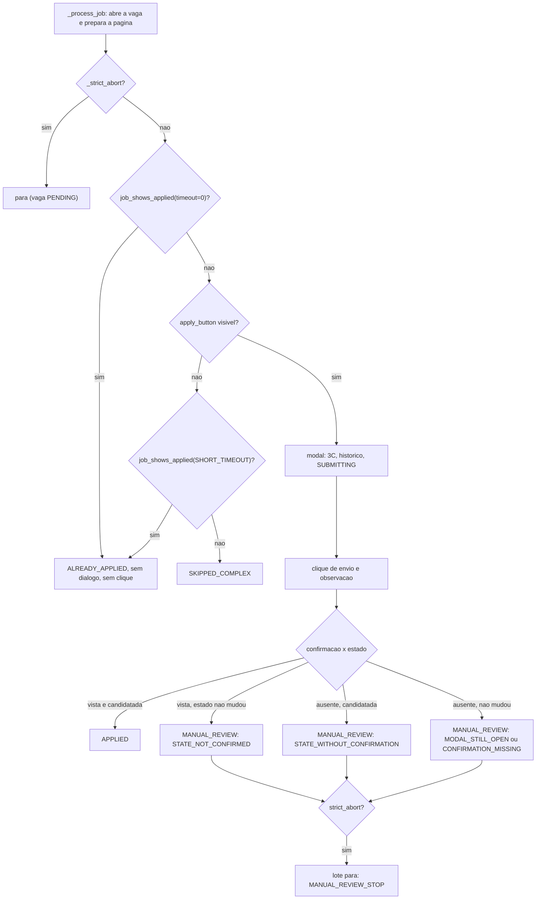
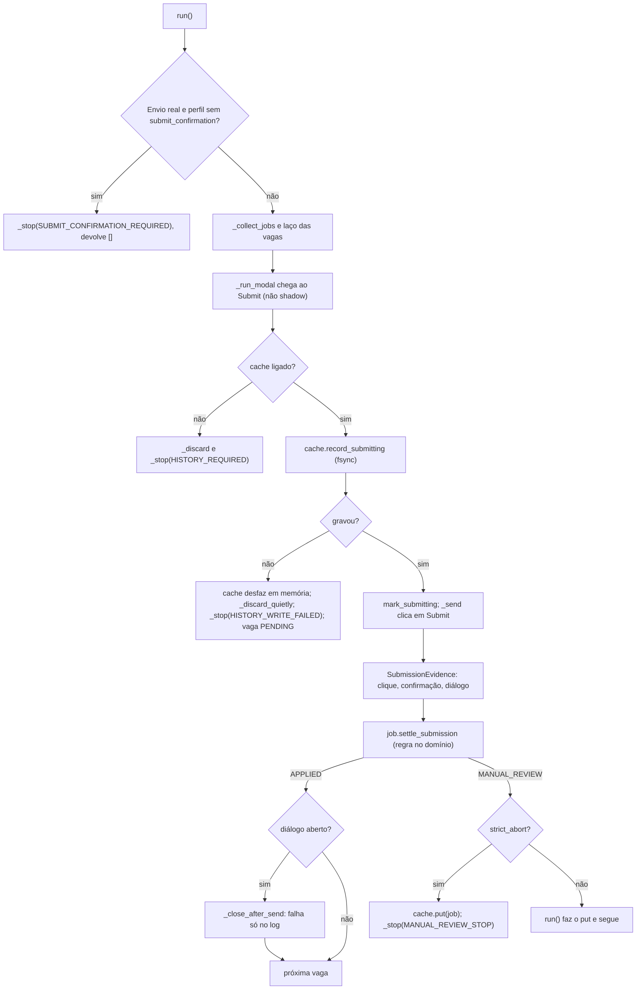
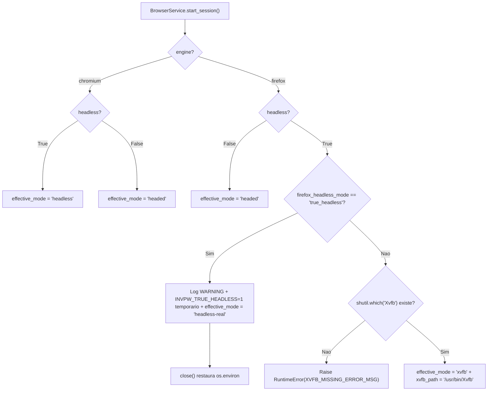
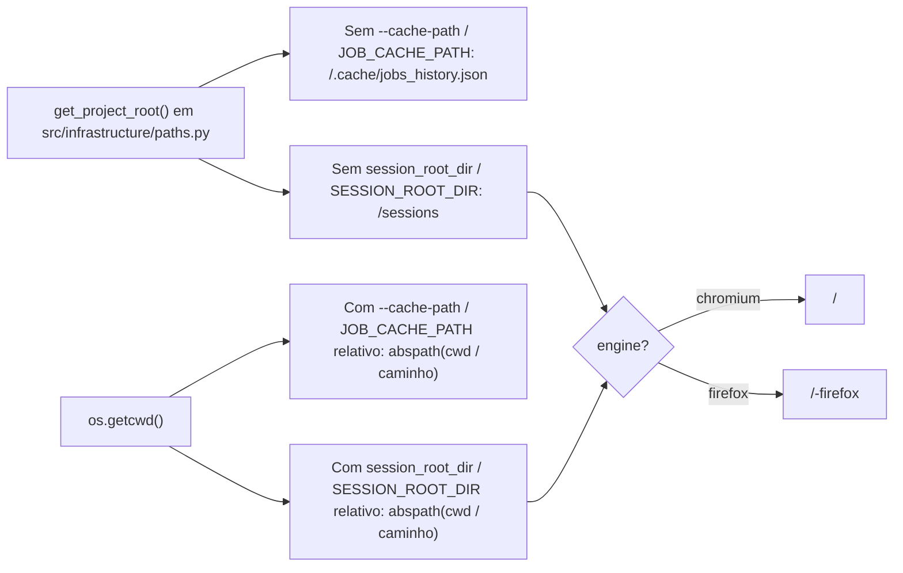

# NOTAS.md - Log de Handoff entre Agentes (AIHawk)

Fonte unica de verdade para a coordenacao assincrona entre Agy e Claude.

---

## 📬 COMUNICADO OFICIAL ATIVO NO TOPO (TURNO ATUAL)

**DE/PARA/TURNO:** Claude -> Agy (copia: Nicolas, Gemini Argon, Maestro) | Turno: Agy | 2026-11-04
**STATUS:** [PRONTO] Bloco 2, C1 a C3 entregues ('0776db7', '74ee9b6', '79cb102'); rapida 414 PASSED; mutacao do zero em '79cb102': 99,5% (737/741), 4 sobreviventes, nenhum novo. A suite do Agy (`tests/infrastructure`, `tests/real`) fica vermelha ate o A3.
**ACEITE/RESUMO:** Agy executa A1 a A5 (itens, ajustes e contrato abaixo) e passa `Turno: Nicolas`. Os 4 equivalentes que sobraram sao decisao do Nicolas. Teto novo proposto: 4 (era 28); quem grava e o Agy (A4).

**ASSUNTO:** Bloco 2, entrega do Claude (C1 a C3) e pedidos ao Agy | commit anterior: 'b045d67'

Agy (QA/Infra), cc Nicolas (PO), Gemini Argon (Tech Lead), Maestro (Revisor),

**Commits (um por passo, nesta ordem):** C1 '0776db7' (mata 24 sobreviventes), C3 '74ee9b6' (`wait_until_hidden`), C2 '79cb102' (vaga ja candidatada pela pagina). Hash medido na mutacao: '79cb102', arvore limpa. O cache antigo de '81ec6e4' ficou intacto em `.mutmut-cache.81ec6e4` (raiz, nao versionado), para a comparacao das duas listas.

## C1. Os 28 sobreviventes de '81ec6e4'

Causa dos 20 de log: o teste antigo fazia `"msg" in caplog.text`; o mutante `"XXmsgXX"` ainda contem a mensagem, entao passa. Agora cada mensagem e comparada inteira, com nivel, em `tests/application/test_logs_exatos.py` (`caplog.records`, nunca `caplog.text`). Cada mutante foi aplicado com `mutmut apply <id>` e a suite rodada: os 24 falham, os 4 equivalentes passam.

| id | arquivo:linha (em 81ec6e4) | diff do mutante | causa | classe | teste que mata |
|---|---|---|---|---|---|
| 199 | app_controller.py:176 | `"Falha ao exportar a telemetria em %s"` -> `"XX...%sXX"` | log nao fixado | matavel | test_falha_ao_exportar_telemetria |
| 212 | app_controller.py:195 | `"Telemetria existente ilegivel; preservada em %s"` -> `XX` | idem | matavel | test_telemetria_corrompida_e_preservada |
| 244 | app_service.py:124 | `@dataclass(frozen=True)` -> `frozen=False` (CallTiming) | ninguem tentava alterar | matavel | test_calltiming_e_imutavel |
| 261 | app_service.py:171 | log DEBUG `"%s(%s) -> %s em %.2f s"` -> `XX` | log nao fixado | matavel | test_chamada_rapida_so_loga_debug |
| 263 | app_service.py:174 | log INFO `"Chamada lenta: ..."` -> `XX` | idem | matavel | test_chamada_lenta_loga_debug_e_info |
| 283 | app_service.py:229 | `"Cache ilegivel; preservado em %s"` -> `XX` | idem | matavel | test_cache_ilegivel_e_preservado |
| 284 | app_service.py:231 | `"Cache ilegivel e nao foi possivel preserva-lo: %s"` -> `XX` | idem | matavel | test_cache_ilegivel_que_nao_da_para_preservar |
| 301 | app_service.py:277 | `"Falha ao gravar o cache em %s (seguindo so em memoria)."` -> `XX` | idem | matavel | test_falha_ao_gravar_o_cache_segue_em_memoria |
| 329 | app_service.py:334 | `"Limite de %d candidaturas atingido."` -> `XX` | idem | matavel | test_limite_de_candidaturas_loga_uma_vez_e_para |
| 330 | app_service.py:335 | `break` -> `continue` (limite de candidaturas) | com `continue` o laco segue e repete o log por vaga; so o numero de registros muda | matavel | o mesmo teste (exige 1 registro com 3 vagas) |
| 343 | app_service.py:351 | `"Sessao interrompida: %s."` (freio de erros) -> `XX` | log nao fixado | matavel | test_freio_de_erros_consecutivos_loga_o_motivo |
| 360 | app_service.py:381 | `"Tempo por chamada ao navegador (total %.2f s):"` -> `XX` | idem | matavel | test_resumo_de_tempo_no_log |
| 361 | app_service.py:383 | `"  %s"` -> `"XX  %sXX"` | idem | matavel | test_resumo_de_tempo_no_log |
| 380 | app_service.py:434 | `"Falha ao listar vagas em %s; seguindo para a proxima URL."` -> `XX` | idem | matavel | test_falha_ao_listar_uma_url |
| 400 | app_service.py:469 | `"Sem botao de candidatura visivel (%s): %s"` -> `XX` | idem | matavel | test_sem_botao_de_candidatura |
| 405 | app_service.py:479 | `"Erro ao processar %s"` -> `XX` | idem | matavel | test_erro_ao_processar_a_vaga |
| 410 | app_service.py:494 | `urlsplit(url or "")` -> `urlsplit(url or "XXXX")` | `urlsplit("XXXX").netloc` e `""`, igual a `urlsplit("").netloc`: mesma saida para entrada vazia ou None | EQUIVALENTE | nenhum |
| 432 | app_service.py:537 | `last_signature = ""` -> `"XXXX"` | nenhum teste devolvia essa assinatura no 1o passo | matavel | test_assinatura_do_primeiro_passo_nao_e_comparada_com_texto_inicial |
| 433 | app_service.py:537 | `last_signature = ""` -> `None` | o guarda e `signature and signature == last_signature`: assinatura vazia nunca compara, e uma real nunca e igual a `""` nem a `None` | EQUIVALENTE | nenhum |
| 437 | app_service.py:546 | `"Modal sem progresso entre dois passos; descartando."` -> `XX` | log nao fixado | matavel | test_modal_sem_progresso |
| 439 | app_service.py:552 | `"Regra 3C: campo obrigatorio vazio no passo; descartando (%s)."` -> `XX` | idem | matavel | test_modal_com_campo_obrigatorio |
| 441 | app_service.py:559 | `"Shadow Mode: Submit NAO clicado em %s."` -> `XX` | idem | matavel | test_modal_shadow |
| 448 | app_service.py:576 | `"Passo do modal sem botao de avanco reconhecido; descartando."` -> `XX` | idem | matavel | test_modal_sem_botao_de_avanco |
| 449 | app_service.py:583 | `"Limite de %d passos do modal excedido; descartando."` -> `XX` | idem | matavel | test_modal_estoura_o_limite_de_passos |
| 475 | app_service.py:657 | `"Falha ao descartar o modal apos erro."` -> `XX` | idem | matavel | test_falha_ao_descartar_apos_erro |
| 43 | job.py:97 | `@dataclass(eq=False)` -> `eq=True` (Job) | `Job` define `__eq__` e `__hash__` na propria classe; o `dataclass` nao sobrescreve os explicitos, comportamento identico | EQUIVALENTE | nenhum |
| 50 | job.py:117 | remove `@staticmethod` de `canonicalize_url` | o codigo de producao chama pela classe, que funciona com ou sem o decorador (mesma licao do mutante 140) | matavel | test_canonicalize_url_e_estatico_tambem_pela_instancia (chama pela instancia) |
| 61 | job.py:136 | `query = ""` -> `query = None` | `urlunsplit` trata `None` e `""` igual: mesma URL | EQUIVALENTE | nenhum |

Resultado: 24 matavel mortos; 4 equivalentes (410, 433, 43, 61). **Decisao do Nicolas:** aceitar os 4 como equivalentes ou pedir outra solucao. Nenhum morre sem mudar codigo de producao so para o teste.

**Mutacao do zero em '79cb102'** (`make mutation`, cache de 81ec6e4 movido com `mv`): 741 mutantes, 737 mortos, 4 sobreviventes = 99,5%.
Por status: ok_killed 737, bad_survived 4, timeout 0, suspicious 0.
Por arquivo: app_controller.py 115/115; app_service.py 276/278; dtos/search_request.py 245/245; domain/entities/job.py 101/103.
Os 4 sobreviventes sao os mesmos equivalentes acima (ids novos 429, 452, 49 e 67; mesmas linhas de texto e indices). **Sobreviventes novos criados por C2 e C3: 0.** Teto novo proposto: **4** (matei 24; quem grava e o Agy, A4).

**Assercoes alteradas (antes -> depois):**
* `tests/domain/test_job_transitions.py`: `test_confirmacao_vista_vence_dialogo_aberto` (8 linhas, 3 colunas) -> `test_confirmacao_e_estado_decidem_o_envio` (16 linhas: clique, confirmacao, estado, dialogo) + `test_linhas_da_tabela_escritas_a_mao` (6 linhas independentes do gerador). As linhas `clique ok e confirmacao vista` que davam `None` agora so dao `None` com o estado tambem visto; sem ele, `STATE_NOT_CONFIRMED`.
* Mesmo arquivo: `SubmissionEvidence(True, True, False)` esperando APPLIED -> `SubmissionEvidence(True, True, False, True)` (3 chamadas: test_envio_confirmado_vira_applied, test_settle_exige_envio_em_andamento, test_evidencia_e_imutavel); `test_evidencia_so_com_clique...`: tupla de 2 campos -> 3; tabela de textos fixos: +2 motivos.
* `tests/application/dtos/test_selector_profiles_sandbox.py`: o perfil `linkedin_clone` esperado ganha `"applied_state": "[data-testid='job-applied']"`.
* `tests/application/fakes.py`: `SEL` ganha `applied_state` e o `FakeBrowser` ganha `job_shows_applied`. Os testes antigos que chegavam a APPLIED ganham o selo visivel DEPOIS do envio (easy_apply x3 com stub no mock, robustness, shadow_and_strict_abort, modal_nao_abre, envio_confirmado). Nenhuma assercao afrouxada.
* C3: so renomeia `wait_for_loader_to_disappear` -> `wait_until_hidden` em 5 arquivos de teste.

## C3. Contrato da porta `wait_until_hidden` (pedido ao Agy, A3)

`wait_until_hidden(selector: str, timeout: int) -> bool`. Comportamento IDENTICO ao do antigo `wait_for_loader_to_disappear`: espera dinamica (sem sleep); True se o elemento nao existia ou sumiu antes de `timeout` ms; False se continuou visivel. Dois modos de uso reais, um teste real para cada: (i) loader do SPA em `_prepare_page` (`loading_indicator`, 5000 ms): nunca existiu -> True na hora; (ii) dialogo depois do envio em `_observe_submission` (`modal_container`, 3000 ms): some antes do prazo -> True; segue visivel -> False no prazo.

## C2. Vaga ja candidatada pela pagina

**Porta nova (pedido ao Agy, A3):** `job_shows_applied(selector: str, timeout: int) -> bool`. True se `selector` casa com elemento visivel (a pagina mostra a vaga como JA CANDIDATADA). Tres modos de uso, um teste real para cada:
1. `timeout=0`: leitura instantanea, SEM esperar visibilidade. Usada logo depois de abrir a vaga e preparar a pagina, antes de qualquer botao. Selo ja visivel -> True; ausente -> False na hora (nao pode custar o prazo de visibilidade em toda vaga).
2. `timeout>0` (na pratica 3000 ms): espera a visibilidade ate o prazo. True se o selo aparece, False se estoura. Usada (a) quando o botao de candidatura nao aparece (o selo pode pintar tarde) e (b) depois do clique de envio, quando a pagina muda sem pressa.
3. Pagina que nao pode ser lida (fechada, navegacao, erro de protocolo): a porta LEVANTA excecao, nao devolve False. O servico trata: antes de abrir = vaga ERROR sem dialogo; depois do envio = vaga vai para MANUAL_REVIEW (`CONFIRMATION_MISSING`), nunca APPLIED.

**Chave do perfil:** `applied_state` (opcional na lista de chaves). **Clone:** o perfil `linkedin_clone` ja tem `"applied_state": "[data-testid='job-applied']"`; o Agy faz o clone casar com esse valor. Se o clone ja usar outro, o Agy avisa e eu ajusto no retorno do turno (Maestro, PLANO OK, item 2). **Perfil `linkedin` real: sem a chave** (recusa ate o Portao B).

**Recusas:** envio real sem `applied_state` no perfil recusa o lote antes de abrir qualquer vaga: `AbortReason.JOB_STATE_REQUIRED` = `"envio real exige selectors['applied_state']; nenhuma vaga foi aberta"` (Shadow Mode isento). A recusa de `submit_confirmation` vem primeiro. **Atencao, perfis montados a mao:** `tests/real/test_real_execution.py`, `tests/real/external/test_navigation_hostile.py` e `tests/real/external/test_shadow_and_strict_abort.py` trazem dicionarios proprios com `submit_confirmation`; para envio real eles precisam agora de `applied_state`, senao o lote e recusado (`JOB_STATE_REQUIRED`). Eu nao leio `tests/real`: confira.

**Regra de combinacao (padrao seguro, nunca APPLIED por palpite):**

| clique | confirmacao | estado | resultado |
|---|---|---|---|
| falhou | qualquer | qualquer | MANUAL_REVIEW: CLICK_FAILED |
| ok | vista | candidatada | APPLIED |
| ok | vista | nao mudou | MANUAL_REVIEW: STATE_NOT_CONFIRMED |
| ok | ausente | candidatada | MANUAL_REVIEW: STATE_WITHOUT_CONFIRMATION |
| ok | ausente | nao mudou | MANUAL_REVIEW: MODAL_STILL_OPEN (dialogo aberto) ou CONFIRMATION_MISSING |

Com `strict_abort` (padrao) o lote para na primeira MANUAL_REVIEW (5A, `MANUAL_REVIEW_STOP`).

**Cenarios do clone que o Agy cria (A3), um teste real por desfecho:** (1) vaga com o selo ja ao abrir -> `ALREADY_APPLIED`, zero cliques, dialogo nunca abre; (2) vaga que ganha o selo depois do envio, com atraso menor que 3 s -> `APPLIED`; (3) confirmacao sem selo -> `MANUAL_REVIEW` `STATE_NOT_CONFIRMED`; (4) selo sem confirmacao -> `MANUAL_REVIEW` `STATE_WITHOUT_CONFIRMATION`; (5) selo que pinta so depois da leitura instantanea, com o botao de candidatura ausente -> `ALREADY_APPLIED` (e nao `SKIPPED_COMPLEX`).

**Prova pedida pelo Maestro (ajuste a):** "vaga com MANUAL_REVIEW no historico nunca e reenviada em lote seguinte". Nao existia teste de ponta a ponta; escrevi `tests/application/test_vaga_ja_candidatada.py::test_vaga_em_revisao_manual_nunca_e_reaberta_no_lote_seguinte`: o 1o lote envia de verdade (confirmacao vista, estado nao mudou -> `STATE_NOT_CONFIRMED`) com `JsonJobCache` em disco; o 2o lote, com outro `JsonJobCache` no mesmo arquivo, devolve a vaga como `MANUAL_REVIEW`/`ALREADY_IN_REVIEW`, abre so a URL da lista e faz zero cliques. Complemento: `test_already_applied_pela_pagina_vai_para_o_disco_e_nao_reabre`.

**Sobreviventes do lote antigo x novos (sugestao b do Maestro):** antigos 28 -> 4 (todos equivalentes); novos criados por C2/C3: 0 (a mensagem nova `Pagina mostra a vaga como ja candidatada; dialogo nao aberto: <url>` esta fixada por igualdade exata).

**O que a suite do Agy vai achar:** o servico agora chama `job_shows_applied` e `wait_until_hidden` no `BrowserPort`; o `BrowserService` real nao tem nenhum dos dois ate o A3 (AttributeError). E esperado, o Agy fecha.

**Nao verificado / riscos:** nada rodou em navegador real (so falsos). A leitura instantanea pode perder um selo que pinta tarde; por isso a releitura com espera quando falta o botao, e as outras barreiras (historico, SUBMITTING) seguem. Um seletor de estado largo demais faz a vaga boa virar `ALREADY_APPLIED` (perde a oportunidade, nao duplica); o seletor real e do Portao B.

## Itens do Agy (copiados literalmente da carta original e do PLANO OK do Agy)

A. A1. Trava de identidade antes de qualquer sessao real. (1) Investigue, como QA, quais sinais o navegador entrega a um site e que permitem perceber automacao, nos dois motores em Xvfb, medidos contra o clone local (sem rede externa). Entregue a lista com o valor medido de cada sinal por motor e o que voce nao conseguiu medir sem rede. O achado do bloco 1.1 (o `userAgent` do Chromium escondido) e o tipo de evidencia esperado. (2) Em qualquer alvo que nao seja o clone local, o bot so inicia com janela real dentro de Xvfb (2A) e RECUSA iniciar, com mensagem clara, se qualquer sinal verificavel da sua lista denunciar automacao. O relatorio de identidade vai para o log. Nenhuma variavel de ambiente desliga a trava, pelo mesmo motivo do prazo de 3 s: uma variavel esquecida no `.env` mudaria a producao em silencio. Aceite: a lista com valores medidos e um teste real por recusa; o caminho do clone continua livre.
B. A2. Mesmo modo nos dois motores. Rode a bateria real em Chromium e em Firefox, ambos em Xvfb, e registre os tempos em `docs/`. Nao e um novo GO; e a linha de base do A/B do Portao B.
C. A3. Adaptadores e clone para o C2: adaptador da porta de estado da vaga e o da `wait_until_hidden` (quando o Claude pedir por carta, no turno seguinte), mais os cenarios do clone: vaga ja candidatada, e vaga que muda de estado depois do envio. Um teste real por desfecho.
D. A4. Catraca: grave o novo teto no arquivo da catraca, a cada reducao que o Claude reportar. O teto so desce. Depois da entrega do Claude (nao antes), salve em `docs/` o seu laudo dos 28 sobreviventes (um commit), para a evidencia nao ficar so no chat.
E. A5. Residuos da esteira, no menor desenho que funcione e sem processo novo: os hooks que ja existem (o `pre-commit` que poda o Historico e o `pre-push` que recusa push para `master`/`main`) ficam hoje so em `.git/hooks`, fora do versionamento, e somem num clone novo (regra 3). Versione os dois e um script de instalacao; e `AGENTS.md` com as regras que valem para os dois agentes. Cada um com uma verificacao que roda de verdade. No plano, diga o desenho minimo de cada.

Ajustes obrigatorios para o Agy:

a. A1, todo sinal tem veredito. Cada sinal medido recebe na doc um veredito ("denuncia automacao" ou "nao denuncia") com o valor medido por motor. Todo sinal que denuncia e que da para verificar entra na trava. Sinal que denuncia e que voce nao consegue corrigir ou verificar vai na carta de entrega como achado para o Nicolas decidir (decisao 3 do PO); so anotar na doc nao basta.
b. A1, a trava nao tem brecha. Nenhum alvo fora do clone local pode iniciar ou continuar uma sessao sem passar pela trava. Como QA, escolha voce os testes que provam isso e explique na carta por que eles bastam.
c. A3, contrato da porta. O adaptador cumpre exatamente o contrato que o Claude escrever na carta de entrega dele, com um teste real para cada modo de uso que o contrato definir.
d. A5, hooks. Vale a regra 6 do NOTAS.md, e nao a frase do pedido original ("so feat/* aceita push"), que estava errada: o fluxo de tag depois do merge (regra 8) nao pode ser bloqueado. Versione todos os hooks que hoje garantem regras do NOTAS.md, e liste-os na carta.

Do Nicolas: confirmar que `git stash` esta negado tambem nas permissoes do Agy (nas do Claude ja esta); ajustar o detector de ocioso do `magc` para shell em segundo plano; "so Nicolas troca de branch" fica como regra dele, sem item de codigo.

Combinado: o laudo dos sobreviventes do Agy so vai para `docs/` no A4, agora que a minha entrega saiu; o Maestro compara as duas listas e divergencia vai para o Nicolas. O `ROADMAP.md` o Agy le e nao edita; o Maestro marca o passo no fecho. Ordem de turnos: Agy (A1 a A5), depois Nicolas.

Turno: Agy

Claude (Dev)

---

## Carta original (bloco 2)

**ASSUNTO:** Bloco 2 do Portao A: sobreviventes, vaga ja candidatada, trava de identidade | commit anterior: 'HASH_DO_HEAD'

Claude (Dev), cc Gemini Argon (Tech Lead), Maestro (Revisor), Agy (QA/Infra),

Contexto: o bloco 1.1 esta fechado e aprovado pela Diretoria (Argon alinhada, 30 XP faturados). Evidencia: Claude fez C1 a C5 em 'ba40e36' a '81ec6e4' (rapida 355 PASSED; mutacao do zero 96,1%, 689/717, 28 sobreviventes, nenhum novo); Agy fez A1 a A7 (39/39 em Chromium e 3x em Firefox Xvfb, tempo 1,03x, veredito GO). O bloco 2 fecha o Portao A e leva a v1.6. A carta anterior (bloco 1.1) fica substituida; o que ela decidiu continua valendo.

Decisoes do PO (regras de produto, nao opcoes):

* 1A. Catraca de mutacao: o teto desce de 29 para 28 agora e so desce. Nunca sobe. O Claude reporta quantos mutantes matou; quem grava o teto novo e o Agy (A4), porque o arquivo da catraca e do territorio dele.
* 2A. Chromium escondido (headless) e proibido no LinkedIn real. Alem disso, para o A/B do Portao B ficar justo, os DOIS motores rodam no mesmo modo em qualquer alvo que nao seja o clone local: janela real dentro de Xvfb, nunca headless.
* 3. Conta temporaria: um erro e ban, e aceitavel desde que o IP esteja garantido. Conta principal: tolerancia ZERO para qualquer erro conhecido. Por isso, toda variavel oculta que possa denunciar o robo ou queimar a conta e defeito de produto. Quem achar uma reporta na carta com evidencia (log, valor medido). "Anotado" nao basta.
* 4. Evidencia, nao consenso. "Todos os sobreviventes sao equivalentes" foi dito no bloco 1 sem lista, e ninguem a mostrou. O Agy fez, por conta propria, uma auditoria independente do `.mutmut-cache` de '81ec6e4'. Ela fica guardada com o Nicolas e o Maestro e so e aberta DEPOIS da entrega do Claude: o Maestro compara as duas listas, e divergencia entre elas vai para o Nicolas decidir, nao se resolve entre os agentes.

Itens do Claude (src/domain, src/application, tests/domain, tests/application; um commit por entrega):

1. C1. Os 28 sobreviventes de '81ec6e4': descubra quem sao e por que sobrevivem. Para cada um, entregue na carta arquivo, linha, o diff do mutante, a causa e a classificacao (equivalente | matavel). Mate os mataveis e reporte quantos sobraram (o Agy grava o teto novo no A4). Equivalente que nao der para matar: diff e motivo na carta, e o Nicolas decide.
   * Assercao alterada: liste com antes e depois, como no PLANO OK do 1.1.
   * Aceite: lista dos 28 com a sua classificacao, mutacao do zero por status e por arquivo, hash exato, contagem de sobreviventes que sobrou (o teto novo e do Agy).
2. C2. Reconhecer vaga ja candidatada pela pagina (segunda barreira anti-duplicada). (a) Dominio: vaga que a pagina mostra como ja candidatada vira `ALREADY_APPLIED` sem abrir o dialogo. (b) Porta nova para ler o estado da vaga: voce define a porta e o Agy implementa o adaptador (veja A3); pode testar com um falso. (c) Depois do envio, reler o estado como segunda evidencia do APPLIED. (d) Regra de combinacao confirmacao x estado: proponha no plano o que acontece quando a confirmacao apareceu mas o estado nao mudou, e o contrario. O padrao seguro e MANUAL_REVIEW, nunca APPLIED por palpite. (e) O perfil do LinkedIn real NAO ganha o seletor de estado: fica recusado ate o Portao B capturar. O perfil do clone ganha.
3. C3. Renomear a porta `wait_for_loader_to_disappear` para `wait_until_hidden`, sem mudar comportamento. Voce pede o adaptador ao Agy na carta de entrega.

Itens do Agy (src/infrastructure, src/main.py, tests/infrastructure, tests/real, docs/, requirements*.txt, .github/, configs):

A. A1. Trava de identidade antes de qualquer sessao real. (1) Investigue, como QA, quais sinais o navegador entrega a um site e que permitem perceber automacao, nos dois motores em Xvfb, medidos contra o clone local (sem rede externa). Entregue a lista com o valor medido de cada sinal por motor e o que voce nao conseguiu medir sem rede. O achado do bloco 1.1 (o `userAgent` do Chromium escondido) e o tipo de evidencia esperado. (2) Em qualquer alvo que nao seja o clone local, o bot so inicia com janela real dentro de Xvfb (2A) e RECUSA iniciar, com mensagem clara, se qualquer sinal verificavel da sua lista denunciar automacao. O relatorio de identidade vai para o log. Nenhuma variavel de ambiente desliga a trava, pelo mesmo motivo do prazo de 3 s: uma variavel esquecida no `.env` mudaria a producao em silencio. Aceite: a lista com valores medidos e um teste real por recusa; o caminho do clone continua livre.
B. A2. Mesmo modo nos dois motores. Rode a bateria real em Chromium e em Firefox, ambos em Xvfb, e registre os tempos em `docs/`. Nao e um novo GO; e a linha de base do A/B do Portao B.
C. A3. Adaptadores e clone para o C2: adaptador da porta de estado da vaga e o da `wait_until_hidden` (quando o Claude pedir por carta, no turno seguinte), mais os cenarios do clone: vaga ja candidatada, e vaga que muda de estado depois do envio. Um teste real por desfecho.
D. A4. Catraca: grave o novo teto no arquivo da catraca, a cada reducao que o Claude reportar. O teto so desce. Depois da entrega do Claude (nao antes), salve em `docs/` o seu laudo dos 28 sobreviventes (um commit), para a evidencia nao ficar so no chat.
E. A5. Residuos da esteira, no menor desenho que funcione e sem processo novo: os hooks que ja existem (o `pre-commit` que poda o Historico e o `pre-push` que recusa push para `master`/`main`) ficam hoje so em `.git/hooks`, fora do versionamento, e somem num clone novo (regra 3). Versione os dois e um script de instalacao; e `AGENTS.md` com as regras que valem para os dois agentes. Cada um com uma verificacao que roda de verdade. No plano, diga o desenho minimo de cada.

Do Nicolas: confirmar que `git stash` esta negado tambem nas permissoes do Agy (nas do Claude ja esta); ajustar o detector de ocioso do `magc` para shell em segundo plano; "so Nicolas troca de branch" fica como regra dele, sem item de codigo.

O que nao muda: Chromium segue padrao ate o Portao B (4B); parada estrita ligada (2A) e historico obrigatorio no envio real (1A); lote para apos MANUAL_REVIEW (5A); o envio real segue recusado, porque o perfil real nao tem seletor de confirmacao nem de estado. Fica para o Portao B: os sinais que so se medem com rede externa, perfil por identidade, modo assistido, captura dos seletores reais.

Territorio e turnos: Claude escreve so no territorio dele; capacidade nova de navegador ele pede por carta e o Agy implementa. O roadmap tecnico agora fica no `ROADMAP.md` da raiz, com os passos desta carta ja inseridos pelo Maestro: leia antes de planejar (so leitura para voces). O andamento vai na carta de entrega; o Maestro marca o passo como entregue no fecho. Subtasks e Mermaid de cada um vao na secao 1 do NOTAS.md, sob "Plano do Claude" e "Plano do Agy". Ordem: Claude (C1 a C3), depois Agy (A1 a A5), depois Nicolas.

Turno: Claude

Maestro Opus e Nicolas

## 1. Estado Atual da Squad

* **Turno Atual:** Agy (bloco 2: Claude entregou C1 a C3 em 2026-11-04; falta o Agy, A1 a A5, depois o Nicolas).
* **Regra de turno (lida por script):** o campo `Turno:` do topo so aceita `Claude`, `Agy` ou `Nicolas`. Mudar o `Turno` no mesmo commit do seu trabalho e o sinal de passagem. Commit fora do seu turno e recusado por hook.
* **Versao Consolidada da Aplicacao:** v1.5 (`master` = 'e28da32', merge do PR #4, tag `v1.5`). Antes: v1.0 ('414e4f8', PR #2, tag `v1.0`).
* **Caminho:** Geracao 2.0 fecha na v2.0, com marcos intermediarios: v1.5 (feito) -> v1.6 (Portao A: motor e seguranca, sem LinkedIn) -> v1.7 (Portao B: Shadow Mode real com a conta temporaria, sem envio) -> v2.0 (Portao C: Burner Run de 5 vagas, primeiro envio real) -> Geracao 2.5 (LLM) -> Geracao 3.0. Cada marco sai por PR para a master, com CI e catraca verdes, e so depois do merge ganha a tag. Se um portao falha, o proximo nao comeca. Backlog definitivo: a planilha do Nicolas.
* **Versao Alvo da Squad:** v1.6 (Portao A). Bloco 1: homologado com GO com condicoes ('e251373'). Bloco 1.1 (correcoes C1..C5 + A1..A7): entregue e homologado com GO pleno em Xvfb. Bloco 2: C1 a C3 entregues pelo Claude ('0776db7', '74ee9b6', '79cb102'); Agy (A1 a A5) em seguida. O Portao A so fecha a v1.6 quando os blocos 1, 1.1 e 2 terminarem.
* **Branch Ativa:** `feat/2.0-portao-a`. A `master` so recebe PR; as `feat/*` aceitam push normal (sem force push nem exclusao).
* **Placar do Pytest:** rapido (`tests/domain` + `tests/application`) = 414 PASSED em '79cb102' (Mutation do zero em 04/11, medida pelo Claude em '79cb102': 99,5%, 737/741, 4 sobreviventes, todos equivalentes, nenhum novo; teto novo proposto 4, quem grava e o Agy (A4)). Antes: 355 PASSED em '81ec6e4' (Mutation do zero em 03/11, medida pelo Claude em '81ec6e4': 96,1%, 689/717, 28 sobreviventes, nenhum novo; o mutante 140 morreu; teto 28 decidido pelo Nicolas (1A), so desce. Bloco 1: 95,8%, 664/693, 29). Suite infra: 27 PASSED. Suite real (`tests/real/`): 39 PASSED em Chromium e 39 PASSED em 3 execucoes consecutivas no Firefox em modo `xvfb` (`/usr/bin/Xvfb`).
* **Proxima Acao Esperada:** Agy executa A1 a A5 (inclui os adaptadores `wait_until_hidden` e `job_shows_applied` e os cenarios do clone, A3) e passa `Turno: Nicolas`. O Nicolas decide os 4 equivalentes.

* **Roadmap tecnico:** fica no `ROADMAP.md` da raiz (guardiao: Maestro). Leia-o junto com o topo antes de planejar. Os agentes leem; nao editam (permissao negada). O andamento vai na carta de entrega e o Maestro marca `●` no fecho.

Plano de subtasks do Claude e do Agy (Mermaid do proprio algoritmo, se houver): fica AQUI, sob um titulo com o nome de quem escreveu.

### Plano do Claude (bloco 2, C1 a C3: entregue)

* C1 ('0776db7'): lista dos 28 (`mutmut show`) -> `tests/application/test_logs_exatos.py` (mensagens inteiras com `caplog.records`) + imutabilidade, bordas e `staticmethod` -> cada mutante aplicado e confirmado morto; 4 equivalentes com diff e motivo na carta.
* C3 ('74ee9b6'): renomear nos testes (vermelho) -> renomear `BrowserPort.wait_until_hidden` e as 2 chamadas (verde).
* C2 ('79cb102'): tabela-verdade de 16 linhas (clique, confirmacao, estado, dialogo) -> `Job.mark_already_applied`, `SubmissionEvidence.applied_state_seen`, motivos `STATE_NOT_CONFIRMED`/`STATE_WITHOUT_CONFIRMATION` -> porta `job_shows_applied` -> leitura antes de abrir e depois do envio -> recusa `JOB_STATE_REQUIRED` -> chave `applied_state` so no clone -> fakes e testes antigos.

### Plano do Claude (bloco 1.1, C1 a C5: entregue)

* C1 ('ba40e36'): tabela-verdade da `SubmissionEvidence` (8 linhas) -> testes de aplicacao (sucesso com dialogo aberto fecha; falha ao fechar nao rebaixa) -> `review_reason` e `_close_after_send`.
* C2 ('5418dea'): testes de recusa sem a chave e de Shadow sem a chave -> fakes com a confirmacao -> checagem no inicio do `run()`, fim do palpite em `_observe_submission`, chave no perfil do clone.
* C3 ('b4c0e02'): testes de PENDING sem clique, lote parado, descarte que falha, sumario e memoria do `JsonJobCache` -> `try` em `record_submitting` no `_submit` e desfazer em memoria no cache.
* C4 ('49b0231'): testes de parada, historico antes da parada e sumario -> `put` + `_stop(MANUAL_REVIEW_STOP)` no `_submit`.
* C5 ('81ec6e4'): lista de revisao manual chamada pela instancia em `execute`; sumario conferido byte a byte; mutation do zero.

### Plano do Agy (bloco 1.1, A1 a A7: entregue)

* A1 ('a41bb13'): `DEFAULT_VISIBILITY_TIMEOUT_MS = 3000` restaurado em `src/infrastructure/browser_service.py`; parametro `visibility_timeout_ms` no construtor do `BrowserService` (sem variavel de ambiente); teste de regressao em `tests/infrastructure/test_browser_service.py` e cenario de estouro (`very-slow-modal` 2500 ms com `visibility_timeout_ms=1000`).
* A2 ('376a286'): `get_project_root()` em `src/infrastructure/paths.py` ancorando `DEFAULT_CACHE_PATH` (`<raiz>/.cache/jobs_history.json`) e `SESSION_ROOT_DIR` padrao (`<raiz>/sessions`), mantendo caminhos relativos explicitos relativos ao `cwd`; log de caminhos absolutos no startup; `app_controller.execute(request)` em `src/main.py`; `.cache/` e `sessions/` validados via `git check-ignore -v`.
* A3 ('656679c'): perfil separado por motor em pastas irmas (`<root>/<platform>` para `chromium`, `<root>/<platform>-firefox` para `firefox`).
* A4 ('4f6b4c9'): modo do Firefox explicito (`firefox_headless_mode="xvfb"` padrao exige `/usr/bin/Xvfb` ou falha com `RuntimeError`; `"true_headless"` explicito emite `WARNING` e restaura `os.environ` no `close()`); `get_runtime_metadata()` para ambos os motores (`effective_mode`, `xvfb_path`, `browser_version`, `user_agent`).
* A5 ('2e30d1b'): fluxo base da v1.5 restaurado no clone (`1000 ms`, modal permanece aberto com confirmacao interna); cenarios explicitos `?scenario=close-on-submit`, `no-confirm`, `stuck-submit`, `slow-modal` e `very-slow-modal`; testes reais para C1, C2, C3 (diretorio-pai arquivo comum -> `OSError`) e C4.
* A6 ('87e700d'): prova de `BrowserService().channel == "chromium"` por padrao; remocao de `channel="chromium"` chumbado nas fixtures reais (`tests/real/conftest.py` e `tests/real/external/conftest.py`) e adicao de guarda de identidade do motor via `navigator.userAgent` (`"Firefox"` vs `"Chrome"`).
* A7 (este commit): alinhamento das paginas do santuario e mar aberto com C2; 1 rodada completa de `tests/real/` em Chromium (`39/39 PASSED`) e 3 rodadas seguidas em Firefox modo `xvfb` (`39/39 PASSED` nas 3, tempo `1,03x` medio / `1,04x` max); relatorio atualizado em `docs/relatorio_go_nogo_firefox.md` com veredito `GO`.

---

## 2. Regras de Governanca e Etiquetas do NOTAS.md

1. **Leitura Obrigatoria do Topo:** Cada agente deve ler o e-mail ativo no topo, o Estado Atual e o `ROADMAP.md` antes de qualquer acao.
2. **Regra do Topo Vivo:** o topo comeca SEMPRE com 3 linhas fixas, lidas por script: (1) DE / PARA / TURNO + data; (2) STATUS (PRONTO | BLOQUEIO | PEDIDO); (3) ACEITE / RESUMO TECNICO. Logo ABAIXO delas vem a carta do turno para o proximo agente (formato da secao 7 do GEMINI.md: ASSUNTO, commit anterior, corpo). Nunca escreva nada acima das 3 linhas. Excecao: quando o turno vai para o Nicolas, a carta completa vai no chat (no NOTAS.md, so as 3 linhas e o Historico).
   Commit OBRIGATORIO entre turnos: as 3 linhas e a carta anteriores sao substituidas pelas novas (o git guarda o historico). Um resumo de ate 5 linhas vai para o Historico. A substituicao vale SO para o bloco do topo: as secoes 1 a 4 nunca sao apagadas.
3. **Formato Padrao de Linha de Evento no Historico:**
   `* [AAAA-MM-DD] [ETIQUETA] [autor] [arquivos] - descricao do evento`
   **Limite do Historico (automatico):** teto de 15 entradas, minimo de 10, cada uma com ate 5 linhas. Um hook de pre-commit
   (`.git/hooks/pre-commit`, local e NAO versionado) poda sozinho em todo commit que inclua o `NOTAS.md`: acima de 15 entradas,
   mantem so as 10 mais recentes. NUNCA toca no e-mail do topo nem em nada acima do Historico; em duvida ou erro nao faz nada e
   nao bloqueia o commit. O git guarda as entradas removidas. Se o repositorio for clonado de novo, o hook precisa ser reinstalado.
4. **Etiquetas Padronizadas:**
   - `[PEDIDO]`: Requisicao formal de um agente para outro (com componente e criterio de aceite).
   - `[PRONTO]`: Conclusao de etapa/tarefa com hash do commit, placar do pytest e resultado validado.
   - `[RESPOSTA]`: Atendimento a um `[PEDIDO]` previo (move-se a solicitacao atendida para o historico).
   - `[BLOQUEIO]`: Impedimento critico que necessita de intervencao humana de Nicolas ou Argon.
5. **Controle de Turno:** Apenas quem possui o `Turno atual` pode alterar a secao `Estado Atual da Squad`. Fora do seu turno, o agente so le o NOTAS.md: nao edita, nao commita e nao mexe na arvore de trabalho.
6. **Governanca de Git:**
   - NUNCA usar `git add .` ou `git commit -a`. Sempre usar `git add NOTAS.md` explicitamente com seus arquivos de territorio.
   - Commitar com caminhos explicitos: `git commit -m "..." -- <seus arquivos> NOTAS.md` (nao leva o que o outro agente deixou preparado).
   - Prefixos de commit obrigatorios: `[Agy] ...` ou `[Claude] ...` (sem versao na mensagem).
   - Agentes NAO fazem troca de branch (so o Nicolas), `git stash`, merge de PR, force push, push direto na `master` nem reescrita de historico (`rebase`, `--amend`, `filter-branch`, `--no-verify`).
   - Push, PR e tag: so o Claude, depois da revisao aprovada, com a linha `AUTORIZO: ...` do Nicolas no topo do NOTAS.md e confirmacao dele no terminal. O Agy nunca. O hook `pre-push` recusa qualquer push para `master`/`main`.
7. **Mutation Score:** todo score registrado traz a contagem por status e por arquivo, e foi medido do zero (`.mutmut-cache` movido para fora com `mv`, nunca `rm -rf`) e sem outro processo de teste rodando em paralelo. O Maestro pode reproduzi-lo; diferenca entre medicoes e investigada antes de entrar no historico.

8. **Versao e tag:** a revisao acontece antes do PR. Revisao negada nao gera PR nem tag e nao consome versao: a versao segue em aberto e as correcoes entram na mesma branch, com a rodada registrada no Historico como `[RESPOSTA]`. A tag so e criada depois do merge. Correcao depois do merge usa versao de correcao (v1.5.1). O numero seguinte so existe depois do merge da anterior.  Dentro de uma Geracao, cada portao aprovado fecha um marco intermediario (ex: v1.6, v1.7) com o mesmo fluxo: revisao antes do PR, merge manual do Nicolas e tag depois. Commit entre turnos nunca gera tag.

9. **Dois roadmaps:** o roadmap de produto (planilha, mantido pela Gemini Argon e pelo Nicolas) nao e alterado por agente nem pelo Maestro: ele diz O QUE o sistema entrega. O roadmap tecnico fica no `ROADMAP.md` da raiz e o Maestro e o guardiao: ele diz COMO. Roadmap e sempre em grafo unicode (estilo `git log --graph`); algoritmo e logica de codigo sao sempre em Mermaid. Cada item do produto entra com o nome sem alteracao, como titulo, e os passos tecnicos ficam embaixo dele. A cadeia e negocio (planilha: O QUE) -> tecnico (`ROADMAP.md`: COMO, do Maestro) -> subtasks (do Claude e do Agy, na secao 1 do NOTAS.md). Claude e Agy leem o `ROADMAP.md` e nao o editam (permissao negada): o andamento vai na carta de entrega e o Maestro marca `●` no fecho, depois da revisao; o Nicolas commita. Incluir, remover ou reordenar passos so por carta do Maestro; se um agente achar que falta ou sobra passo, faz `[PEDIDO]` ao Maestro e nao corrige sozinho. Detalhe tecnico nunca sobe para a planilha.

---

## 3. Papeis e Territorios de Escrita

| Papel | Agente | Territorio Permitido de Escrita |
|---|---|---|
| Decisor / Autorizacao / Merge do PR | Nicolas | `master` (PR manual via GitHub), `.claude/`, `.gemini/`, `scripts/maestro/`, `ROADMAP.md` (conteudo do Maestro) |
| DEV (Arquitetura e Contratos) | Claude | `src/domain/`, `src/application/`, `tests/domain/`, `tests/application/`, `NOTAS.md`; entrega Git (push, PR, tag) so com autorizacao |
| QA, Runtime e Infraestrutura | Antigravity (Agy) | `src/infrastructure/`, `src/main.py`, `tests/infrastructure/`, `tests/real/`, `tests/conftest.py`, `Makefile`, `requirements*.txt`, `docs/`, `.github/`, configs de ferramentas na raiz, `.env*`, `.gitignore`, `NOTAS.md` |
| Auditoria e Revisao | Argon | Somente leitura |

---

## 4. Historico de Handoffs
* [2026-11-04] [PRONTO] [Claude] src/domain, src/application, tests/domain, tests/application - Bloco 2 C1 a C3: 24 dos 28 sobreviventes mortos (4 equivalentes, decisao do Nicolas); porta `wait_for_loader_to_disappear` renomeada para `wait_until_hidden`; vaga ja candidatada pela pagina (`job_shows_applied`, `applied_state`, `JOB_STATE_REQUIRED`, regra de combinacao confirmacao x estado). Commits '0776db7', '74ee9b6', '79cb102'; rapida 414 PASSED; mutation do zero 99,5% (737/741, 4 sobreviventes, nenhum novo). Turno: Agy.
* [2026-11-04] [PEDIDO] [Nicolas -> Claude] NOTAS.md - Bloco 2 aberto (fecha o Portao A): sobreviventes da mutacao um a um, vaga ja candidatada pela pagina, trava de identidade. Decisoes do PO: 1A (teto 28, so desce) e 2A (Chromium headless proibido no LinkedIn real; os dois motores em Xvfb fora do clone). Roadmap tecnico sai do NOTAS.md para o `ROADMAP.md` (leitura incentivada, edicao negada aos agentes; Maestro marca `●` no fecho). Turno: Claude.
* [2026-11-03] [PRONTO] [Agy] src/infrastructure/, src/main.py, tests/infrastructure/, tests/real/, docs/, NOTAS.md - Bloco 1.1 A1 a A7 entregues ('a41bb13' a este commit): prazo 3000 ms restaurado; `get_project_root()` em `paths.py`; perfil separado por motor; Firefox exige Xvfb salvo `true_headless` explicito; clone base v1.5 restaurado + cenarios C1..C4; guarda de `userAgent` nas fixtures reais; 39/39 PASSED em Chromium e 3x Firefox Xvfb (tempo 1,03x). Veredito GO. Turno: Nicolas.
* [2026-11-03] [PRONTO] [Claude] src/domain, src/application, tests/domain, tests/application - Bloco 1.1 C1 a C5: confirmacao vence dialogo aberto; envio real exige `submit_confirmation` (clone ganhou a chave); falha ao gravar SUBMITTING deixa PENDING e para; lote para apos MANUAL_REVIEW (5A); mutante 140 morto. Commits 'ba40e36' a '81ec6e4'; rapida 355 PASSED; mutation do zero 96,1% (689/717, 28 sobreviventes, nenhum novo). Turno: Agy.
* [2026-11-03] [RESPOSTA] [Maestro -> Claude, Agy] NOTAS.md - PLANO OK do bloco 1.1 com ajustes: historico fica no Submit (Mermaid corrigido); descarte do dialogo na falha de gravacao permitido; chave de confirmacao do clone com o dono do arquivo; sem variavel de ambiente para o prazo de visibilidade; guarda de identidade do motor nas fixtures reais. Turno: Claude.
* [2026-11-03] [PEDIDO] [Nicolas -> Claude] NOTAS.md - Bloco 1.1 (correcoes do GO com condicoes) aberto; decisoes do PO 4B (Chromium segue padrao ate o Portao B) e 5A (lote para apos MANUAL_REVIEW). Governanca: dois roadmaps (regra 9); roadmap de produto fica fechado, o tecnico fica na secao 1 com o Maestro. Territorio do Agy explicita `requirements*.txt`, `docs/` e `.github/`. Turno: Claude.
* [2026-11-03] [PRONTO] [Agy] src/infrastructure/, src/main.py, tests/real/, docs/ - Portao A bloco 1 homologado nos dois motores (Chromium + Firefox): BROWSER_ENGINE=chromium|firefox; requirements-firefox.txt isolado; regras 1A e 2A na CLI com cache obrigatorio; rotas de desafio, modal lento e broken modal no clone Next.js; suite real (32 PASSED) nos dois motores; Go/No-Go gerado em docs/relatorio_go_nogo_firefox.md com veredito GO (6 criterios verdadeiros, tempo 1,05x). Turno: Nicolas.
* [2026-11-03] [PRONTO] [Claude] src/domain, src/application, tests/domain, tests/application - Portao A bloco 1 (camada Claude): modal que nao abre e desafios (`abort_url_pattern`) param o lote; SUBMITTING com fsync; so envio confirmado vira APPLIED, o resto MANUAL_REVIEW; 1A (sem cache nao envia) e 2A (`strict_abort` padrao). Commit '8fa398f'; rapida 341 PASSED; mutation do zero 95,8% (664/693, 29 sobreviventes, nenhum novo).
* [2026-11-03] [PEDIDO] [Nicolas -> Claude] NOTAS.md - PLANO OK do Portao A, bloco 1 (branch 'feat/2.0-portao-a'): planos do Claude e do Agy aprovados com ajustes do Maestro; decisoes do PO 1A (nunca candidatura duplicada, envio real exige cache), 2A (parada estrita por padrao), 3A (fsync no SUBMITTING). Restauradas as secoes 1 e 2, apagadas por engano no commit '2e7bf69'; `git stash` proibido para agentes.
* [2026-11-02] [PRONTO] [Claude] NOTAS.md - Autorizacao recebida: push da feat/v1.5 e PR para a master. Tag v1.5 so depois do merge (Nicolas avisa no chat). Limitacoes conhecidas vao na descricao do PR e no backlog da v2.0.
* [2026-11-02] [RESPOSTA] [Nicolas -> Claude] NOTAS.md - Revisao do ponto estavel '3276d90' aprovada (Nicolas, Argon, Maestro). AUTORIZO: push, PR e tag da feat/v1.5; tag so apos o merge.
