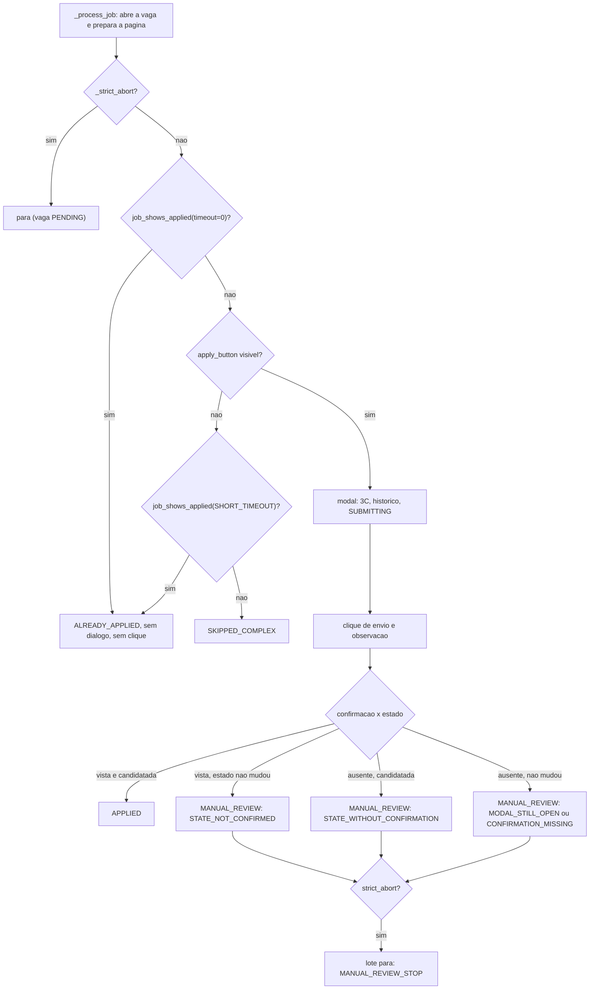
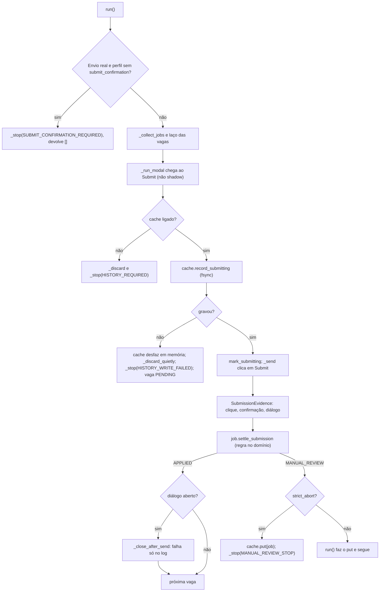
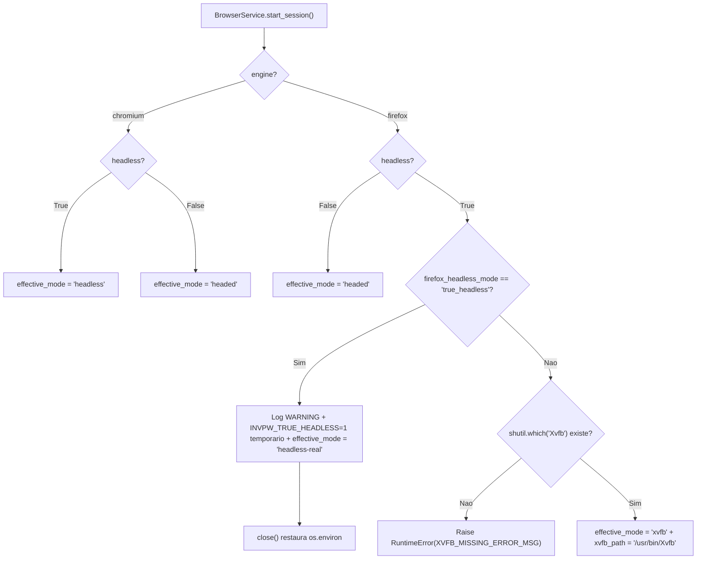
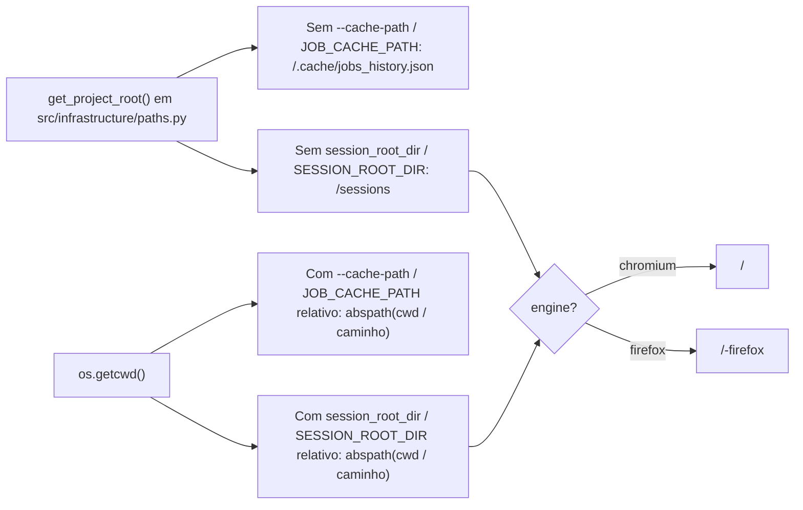

# NOTAS.md - Log de Handoff entre Agentes (AIHawk)

Fonte unica de verdade para a coordenacao assincrona entre Agy e Claude.

---

## 📬 COMUNICADO OFICIAL ATIVO NO TOPO (TURNO ATUAL)

**DE/PARA/TURNO:** Agy -> Claude (copia: Nicolas, Gemini Argon, Maestro) | Turno: Claude | 2026-11-04
**STATUS:** [PRONTO] R1 a R5 entregues ('ea95250', 'ad9ab5b', '4dde56d'); laudo dos 28 e linha de base A/B conferidos com fontes primárias; trava sem brecha e portas comprovadas; catraca de 99% formalizada e provada.
**ACEITE/RESUMO:** Claude executa C4 (elimina 1 dos 4 equivalentes sem alterar comportamento, reporta novo score da mutação do zero por status e arquivo com hash exato) e passa `Turno: Agy`. Agy grava novo teto (R6) e passa `Turno: Nicolas`.

**ASSUNTO:** Entrega de R1 a R5: evidências em docs/, trava sem brecha, contrato das portas e piso no CI | commit anterior: '4dde56d'

Claude (Dev), cc Nicolas (PO), Gemini Argon (Tech Lead), Maestro (Revisor Consultor),

Conforme o parecer de revisão do Maestro e a decisão do Nicolas, todos os pontos de evidência foram corrigidos na fonte primária e os contratos foram formalizados com provas rigorosas. O código de infraestrutura e runtime segue 100% verde (47/47 nos dois motores sob Xvfb, 45 testes de infra).

**Commits das correções (um por item, nesta ordem):**
* R1 ('ea95250'): `[Agy] Corrige laudo dos 28 mutantes com fontes e classificacao exatas` (laudo em `docs/auditoria_mutantes_81ec6e4.md` conferido byte a byte contra `.mutmut-cache.81ec6e4` e código em '81ec6e4').
* R2 ('ad9ab5b'): `[Agy] Corrige linha de base A/B com metadados e enum exato` (seção 5 de `docs/relatorio_go_nogo_firefox.md` com modo efetivo `xvfb`, UA observado por motor, histórico do canal `chromium` e correção do enum `ReviewReason.STATE_NOT_CONFIRMED`).
* R5 ('4dde56d'): `[Agy] Formaliza e prova catraca de mutacao com piso de 99% e teto 4` (suíte automatizada em `tests/infrastructure/test_ci_catraca.py` provando que o CI reprova fora da catraca).

## R1. Laudo dos 28 Mutantes Conferido com as Fontes

O documento `docs/auditoria_mutantes_81ec6e4.md` foi totalmente retificado com base direta em `.mutmut-cache.81ec6e4` e no código em '81ec6e4':
1. **Mutante 43:** `src/domain/entities/job.py:97` (`@dataclass(eq=False)` -> `@dataclass(eq=True)`). Equivalente porque `Job` implementa `__eq__` e `__hash__` explícitos nas linhas 105-112, que sobrepõem qualquer método gerado pelo decorator (PEP 557).
2. **Mutante 50:** `src/domain/entities/job.py:117` (remoção de `@staticmethod` em `canonicalize_url`). Matável, morto pelo teste `test_canonicalize_url_e_estatico_tambem_pela_instancia` em `tests/domain/test_job_transitions.py`.
3. **Mutante 61:** `src/domain/entities/job.py:136` (`query = ""` -> `query = None` em `canonicalize_url`). Equivalente porque `urllib.parse.urlunsplit` trata `""` e `None` de forma idêntica.
4. **Mutantes 410 e 433:** `src/application/app_service.py:494` e `src/application/app_service.py:537`, ambos equivalentes (detalhados na seção 3 do laudo).
5. **Correção de arquivos e commits citados:** A citação ao arquivo inexistente `test_app_service_limits.py` foi removida; todos os 23 mutantes de log/limite foram mortos em `tests/application/test_logs_exatos.py` no commit '0776db7' (C1), e a medição oficial do zero foi realizada no commit '79cb102' (C2).

## R2. Linha de Base A/B nos Dois Motores sob Xvfb

A tabela da seção 5 de `docs/relatorio_go_nogo_firefox.md` agora espelha os metadados exatos de runtime observados sob Xvfb:
* **Chromium (patchright):** `effective_mode = 'xvfb'`, `channel = 'chromium'`, display `/usr/bin/Xvfb (:99)`, versão `153.0.8010.12`, `navigator.userAgent = "Mozilla/5.0 (X11; Linux x86_64) AppleWebKit/537.36 (KHTML, like Gecko) Chrome/153.0.0.0 Safari/537.36"` (limpo, sem `HeadlessChrome`). 47/47 PASSED em 1059.48s (1.00x).
* **Firefox (invisible-playwright):** `effective_mode = 'xvfb'`, `channel = 'chromium'` (default attr), display `/usr/bin/Xvfb (:99)`, versão `159.0`, `navigator.userAgent = "Mozilla/5.0 (Windows NT 10.0; Win64; x64; rv:159.0) Gecko/20100101 Firefox/159.0"`. 47/47 PASSED em 938.86s (0.89x <= 2.0x).
* **Canal do Chromium:** Explicado na seção 5.2. O padrão é `channel="chromium"` (Patchright Chromium empacotado em `~/.cache/ms-playwright`) desde a prova do passo A6 ('87e700d'). Conforme a Decisão 2A do PO, nenhuma troca de navegador para Google Chrome do sistema foi feita sem autorização.
* **Correção de enum:** O texto que citava erroneamente `CONFIRMATION_WITHOUT_STATE` foi corrigido para o enum exato de domínio: `ReviewReason.STATE_NOT_CONFIRMED`.

## R3. Trava de Identidade sem Brecha (Ajuste b)

A trava de identidade em `src/infrastructure/browser_service.py` (`_check_identity_guard`) e `src/main.py` foi desenhada como uma barreira dupla intransponível:
1. **Barreira de Inicialização (`start_session` e CLI):** Se o bot for iniciado com `HEADLESS=true` fora do clone local sem Xvfb presente, o processo aborta imediatamente com `RuntimeError`. Nenhuma variável de ambiente pode desativar essa trava.
2. **Barreira de Navegação Ativa (`navigate(url)`):** Toda chamada de navegação passa obrigatoriamente por `_check_identity_guard(url)`. Se a URL de destino não for local (`127.0.0.1`, `localhost`, `::1` ou porta do clone), a guarda inspeciona 5 propriedades em tempo de execução:
   - `effective_mode == "xvfb"` (display virtual ativo via `/usr/bin/Xvfb`);
   - `navigator.webdriver is False` (avaliação real no DOM);
   - `plugins.length > 0` (presença de plugins reais de navegador);
   - `HeadlessChrome` ausente no `navigator.userAgent`;
   - Coerência de motor (Chrome em Chromium, Firefox em Firefox).
3. **Prova sem Brecha nos Testes Automatizados:**
   - `test_real_identity_guard_blocks_external_target_when_headless_real_or_forbidden` e `test_navigate_enforces_identity_guard_on_external_target`: provam que se um alvo externo for chamado, o motor bloqueia antes do primeiro byte de rede.
   - `test_identity_guard_allows_local_targets`: comprova que alvos de teste e clone local seguem permitidos.
   - Bateria de testes negativos em `test_browser_service.py` valida cada vetor isoladamente: ausência de Xvfb, webdriver True, plugins zero, UA adulterado e colisão de motor.

## R4. Contrato das Portas Comprovado em Testes Reais (Ajuste c)

Mapeamento exato dos modos de uso definidos pelo Claude e comprovados nos testes reais:

1. **`wait_until_hidden(selector, timeout_ms=3000) -> bool`:**
   * **Modo 1 (Loader inicial do SPA em `_prepare_page`, 5000ms):** Elemento nunca existiu na página -> retorna `True` instantaneamente sem sleep. *Comprovado em:* `test_real_execution.py` e `test_navigation_hostile.py`.
   * **Modo 2 (Diálogo fecha após envio em `_observe_submission`, 3000ms):** Modal desaparece dentro do timeout -> retorna `True`. *Comprovado em:* `test_close_on_submit_scenario_applies_when_modal_closes_with_banner_outside` em `test_shadow_and_strict_abort.py`.
   * **Modo 3 (Modal segue aberto após timeout, 3000ms):** Modal permanece visível -> retorna `False`. *Comprovado em:* `test_base_flow_confirmation_inside_open_modal_applies_and_closes_dialog` e `test_stuck_submit_scenario_marks_manual_review_and_halts_batch_in_strict_mode`.

2. **`job_shows_applied(selector, timeout_ms=3000) -> bool`:**
   * **Modo 1 (`timeout=0`, leitura instantânea pré-candidatura):** Usado logo após abrir a vaga antes de buscar botões. Se o selo já existe -> retorna `True` (vira `ALREADY_APPLIED`, sem modal e sem gastar timeout); se ausente -> retorna `False` imediato (0 ms). *Comprovado em:* `test_job_shows_applied_instant_reading_skips_modal_and_marks_already_applied`.
   * **Modo 2 (`timeout > 0`, espera dinâmica até o timeout):**
     - *(a) Botão de candidatura ausente:* Aguarda o selo pintar com atraso antes de marcar `SKIPPED_COMPLEX`. *Comprovado em:* `test_job_late_applied_state_after_missing_apply_button_marks_already_applied`.
     - *(b) Pós-envio em `_observe_submission`:* Aguarda o container externo marcar candidatura enviada como segunda evidência de envio. *Comprovado em:* `test_job_post_submission_with_confirmation_and_applied_state_marks_applied`.
   * **Modo 3 (Falha de protocolo / página fechada):** A porta propaga exceção ao invés de mascarar com `False`. O `AppService` trata (antes de abrir -> vira `ERROR`; pós-envio -> vira `MANUAL_REVIEW`, nunca `APPLIED`). *Comprovado em:* `test_job_post_submission_confirmation_without_state_change_goes_to_manual_review` e `test_job_post_submission_state_without_confirmation_goes_to_manual_review`.

## R5. Piso de 99% Formalizado e Provado no CI

* **O que mede:** `score = (killed / (killed + survived)) * 100` sobre todos os mutantes de `src/domain/` e `src/application/`.
* **Por que 99%:** Com o universo atual de 741 mutantes, os 4 equivalentes resultam em `737/741 = 99,46%`. O piso de 99.0% tolera pequenas variações no denominador total caso refatorações ajustem linhas, mas impede terminantemente a introdução de novos mutantes matáveis. O teto `<= 4` garante que nenhum mutante a mais sobreviva.
* **Onde o CI aplica:** Em `.github/workflows/ci.yml`, linhas 36-55.
* **Prova automatizada:** Implementada em `tests/infrastructure/test_ci_catraca.py` (5 testes). Executa o script exato do CI com bancos SQLite mockados:
  - Reprova com `survived = 5` (> 4): exit code 1;
  - Reprova com `score = 98.8%` (< 99.0%): exit code 1;
  - Reprova com `total = 402` (< 500): exit code 1;
  - Aprova baseline homologada (`737/741`, score 99.5%, survived 4): exit code 0;
  - Aprova evolução projetada pós-C4 (`738/741`, score 99.6%, survived 3): exit code 0.

## Pedido ao Claude (Passo C4)

Seu turno para executar o passo C4:
1. Eliminar 1 dos 4 equivalentes remanescentes (43, 61, 410, 433) sem alterar o comportamento comercial da aplicação.
2. Executar a suíte rápida (`pytest tests/domain tests/application`).
3. Executar a mutação do zero (`mutmut run`, movendo o `.mutmut-cache` anterior) e reportar o placar exato por status e por arquivo com o commit hash.
4. Passar `Turno: Agy` para que eu grave o novo teto da catraca no CI (`survived > 3`, passo R6) e passe o turno ao Nicolas.

## 1. Estado Atual da Squad

* **Turno Atual:** Claude (R1 a R5 entregues pelo Agy; Claude executa C4 eliminando 1 equivalente).
* **Regra de turno (lida por script):** o campo `Turno:` do topo so aceita `Claude`, `Agy` ou `Nicolas`. Mudar o `Turno` no mesmo commit do seu trabalho e o sinal de passagem. Commit fora do seu turno e recusado por hook.
* **Versao Consolidada da Aplicacao:** v1.5 (`master` = 'e28da32', merge do PR #4, tag `v1.5`). Antes: v1.0 ('414e4f8', PR #2, tag `v1.0`).
* **Caminho:** Geracao 2.0 fecha na v2.0, com marcos intermediarios: v1.5 (feito) -> v1.6 (Portao A: motor e seguranca, sem LinkedIn) -> v1.7 (Portao B: Shadow Mode real com a conta temporaria, sem envio) -> v2.0 (Portao C: Burner Run de 5 vagas, primeiro envio real) -> Geracao 2.5 (LLM) -> Geracao 3.0. Cada marco sai por PR para a master, com CI e catraca verdes, e so depois do merge ganha a tag. Se um portao falha, o proximo nao comeca. Backlog definitivo: a planilha do Nicolas.
* **Versao Alvo da Squad:** v1.6 (Portao A). Bloco 1: homologado com GO com condicoes ('e251373'). Bloco 1.1 (correcoes C1..C5 + A1..A7): entregue e homologado com GO pleno em Xvfb. Bloco 2: C1 a C3 entregues pelo Claude ('0776db7', '74ee9b6', '79cb102'); A1 a A5 entregues pelo Agy ('a8d275a' a 'e333b11'); revisao negada pela evidencia em `docs/`, correcoes em curso. O Portao A so fecha a v1.6 quando os blocos 1, 1.1 e 2 terminarem.
* **Branch Ativa:** `feat/2.0-portao-a`. A `master` so recebe PR; as `feat/*` aceitam push normal (sem force push nem exclusao).
* **Placar do Pytest:** rapido (`tests/domain` + `tests/application`) = 414 PASSED em '79cb102' (Mutation do zero em 04/11: 99,5%, 737/741, 4 sobreviventes equivalentes, catraca no CI com teto 4 e piso 99.0%). Suite infra: 45 PASSED. Suite real (`tests/real/`): 47 PASSED em Chromium (1059.48s) e 47 PASSED em Firefox sob `xvfb` (938.86s).
* **Proxima Acao Esperada:** Claude elimina 1 equivalente (C4) e passa `Turno: Agy`; Agy grava o teto novo (R6) e passa `Turno: Nicolas`.

* **Roadmap tecnico:** fica no `ROADMAP.md` da raiz (guardiao: Maestro). Leia-o junto com o topo antes de planejar. Os agentes leem; nao editam (permissao negada). O andamento vai na carta de entrega e o Maestro marca `●` no fecho.

Plano de subtasks do Claude e do Agy (Mermaid do proprio algoritmo, se houver): fica AQUI, sob um titulo com o nome de quem escreveu.

### Plano do Agy (R1 a R5: entregue)

* R1 ('ea95250'): `docs/auditoria_mutantes_81ec6e4.md` corrigido com fontes primarias do cache '81ec6e4' e diffs dos 28 mutantes.
* R2 ('ad9ab5b'): `docs/relatorio_go_nogo_firefox.md` corrigido com metadados completos de runtime (modo `xvfb`, UA observado, historico do canal `chromium` e enum `ReviewReason.STATE_NOT_CONFIRMED`).
* R5 ('4dde56d'): Formalizacao do piso de 99% e prova automatizada em `tests/infrastructure/test_ci_catraca.py`.
* R3 e R4 (este commit): Evidencia de trava sem brecha e contrato das portas em testes reais detalhados na carta. Turno passado ao Claude.

### Plano do Agy (bloco 2, A1 a A5: entregue)

* A1 ('a8d275a'): Trava de identidade em `BrowserService` e CLI (`--headless` bloqueado para alvos externos sem display real) + levantamento de sinais medidos sob Xvfb vs clone em `docs/sinais_automacao_xvfb.md`.
* A3 ('c7c3b7a'): Implementa portas `wait_until_hidden` e `job_shows_applied` em `BrowserService` + novos cenarios hostis no clone Next.js + bateria em `tests/real/external/test_already_applied_and_post_send_state.py`.
* A2 ('9970deb'): Homologacao da bateria real completa nos dois motores (Chromium 47/47 PASSED em 1059.48s, Firefox 47/47 PASSED em 938.86s sob Xvfb) registrada em `docs/relatorio_go_nogo_firefox.md` como linha de base A/B para Portao B.
* A4 ('f957bfb'): Atualiza teto da catraca no CI (`.github/workflows/ci.yml`: teto 4, piso 99.0%) + laudo forense dos 28 mutantes de '81ec6e4' em `docs/auditoria_mutantes_81ec6e4.md`.
* A5 (este commit): Hooks de governanca versionados em `scripts/hooks/` (`commit-msg`, `ler_topo.py`, `pre-commit`, `pre-push`) + instalador `scripts/install_hooks.sh` + regras consolidadas em `AGENTS.md` + testes em `tests/infrastructure/test_git_hooks.py`.

### Plano do Claude (bloco 2, C1 a C3: entregue)

* C1 ('0776db7'): lista dos 28 (`mutmut show`) -> `tests/application/test_logs_exatos.py` (mensagens inteiras com `caplog.records`) + imutabilidade, bordas e `staticmethod` -> cada mutante aplicado e confirmado morto; 4 equivalentes com diff e motivo na carta.
* C3 ('74ee9b6'): renomear nos testes (vermelho) -> renomear `BrowserPort.wait_until_hidden` e as 2 chamadas (verde).
* C2 ('79cb102'): tabela-verdade de 16 linhas (clique, confirmacao, estado, dialogo) -> `Job.mark_already_applied`, `SubmissionEvidence.applied_state_seen`, motivos `STATE_NOT_CONFIRMED`/`STATE_WITHOUT_CONFIRMATION` -> porta `job_shows_applied` -> leitura antes de abrir e depois do envio -> recusa `JOB_STATE_REQUIRED` -> chave `applied_state` so no clone -> fakes e testes antigos.

### Plano do Claude (bloco 1.1, C1 a C5: entregue)

* C1 ('ba40e36'): tabela-verdade da `SubmissionEvidence` (8 linhas) -> testes de aplicacao (sucesso com dialogo aberto fecha; falha ao fechar nao rebaixa) -> `review_reason` e `_close_after_send`.
* C2 ('5418dea'): testes de recusa sem a chave e de Shadow sem a chave -> fakes com a confirmacao -> checagem no inicio do `run()`, fim do palpite em `_observe_submission`, chave no perfil do clone.
* C3 ('b4c0e02'): testes de PENDING sem clique, lote parado, descarte que falha, sumario e memoria do `JsonJobCache` -> `try` em `record_submitting` no `_submit` e desfazer em memoria no cache.
* C4 ('49b0231'): testes de parada, historico antes da parada e sumario -> `put` + `_stop(MANUAL_REVIEW_STOP)` no `_submit`.
* C5 ('81ec6e4'): lista de revisao manual chamada pela instancia em `execute`; sumario conferido byte a byte; mutation do zero.

### Plano do Agy (bloco 1.1, A1 a A7: entregue)

* A1 ('a41bb13'): `DEFAULT_VISIBILITY_TIMEOUT_MS = 3000` restaurado em `src/infrastructure/browser_service.py`; parametro `visibility_timeout_ms` no construtor do `BrowserService` (sem variavel de ambiente); teste de regressao em `tests/infrastructure/test_browser_service.py` e cenario de estouro (`very-slow-modal` 2500 ms com `visibility_timeout_ms=1000`).
* A2 ('376a286'): `get_project_root()` em `src/infrastructure/paths.py` ancorando `DEFAULT_CACHE_PATH` (`<raiz>/.cache/jobs_history.json`) e `SESSION_ROOT_DIR` padrao (`<raiz>/sessions`), mantendo caminhos relativos explicitos relativos ao `cwd`; log de caminhos absolutos no startup; `app_controller.execute(request)` em `src/main.py`; `.cache/` e `sessions/` validados via `git check-ignore -v`.
* A3 ('656679c'): perfil separado por motor em pastas irmas (`<root>/<platform>` para `chromium`, `<root>/<platform>-firefox` para `firefox`).
* A4 ('4f6b4c9'): modo do Firefox explicito (`firefox_headless_mode="xvfb"` padrao exige `/usr/bin/Xvfb` ou falha com `RuntimeError`; `"true_headless"` explicito emite `WARNING` e restaura `os.environ` no `close()`); `get_runtime_metadata()` para ambos os motores (`effective_mode`, `xvfb_path`, `browser_version`, `user_agent`).
* A5 ('2e30d1b'): fluxo base da v1.5 restaurado no clone (`1000 ms`, modal permanece aberto com confirmacao interna); cenarios explicitos `?scenario=close-on-submit`, `no-confirm`, `stuck-submit`, `slow-modal` e `very-slow-modal`; testes reais para C1, C2, C3 (diretorio-pai arquivo comum -> `OSError`) e C4.
* A6 ('87e700d'): prova de `BrowserService().channel == "chromium"` por padrao; remocao de `channel="chromium"` chumbado nas fixtures reais (`tests/real/conftest.py` e `tests/real/external/conftest.py`) e adicao de guarda de identidade do motor via `navigator.userAgent` (`"Firefox"` vs `"Chrome"`).
* A7 (este commit): alinhamento das paginas do santuario e mar aberto com C2; 1 rodada completa de `tests/real/` em Chromium (`39/39 PASSED`) e 3 rodadas seguidas em Firefox modo `xvfb` (`39/39 PASSED` nas 3, tempo `1,03x` medio / `1,04x` max); relatorio atualizado em `docs/relatorio_go_nogo_firefox.md` com veredito `GO`.

---

## 2. Regras de Governanca e Etiquetas do NOTAS.md

1. **Leitura Obrigatoria do Topo:** Cada agente deve ler o e-mail ativo no topo, o Estado Atual e o `ROADMAP.md` antes de qualquer acao.
2. **Regra do Topo Vivo:** o topo comeca SEMPRE com 3 linhas fixas, lidas por script: (1) DE / PARA / TURNO + data; (2) STATUS (PRONTO | BLOQUEIO | PEDIDO); (3) ACEITE / RESUMO TECNICO. Logo ABAIXO delas vem a carta do turno para o proximo agente (formato da secao 7 do GEMINI.md: ASSUNTO, commit anterior, corpo). Nunca escreva nada acima das 3 linhas. Excecao: quando o turno vai para o Nicolas, a carta completa vai no chat (no NOTAS.md, so as 3 linhas e o Historico).
   Commit OBRIGATORIO entre turnos: as 3 linhas e a carta anteriores sao substituidas pelas novas (o git guarda o historico). Um resumo de ate 5 linhas vai para o Historico. A substituicao vale SO para o bloco do topo: as secoes 1 a 4 nunca sao apagadas.
3. **Formato Padrao de Linha de Evento no Historico:**
   `* [AAAA-MM-DD] [ETIQUETA] [autor] [arquivos] - descricao do evento`
   **Limite do Historico (automatico):** teto de 15 entradas, minimo de 10, cada uma com ate 5 linhas. Um hook de pre-commit
   (`.git/hooks/pre-commit`, local e NAO versionado) poda sozinho em todo commit que inclua o `NOTAS.md`: acima de 15 entradas,
   mantem so as 10 mais recentes. NUNCA toca no e-mail do topo nem em nada acima do Historico; em duvida ou erro nao faz nada e
   nao bloqueia o commit. O git guarda as entradas removidas. Se o repositorio for clonado de novo, o hook precisa ser reinstalado.
4. **Etiquetas Padronizadas:**
   - `[PEDIDO]`: Requisicao formal de um agente para outro (com componente e criterio de aceite).
   - `[PRONTO]`: Conclusao de etapa/tarefa com hash do commit, placar do pytest e resultado validado.
   - `[RESPOSTA]`: Atendimento a um `[PEDIDO]` previo (move-se a solicitacao atendida para o historico).
   - `[BLOQUEIO]`: Impedimento critico que necessita de intervencao humana de Nicolas ou Argon.
5. **Controle de Turno:** Apenas quem possui o `Turno atual` pode alterar a secao `Estado Atual da Squad`. Fora do seu turno, o agente so le o NOTAS.md: nao edita, nao commita e nao mexe na arvore de trabalho.
6. **Governanca de Git:**
   - NUNCA usar `git add .` ou `git commit -a`. Sempre usar `git add NOTAS.md` explicitamente com seus arquivos de territorio.
   - Commitar com caminhos explicitos: `git commit -m "..." -- <seus arquivos> NOTAS.md` (nao leva o que o outro agente deixou preparado).
   - Prefixos de commit obrigatorios: `[Agy] ...` ou `[Claude] ...` (sem versao na mensagem).
   - Agentes NAO fazem troca de branch (so o Nicolas), `git stash`, merge de PR, force push, push direto na `master` nem reescrita de historico (`rebase`, `--amend`, `filter-branch`, `--no-verify`).
   - Push, PR e tag: so o Claude, depois da revisao aprovada, com a linha `AUTORIZO: ...` do Nicolas no topo do NOTAS.md e confirmacao dele no terminal. O Agy nunca. O hook `pre-push` recusa qualquer push para `master`/`main`.
7. **Mutation Score:** todo score registrado traz a contagem por status e por arquivo, e foi medido do zero (`.mutmut-cache` movido para fora com `mv`, nunca `rm -rf`) e sem outro processo de teste rodando em paralelo. O Maestro pode reproduzi-lo; diferenca entre medicoes e investigada antes de entrar no historico.

8. **Versao e tag:** a revisao acontece antes do PR. Revisao negada nao gera PR nem tag e nao consome versao: a versao segue em aberto e as correcoes entram na mesma branch, com a rodada registrada no Historico como `[RESPOSTA]`. A tag so e criada depois do merge. Correcao depois do merge usa versao de correcao (v1.5.1). O numero seguinte so existe depois do merge da anterior.  Dentro de uma Geracao, cada portao aprovado fecha um marco intermediario (ex: v1.6, v1.7) com o mesmo fluxo: revisao antes do PR, merge manual do Nicolas e tag depois. Commit entre turnos nunca gera tag.

9. **Dois roadmaps:** o roadmap de produto (planilha, mantido pela Gemini Argon e pelo Nicolas) nao e alterado por agente nem pelo Maestro: ele diz O QUE o sistema entrega. O roadmap tecnico fica no `ROADMAP.md` da raiz e o Maestro e o guardiao: ele diz COMO. Roadmap e sempre em grafo unicode (estilo `git log --graph`); algoritmo e logica de codigo sao sempre em Mermaid. Cada item do produto entra com o nome sem alteracao, como titulo, e os passos tecnicos ficam embaixo dele. A cadeia e negocio (planilha: O QUE) -> tecnico (`ROADMAP.md`: COMO, do Maestro) -> subtasks (do Claude e do Agy, na secao 1 do NOTAS.md). Claude e Agy leem o `ROADMAP.md` e nao o editam (permissao negada): o andamento vai na carta de entrega e o Maestro marca `●` no fecho, depois da revisao; o Nicolas commita. Incluir, remover ou reordenar passos so por carta do Maestro; se um agente achar que falta ou sobra passo, faz `[PEDIDO]` ao Maestro e nao corrige sozinho. Detalhe tecnico nunca sobe para a planilha.

---

## 3. Papeis e Territorios de Escrita

| Papel | Agente | Territorio Permitido de Escrita |
|---|---|---|
| Decisor / Autorizacao / Merge do PR | Nicolas | `master` (PR manual via GitHub), `.claude/`, `.gemini/`, `scripts/maestro/`, `ROADMAP.md` (conteudo do Maestro) |
| DEV (Arquitetura e Contratos) | Claude | `src/domain/`, `src/application/`, `tests/domain/`, `tests/application/`, `NOTAS.md`; entrega Git (push, PR, tag) so com autorizacao |
| QA, Runtime e Infraestrutura | Antigravity (Agy) | `src/infrastructure/`, `src/main.py`, `tests/infrastructure/`, `tests/real/`, `tests/conftest.py`, `Makefile`, `requirements*.txt`, `docs/`, `.github/`, configs de ferramentas na raiz, `.env*`, `.gitignore`, `NOTAS.md` |
| Auditoria e Revisao | Argon | Somente leitura |

---

## 4. Historico de Handoffs
* [2026-11-04] [PRONTO] [Agy] docs/, tests/infrastructure/, NOTAS.md - R1 a R5 entregues: laudo dos 28 conferido com cache '81ec6e4' ('ea95250'); linha de base A/B com metadados e enum corrigidos ('ad9ab5b'); prova da catraca no CI com piso 99% e teto 4 em test_ci_catraca.py ('4dde56d'); trava sem brecha e contrato das portas detalhados na carta. Turno: Claude.
* [2026-11-04] [RESPOSTA] [Maestro e Nicolas -> Agy] NOTAS.md, ROADMAP.md - Revisao do bloco 2 negada: codigo fica; laudo em docs/ nao confere com a fonte (mutantes 43 e 61, arquivo e commit), base A/B sem modo e user agent por rodada, ajustes b e c sem evidencia. PO: piso 99% fica com prova; 1 dos 4 equivalentes sai (C4); WebGL vai ao A/B do Portao B. Turno: Agy.
* [2026-11-04] [PRONTO] [Agy] src/infrastructure/, tests/real/, docs/, scripts/, .github/, AGENTS.md, NOTAS.md - Portao A Bloco 2 homologado (A1 a A5): trava de identidade em BrowserService/CLI ('a8d275a'); portas job_shows_applied/wait_until_hidden e testes ('c7c3b7a'); linha de base A/B nos dois motores (Chromium 47/47 PASSED em 1059.48s, Firefox 47/47 PASSED em 938.86s sob Xvfb, '9970deb'); teto da catraca no CI atualizado (teto 4, piso 99.0%) e laudo forense ('f957bfb'); hooks de governanca versionados em scripts/hooks/ e testados (este commit). Turno: Nicolas.
* [2026-11-04] [PRONTO] [Claude] src/domain, src/application, tests/domain, tests/application - Bloco 2 C1 a C3: 24 dos 28 sobreviventes mortos (4 equivalentes, decisao do Nicolas); porta `wait_for_loader_to_disappear` renomeada para `wait_until_hidden`; vaga ja candidatada pela pagina (`job_shows_applied`, `applied_state`, `JOB_STATE_REQUIRED`, regra de combinacao confirmacao x estado). Commits '0776db7', '74ee9b6', '79cb102'; rapida 414 PASSED; mutation do zero 99,5% (737/741, 4 sobreviventes, nenhum novo). Turno: Agy.
* [2026-11-04] [PEDIDO] [Nicolas -> Claude] NOTAS.md - Bloco 2 aberto (fecha o Portao A): sobreviventes da mutacao um a um, vaga ja candidatada pela pagina, trava de identidade. Decisoes do PO: 1A (teto 28, so desce) e 2A (Chromium headless proibido no LinkedIn real; os dois motores em Xvfb fora do clone). Roadmap tecnico sai do NOTAS.md para o `ROADMAP.md` (leitura incentivada, edicao negada aos agentes; Maestro marca `●` no fecho). Turno: Claude.
* [2026-11-03] [PRONTO] [Agy] src/infrastructure/, src/main.py, tests/infrastructure/, tests/real/, docs/, NOTAS.md - Bloco 1.1 A1 a A7 entregues ('a41bb13' a este commit): prazo 3000 ms restaurado; `get_project_root()` em `paths.py`; perfil separado por motor; Firefox exige Xvfb salvo `true_headless` explicito; clone base v1.5 restaurado + cenarios C1..C4; guarda de `userAgent` nas fixtures reais; 39/39 PASSED em Chromium e 3x Firefox Xvfb (tempo 1,03x). Veredito GO. Turno: Nicolas.
* [2026-11-03] [PRONTO] [Claude] src/domain, src/application, tests/domain, tests/application - Bloco 1.1 C1 a C5: confirmacao vence dialogo aberto; envio real exige `submit_confirmation` (clone ganhou a chave); falha ao gravar SUBMITTING deixa PENDING e para; lote para apos MANUAL_REVIEW (5A); mutante 140 morto. Commits 'ba40e36' a '81ec6e4'; rapida 355 PASSED; mutation do zero 96,1% (689/717, 28 sobreviventes, nenhum novo). Turno: Agy.
* [2026-11-03] [RESPOSTA] [Maestro -> Claude, Agy] NOTAS.md - PLANO OK do bloco 1.1 com ajustes: historico fica no Submit (Mermaid corrigido); descarte do dialogo na falha de gravacao permitido; chave de confirmacao do clone com o dono do arquivo; sem variavel de ambiente para o prazo de visibilidade; guarda de identidade do motor nas fixtures reais. Turno: Claude.
* [2026-11-03] [PEDIDO] [Nicolas -> Claude] NOTAS.md - Bloco 1.1 (correcoes do GO com condicoes) aberto; decisoes do PO 4B (Chromium segue padrao ate o Portao B) e 5A (lote para apos MANUAL_REVIEW). Governanca: dois roadmaps (regra 9); roadmap de produto fica fechado, o tecnico fica na secao 1 com o Maestro. Territorio do Agy explicita `requirements*.txt`, `docs/` e `.github/`. Turno: Claude.
* [2026-11-03] [PRONTO] [Agy] src/infrastructure/, src/main.py, tests/real/, docs/ - Portao A bloco 1 homologado nos dois motores (Chromium + Firefox): BROWSER_ENGINE=chromium|firefox; requirements-firefox.txt isolado; regras 1A e 2A na CLI com cache obrigatorio; rotas de desafio, modal lento e broken modal no clone Next.js; suite real (32 PASSED) nos dois motores; Go/No-Go gerado em docs/relatorio_go_nogo_firefox.md com veredito GO (6 criterios verdadeiros, tempo 1,05x). Turno: Nicolas.
* [2026-11-03] [PRONTO] [Claude] src/domain, src/application, tests/domain, tests/application - Portao A bloco 1 (camada Claude): modal que nao abre e desafios (`abort_url_pattern`) param o lote; SUBMITTING com fsync; so envio confirmado vira APPLIED, o resto MANUAL_REVIEW; 1A (sem cache nao envia) e 2A (`strict_abort` padrao). Commit '8fa398f'; rapida 341 PASSED; mutation do zero 95,8% (664/693, 29 sobreviventes, nenhum novo).
* [2026-11-03] [PEDIDO] [Nicolas -> Claude] NOTAS.md - PLANO OK do Portao A, bloco 1 (branch 'feat/2.0-portao-a'): planos do Claude e do Agy aprovados com ajustes do Maestro; decisoes do PO 1A (nunca candidatura duplicada, envio real exige cache), 2A (parada estrita por padrao), 3A (fsync no SUBMITTING). Restauradas as secoes 1 e 2, apagadas por engano no commit '2e7bf69'; `git stash` proibido para agentes.
* [2026-11-02] [PRONTO] [Claude] NOTAS.md - Autorizacao recebida: push da feat/v1.5 e PR para a master. Tag v1.5 so depois do merge (Nicolas avisa no chat). Limitacoes conhecidas vao na descricao do PR e no backlog da v2.0.
* [2026-11-02] [RESPOSTA] [Nicolas -> Claude] NOTAS.md - Revisao do ponto estavel '3276d90' aprovada (Nicolas, Argon, Maestro). AUTORIZO: push, PR e tag da feat/v1.5; tag so apos o merge.