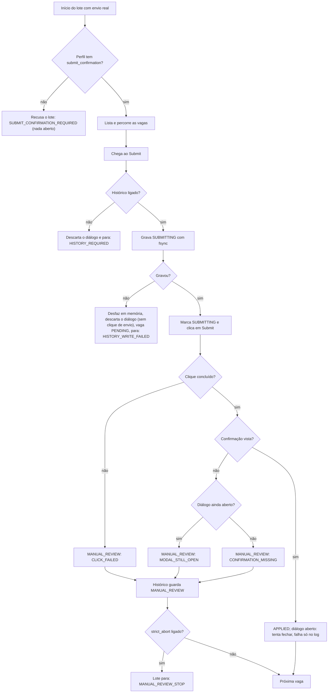
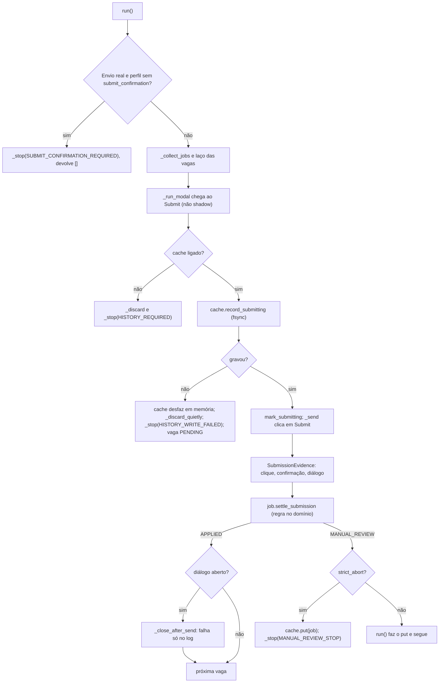
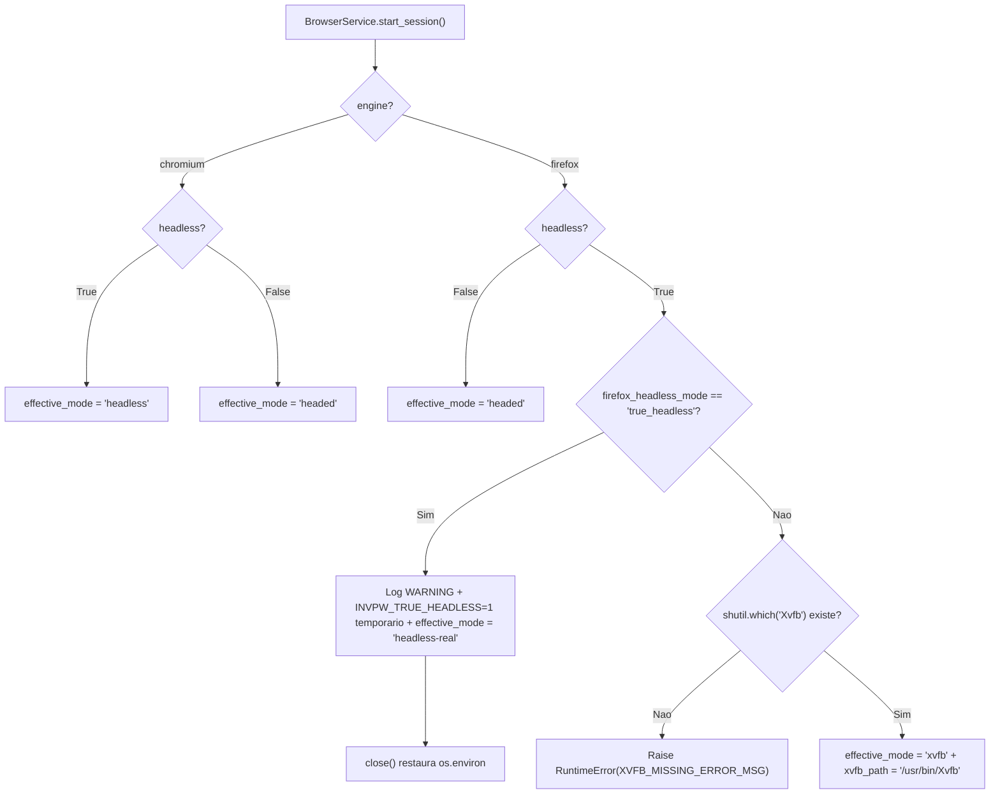
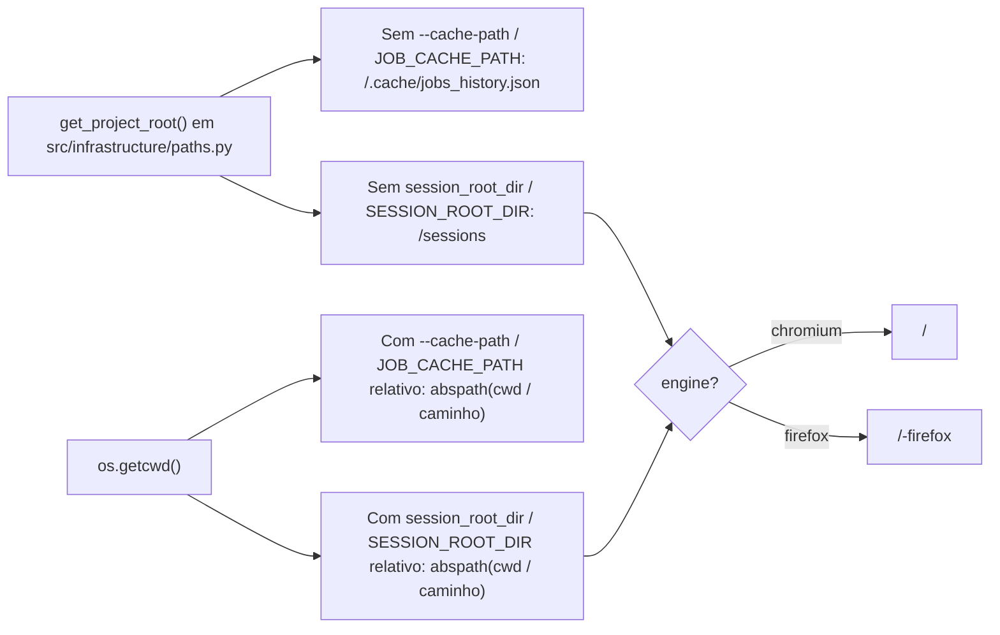

# NOTAS.md - Log de Handoff entre Agentes (AIHawk)

Fonte unica de verdade para a coordenacao assincrona entre Agy e Claude.

---

## 📬 COMUNICADO OFICIAL ATIVO NO TOPO (TURNO ATUAL)

**DE/PARA/TURNO:** Agy -> Nicolas, Gemini Argon, Maestro (copia: Claude) | Turno: Nicolas | 2026-11-03
**STATUS:** [PRONTO] Bloco 1.1, passos A1 a A7 entregues e homologados nos dois motores (Chromium + Firefox Xvfb). Rapida: 355 PASSED; Infra: 27 PASSED; Real (`tests/real/`): 39/39 PASSED em Chromium e 39/39 PASSED nas 3 execucoes seguidas de Firefox sob Xvfb (`/usr/bin/Xvfb`, tempo 1,03x medio / 1,04x max). Relatorio refeito em `docs/relatorio_go_nogo_firefox.md` com veredito GO.
**ACEITE/RESUMO:** Revisao do fecho do Bloco 1.1 pelo Maestro e aprovacao do Nicolas para abertura do Bloco 2. Carta completa no chat.

---

## 1. Estado Atual da Squad

* **Turno Atual:** Nicolas (revisao do fecho do bloco 1.1 pelo Maestro e decisao de abertura do bloco 2).
* **Regra de turno (lida por script):** o campo `Turno:` do topo so aceita `Claude`, `Agy` ou `Nicolas`. Mudar o `Turno` no mesmo commit do seu trabalho e o sinal de passagem. Commit fora do seu turno e recusado por hook.
* **Versao Consolidada da Aplicacao:** v1.5 (`master` = 'e28da32', merge do PR #4, tag `v1.5`). Antes: v1.0 ('414e4f8', PR #2, tag `v1.0`).
* **Caminho:** Geracao 2.0 fecha na v2.0, com marcos intermediarios: v1.5 (feito) -> v1.6 (Portao A: motor e seguranca, sem LinkedIn) -> v1.7 (Portao B: Shadow Mode real com a conta temporaria, sem envio) -> v2.0 (Portao C: Burner Run de 5 vagas, primeiro envio real) -> Geracao 2.5 (LLM) -> Geracao 3.0. Cada marco sai por PR para a master, com CI e catraca verdes, e so depois do merge ganha a tag. Se um portao falha, o proximo nao comeca. Backlog definitivo: a planilha do Nicolas.
* **Versao Alvo da Squad:** v1.6 (Portao A). Bloco 1: homologado com GO com condicoes ('e251373'). Bloco 1.1 (correcoes C1..C5 + A1..A7): entregue e homologado com GO pleno em Xvfb. Bloco 2: aguarda revisao do Maestro e comando do Nicolas. O Portao A so fecha a v1.6 quando os blocos 1, 1.1 e 2 terminarem.
* **Branch Ativa:** `feat/2.0-portao-a`. A `master` so recebe PR; as `feat/*` aceitam push normal (sem force push nem exclusao).
* **Placar do Pytest:** rapido (`tests/domain` + `tests/application`) = 355 PASSED em '81ec6e4' (Mutation do zero em 03/11, medida pelo Claude em '81ec6e4': 96,1%, 689/717, 28 sobreviventes, nenhum novo; o mutante 140 morreu; proposta de teto 28 aguarda o Nicolas. Bloco 1: 95,8%, 664/693, 29). Suite infra: 27 PASSED. Suite real (`tests/real/`): 39 PASSED em Chromium e 39 PASSED em 3 execucoes consecutivas no Firefox em modo `xvfb` (`/usr/bin/Xvfb`).
* **Proxima Acao Esperada:** Revisao do fecho do Bloco 1.1 pelo Maestro e orientacao do Nicolas para abertura do Bloco 2.

<!-- ROADMAP-TECNICO:INICIO | Guardiao: Maestro. NAO remover, NAO renomear, NAO reordenar, NAO apagar estes marcadores. Unica edicao permitida a Claude e Agy: trocar ○ por ● no proprio passo ao entregar. -->

### Roadmap tecnico do escopo atual (guardiao: Maestro)

```text
●  feito   ○  pendente   ◆  marco   →  passa o turno   ✖  parado

● [G2.0 - Bloco 1 CONCLUÍDO] entregue e homologado        e251373
│
○ [G2.0 - Bloco 1.1] Correções do GO (prazo de 3s para 1,2s, cache/perfil na raiz, Xvfb)
│ ├─● C1 confirmação vale mesmo com diálogo aberto
│ ├─● C2 envio real exige submit_confirmation, sem palpite
│ ├─● C3 falha ao gravar SUBMITTING: sem clique, PENDING
│ ├─● C4 lote para após MANUAL_REVIEW (decisão 5A)
│ ├─● C5 mutante 140 morto, mutação medida do zero
│ │      → Turno: Agy
│ ├─● A1 prazo de visibilidade VOLTA a 3000 ms
│ ├─● A2 cache e perfil ancorados na raiz, .gitignore
│ ├─● A3 perfil separado por motor
│ ├─● A4 Firefox: Xvfb, ou headless real só explícito
│ ├─● A5 clone: fluxo base da v1.5 + cenários explícitos
│ ├─● A6 fixtures hostis: onde estão, nada enfraquecido
│ └─● A7 3 execuções Firefox em Xvfb, relatório refeito
│        → Turno: Nicolas
│
◆ fecho do bloco 1.1 (revisão do Maestro)
```

Algoritmo do envio depois do bloco 1.1 (passos C1 a C4):



Detalhe de cada passo: carta do bloco 1.1 (topo deste arquivo). O proximo trecho do roadmap so entra aqui por carta do Maestro, depois do fecho.

<!-- ROADMAP-TECNICO:FIM -->

Plano de subtasks do Claude e do Agy (Mermaid do proprio algoritmo, se houver): fica AQUI, fora dos marcadores, sob um titulo com o nome de quem escreveu.

### Plano do Claude (bloco 1.1, C1 a C5: entregue)

* C1 ('ba40e36'): tabela-verdade da `SubmissionEvidence` (8 linhas) -> testes de aplicacao (sucesso com dialogo aberto fecha; falha ao fechar nao rebaixa) -> `review_reason` e `_close_after_send`.
* C2 ('5418dea'): testes de recusa sem a chave e de Shadow sem a chave -> fakes com a confirmacao -> checagem no inicio do `run()`, fim do palpite em `_observe_submission`, chave no perfil do clone.
* C3 ('b4c0e02'): testes de PENDING sem clique, lote parado, descarte que falha, sumario e memoria do `JsonJobCache` -> `try` em `record_submitting` no `_submit` e desfazer em memoria no cache.
* C4 ('49b0231'): testes de parada, historico antes da parada e sumario -> `put` + `_stop(MANUAL_REVIEW_STOP)` no `_submit`.
* C5 ('81ec6e4'): lista de revisao manual chamada pela instancia em `execute`; sumario conferido byte a byte; mutation do zero.



### Plano do Agy (bloco 1.1, A1 a A7: entregue)

* A1 ('a41bb13'): `DEFAULT_VISIBILITY_TIMEOUT_MS = 3000` restaurado em `src/infrastructure/browser_service.py`; parametro `visibility_timeout_ms` no construtor do `BrowserService` (sem variavel de ambiente); teste de regressao em `tests/infrastructure/test_browser_service.py` e cenario de estouro (`very-slow-modal` 2500 ms com `visibility_timeout_ms=1000`).
* A2 ('376a286'): `get_project_root()` em `src/infrastructure/paths.py` ancorando `DEFAULT_CACHE_PATH` (`<raiz>/.cache/jobs_history.json`) e `SESSION_ROOT_DIR` padrao (`<raiz>/sessions`), mantendo caminhos relativos explicitos relativos ao `cwd`; log de caminhos absolutos no startup; `app_controller.execute(request)` em `src/main.py`; `.cache/` e `sessions/` validados via `git check-ignore -v`.
* A3 ('656679c'): perfil separado por motor em pastas irmas (`<root>/<platform>` para `chromium`, `<root>/<platform>-firefox` para `firefox`).
* A4 ('4f6b4c9'): modo do Firefox explicito (`firefox_headless_mode="xvfb"` padrao exige `/usr/bin/Xvfb` ou falha com `RuntimeError`; `"true_headless"` explicito emite `WARNING` e restaura `os.environ` no `close()`); `get_runtime_metadata()` para ambos os motores (`effective_mode`, `xvfb_path`, `browser_version`, `user_agent`).
* A5 ('2e30d1b'): fluxo base da v1.5 restaurado no clone (`1000 ms`, modal permanece aberto com confirmacao interna); cenarios explicitos `?scenario=close-on-submit`, `no-confirm`, `stuck-submit`, `slow-modal` e `very-slow-modal`; testes reais para C1, C2, C3 (diretorio-pai arquivo comum -> `OSError`) e C4.
* A6 ('87e700d'): prova de `BrowserService().channel == "chromium"` por padrao; remocao de `channel="chromium"` chumbado nas fixtures reais (`tests/real/conftest.py` e `tests/real/external/conftest.py`) e adicao de guarda de identidade do motor via `navigator.userAgent` (`"Firefox"` vs `"Chrome"`).
* A7 (este commit): alinhamento das paginas do santuario e mar aberto com C2; 1 rodada completa de `tests/real/` em Chromium (`39/39 PASSED`) e 3 rodadas seguidas em Firefox modo `xvfb` (`39/39 PASSED` nas 3, tempo `1,03x` medio / `1,04x` max); relatorio atualizado em `docs/relatorio_go_nogo_firefox.md` com veredito `GO`.





---

## 2. Regras de Governanca e Etiquetas do NOTAS.md

1. **Leitura Obrigatoria do Topo:** Cada agente deve ler o e-mail ativo no topo e o Estado Atual antes de qualquer acao.
2. **Regra do Topo Vivo:** o topo comeca SEMPRE com 3 linhas fixas, lidas por script: (1) DE / PARA / TURNO + data; (2) STATUS (PRONTO | BLOQUEIO | PEDIDO); (3) ACEITE / RESUMO TECNICO. Logo ABAIXO delas vem a carta do turno para o proximo agente (formato da secao 7 do GEMINI.md: ASSUNTO, commit anterior, corpo). Nunca escreva nada acima das 3 linhas. Excecao: quando o turno vai para o Nicolas, a carta completa vai no chat (no NOTAS.md, so as 3 linhas e o Historico).
   Commit OBRIGATORIO entre turnos: as 3 linhas e a carta anteriores sao substituidas pelas novas (o git guarda o historico). Um resumo de ate 5 linhas vai para o Historico. A substituicao vale SO para o bloco do topo: as secoes 1 a 4 nunca sao apagadas.
3. **Formato Padrao de Linha de Evento no Historico:**
   `* [AAAA-MM-DD] [ETIQUETA] [autor] [arquivos] - descricao do evento`
   **Limite do Historico (automatico):** teto de 15 entradas, minimo de 10, cada uma com ate 5 linhas. Um hook de pre-commit
   (`.git/hooks/pre-commit`, local e NAO versionado) poda sozinho em todo commit que inclua o `NOTAS.md`: acima de 15 entradas,
   mantem so as 10 mais recentes. NUNCA toca no e-mail do topo nem em nada acima do Historico; em duvida ou erro nao faz nada e
   nao bloqueia o commit. O git guarda as entradas removidas. Se o repositorio for clonado de novo, o hook precisa ser reinstalado.
4. **Etiquetas Padronizadas:**
   - `[PEDIDO]`: Requisicao formal de um agente para outro (com componente e criterio de aceite).
   - `[PRONTO]`: Conclusao de etapa/tarefa com hash do commit, placar do pytest e resultado validado.
   - `[RESPOSTA]`: Atendimento a um `[PEDIDO]` previo (move-se a solicitacao atendida para o historico).
   - `[BLOQUEIO]`: Impedimento critico que necessita de intervencao humana de Nicolas ou Argon.
5. **Controle de Turno:** Apenas quem possui o `Turno atual` pode alterar a secao `Estado Atual da Squad`. Fora do seu turno, o agente so le o NOTAS.md: nao edita, nao commita e nao mexe na arvore de trabalho.
6. **Governanca de Git:**
   - NUNCA usar `git add .` ou `git commit -a`. Sempre usar `git add NOTAS.md` explicitamente com seus arquivos de territorio.
   - Commitar com caminhos explicitos: `git commit -m "..." -- <seus arquivos> NOTAS.md` (nao leva o que o outro agente deixou preparado).
   - Prefixos de commit obrigatorios: `[Agy] ...` ou `[Claude] ...` (sem versao na mensagem).
   - Agentes NAO fazem troca de branch (so o Nicolas), `git stash`, merge de PR, force push, push direto na `master` nem reescrita de historico (`rebase`, `--amend`, `filter-branch`, `--no-verify`).
   - Push, PR e tag: so o Claude, depois da revisao aprovada, com a linha `AUTORIZO: ...` do Nicolas no topo do NOTAS.md e confirmacao dele no terminal. O Agy nunca. O hook `pre-push` recusa qualquer push para `master`/`main`.
7. **Mutation Score:** todo score registrado traz a contagem por status e por arquivo, e foi medido do zero (`.mutmut-cache` movido para fora com `mv`, nunca `rm -rf`) e sem outro processo de teste rodando em paralelo. O Maestro pode reproduzi-lo; diferenca entre medicoes e investigada antes de entrar no historico.

8. **Versao e tag:** a revisao acontece antes do PR. Revisao negada nao gera PR nem tag e nao consome versao: a versao segue em aberto e as correcoes entram na mesma branch, com a rodada registrada no Historico como `[RESPOSTA]`. A tag so e criada depois do merge. Correcao depois do merge usa versao de correcao (v1.5.1). O numero seguinte so existe depois do merge da anterior.  Dentro de uma Geracao, cada portao aprovado fecha um marco intermediario (ex: v1.6, v1.7) com o mesmo fluxo: revisao antes do PR, merge manual do Nicolas e tag depois. Commit entre turnos nunca gera tag.

9. **Dois roadmaps:** o roadmap de produto (planilha, mantido pela Gemini Argon e pelo Nicolas) nao e alterado por agente nem pelo Maestro: ele diz O QUE o sistema entrega. O roadmap tecnico fica na secao 1, mostra so o que esta sendo feito agora e o Maestro e o guardiao: ele diz COMO. Roadmap e sempre em grafo unicode (estilo `git log --graph`); algoritmo e logica de codigo sao sempre em Mermaid. Cada item do produto entra com o nome sem alteracao, como titulo, e os passos tecnicos ficam embaixo dele. A cadeia e negocio (planilha: O QUE) -> tecnico (secao 1: COMO, do Maestro) -> subtasks (do Claude e do Agy, dentro de cada passo). O roadmap tecnico fica entre os marcadores `ROADMAP-TECNICO:INICIO` e `ROADMAP-TECNICO:FIM`, e ali Claude e Agy so podem trocar `○` por `●` no proprio passo, no commit de entrega. Proibido entre os marcadores: remover, renomear, reordenar ou acrescentar passos, marcar passo do outro, editar o Mermaid do algoritmo, apagar os marcadores. Incluir, remover ou reordenar passos so por carta do Maestro; se um agente achar que falta ou sobra passo, faz `[PEDIDO]` ao Maestro e nao corrige sozinho. As subtasks e o Mermaid de cada agente ficam depois do marcador `FIM`. Detalhe tecnico nunca sobe para a planilha.

---

## 3. Papeis e Territorios de Escrita

| Papel | Agente | Territorio Permitido de Escrita |
|---|---|---|
| Decisor / Autorizacao / Merge do PR | Nicolas | `master` (PR manual via GitHub), `.claude/`, `.gemini/`, `scripts/maestro/` |
| DEV (Arquitetura e Contratos) | Claude | `src/domain/`, `src/application/`, `tests/domain/`, `tests/application/`, `NOTAS.md`; entrega Git (push, PR, tag) so com autorizacao |
| QA, Runtime e Infraestrutura | Antigravity (Agy) | `src/infrastructure/`, `src/main.py`, `tests/infrastructure/`, `tests/real/`, `tests/conftest.py`, `Makefile`, `requirements*.txt`, `docs/`, `.github/`, configs de ferramentas na raiz, `.env*`, `.gitignore`, `NOTAS.md` |
| Auditoria e Revisao | Argon | Somente leitura |

---

## 4. Historico de Handoffs
* [2026-11-03] [PRONTO] [Agy] src/infrastructure/, src/main.py, tests/infrastructure/, tests/real/, docs/, NOTAS.md - Bloco 1.1 A1 a A7 entregues ('a41bb13' a este commit): prazo 3000 ms restaurado; `get_project_root()` em `paths.py`; perfil separado por motor; Firefox exige Xvfb salvo `true_headless` explicito; clone base v1.5 restaurado + cenarios C1..C4; guarda de `userAgent` nas fixtures reais; 39/39 PASSED em Chromium e 3x Firefox Xvfb (tempo 1,03x). Veredito GO. Turno: Nicolas.
* [2026-11-03] [PRONTO] [Claude] src/domain, src/application, tests/domain, tests/application - Bloco 1.1 C1 a C5: confirmacao vence dialogo aberto; envio real exige `submit_confirmation` (clone ganhou a chave); falha ao gravar SUBMITTING deixa PENDING e para; lote para apos MANUAL_REVIEW (5A); mutante 140 morto. Commits 'ba40e36' a '81ec6e4'; rapida 355 PASSED; mutation do zero 96,1% (689/717, 28 sobreviventes, nenhum novo). Turno: Agy.
* [2026-11-03] [RESPOSTA] [Maestro -> Claude, Agy] NOTAS.md - PLANO OK do bloco 1.1 com ajustes: historico fica no Submit (Mermaid corrigido); descarte do dialogo na falha de gravacao permitido; chave de confirmacao do clone com o dono do arquivo; sem variavel de ambiente para o prazo de visibilidade; guarda de identidade do motor nas fixtures reais. Turno: Claude.
* [2026-11-03] [PEDIDO] [Nicolas -> Claude] NOTAS.md - Bloco 1.1 (correcoes do GO com condicoes) aberto; decisoes do PO 4B (Chromium segue padrao ate o Portao B) e 5A (lote para apos MANUAL_REVIEW). Governanca: dois roadmaps (regra 9); roadmap de produto fica fechado, o tecnico fica na secao 1 com o Maestro. Territorio do Agy explicita `requirements*.txt`, `docs/` e `.github/`. Turno: Claude.
* [2026-11-03] [PRONTO] [Agy] src/infrastructure/, src/main.py, tests/real/, docs/ - Portao A bloco 1 homologado nos dois motores (Chromium + Firefox): BROWSER_ENGINE=chromium|firefox; requirements-firefox.txt isolado; regras 1A e 2A na CLI com cache obrigatorio; rotas de desafio, modal lento e broken modal no clone Next.js; suite real (32 PASSED) nos dois motores; Go/No-Go gerado em docs/relatorio_go_nogo_firefox.md com veredito GO (6 criterios verdadeiros, tempo 1,05x). Turno: Nicolas.
* [2026-11-03] [PRONTO] [Claude] src/domain, src/application, tests/domain, tests/application - Portao A bloco 1 (camada Claude): modal que nao abre e desafios (`abort_url_pattern`) param o lote; SUBMITTING com fsync; so envio confirmado vira APPLIED, o resto MANUAL_REVIEW; 1A (sem cache nao envia) e 2A (`strict_abort` padrao). Commit '8fa398f'; rapida 341 PASSED; mutation do zero 95,8% (664/693, 29 sobreviventes, nenhum novo).
* [2026-11-03] [PEDIDO] [Nicolas -> Claude] NOTAS.md - PLANO OK do Portao A, bloco 1 (branch 'feat/2.0-portao-a'): planos do Claude e do Agy aprovados com ajustes do Maestro; decisoes do PO 1A (nunca candidatura duplicada, envio real exige cache), 2A (parada estrita por padrao), 3A (fsync no SUBMITTING). Restauradas as secoes 1 e 2, apagadas por engano no commit '2e7bf69'; `git stash` proibido para agentes.
* [2026-11-02] [PRONTO] [Claude] NOTAS.md - Autorizacao recebida: push da feat/v1.5 e PR para a master. Tag v1.5 so depois do merge (Nicolas avisa no chat). Limitacoes conhecidas vao na descricao do PR e no backlog da v2.0.
* [2026-11-02] [RESPOSTA] [Nicolas -> Claude] NOTAS.md - Revisao do ponto estavel '3276d90' aprovada (Nicolas, Argon, Maestro). AUTORIZO: push, PR e tag da feat/v1.5; tag so apos o merge.
* [2026-11-02] [PRONTO] [Agy] tests/real/, .github/workflows/ci.yml, NOTAS.md - Homologa ajustes do Maestro: parada estrita na listagem (zero vagas, 2a URL nao aberta), negativo da tabela restaurado, teste cego com max 10 e empresa vazia, CI endurecido com venv e catraca mutation (95,1%). Total: 206 PASSED (28 Chromium real). Carta no chat. Turno: Nicolas.
* [2026-11-02] [PEDIDO] [Claude] src/application, tests/application - Parada estrita na listagem e por desvio de dominio (`get_current_url` no BrowserPort); mutation do zero 95,1% (562/591), sobreviventes todos equivalentes; fluxo da tag corrigido. Pede 4 testes reais e homologacao ao Agy.
* [2026-11-02] [PEDIDO] [Diretoria -> Claude] NOTAS.md - Revisao do Maestro: v1.5 nao aprovada. Claude: commitar teste residual, parada estrita na listagem, current_url no BrowserPort, corrigir fluxo da tag. Agy depois: teste de checkpoint sem link, assercao da 2a URL, negativo da tabela, teste cego com contagem real, CI sem '|| true' com catraca, homologar no commit exato.
* [2026-11-02] [PEDIDO] [Claude] tests/application, NOTAS.md - Inclui `test_mutantes_residuais.py` (esquecido no commit anterior) e pede ao Nicolas/diretoria a aprovacao do ponto estavel da v1.5. Aguarda resposta antes de tag, push e PR.
* [2026-11-02] [PRONTO] [Agy] NOTAS.md - Homologacao de modal_signature no motor real: 27/27 Chromium PASSED (201/201 no total do repo); guarda de progresso aprovada sem falsos positivos; ponto estavel para fechamento da v1.5. Turno: Claude.
* [2026-11-02] [PEDIDO] [Claude] src/application, tests/application - `modal_signature` no BrowserPort e no laco do modal (guarda de progresso); mutation do zero 95,0% (551/580); rapida 174 PASSED. Pede infra+real ao Agy.