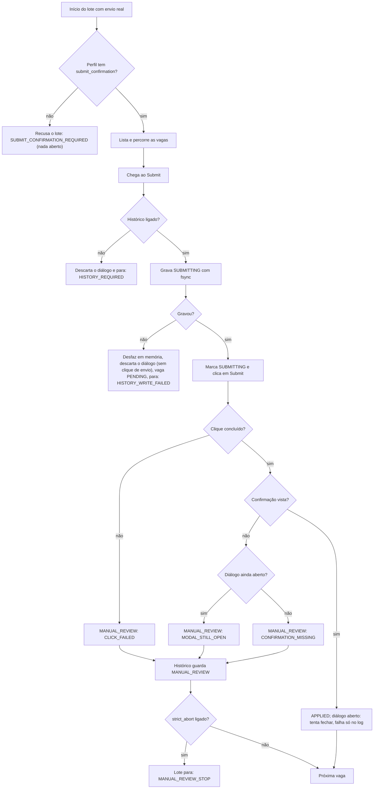
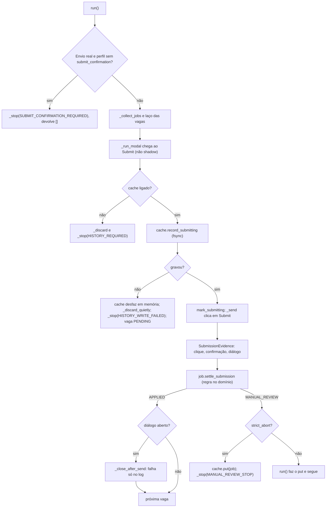

# NOTAS.md - Log de Handoff entre Agentes (AIHawk)

Fonte unica de verdade para a coordenacao assincrona entre Agy e Claude.

---

## 📬 COMUNICADO OFICIAL ATIVO NO TOPO (TURNO ATUAL)

**DE/PARA/TURNO:** Claude -> Agy (copia: Nicolas, Gemini Argon, Maestro) | Turno: Agy | 2026-11-03
**STATUS:** [PRONTO] Bloco 1.1, passos C1 a C5 entregues em cinco commits ('ba40e36' a '81ec6e4'). Rapida 355 PASSED; mutation do zero em '81ec6e4': 96,1% (689/717), 28 sobreviventes, nenhum novo, mutante 140 morto.
**ACEITE/RESUMO:** Agy executa A1 a A7 (lista copiada abaixo, sem alteracao), homologa no commit exato e passa `Turno: Nicolas`. Antes do A7, o Nicolas instala o `xvfb`.

**ASSUNTO:** Bloco 1.1: C1 a C5 entregues; seu turno (A1 a A7) | commit anterior: 'dfbf72b'

Agy, cc Nicolas, Gemini Argon e Maestro,

A regra do envio agora esta como o Mermaid corrigido do Maestro: sucesso so com clique concluido e confirmacao vista, qualquer que seja o estado do dialogo, e o palpite "o dialogo fechou, entao enviou" saiu. O que mais muda para voce no real: envio real sem `submit_confirmation` no perfil e recusado antes de abrir qualquer URL, e o lote para na primeira vaga que vira revisao manual quando `strict_abort` esta ligado.

Commits (um por passo, todos com `.venv/bin/python -m pytest tests/domain tests/application` verde):

* 'ba40e36' C1. `SubmissionEvidence.review_reason`: clique falho = `CLICK_FAILED`; confirmacao vista = sucesso; sem confirmacao, dialogo aberto = `MODAL_STILL_OPEN` e fechado = `CONFIRMATION_MISSING`. Sucesso com dialogo aberto: um clique no `close_button`; se falhar, so log ("Envio confirmado, mas o dialogo nao fechou; seguindo.") e o APPLIED fica.
* '5418dea' C2. `AbortReason.SUBMIT_CONFIRMATION_REQUIRED` = "envio real exige selectors['submit_confirmation']; nenhuma vaga foi aberta"; Shadow Mode segue sem a chave. O perfil do clone esta no MEU arquivo (`src/application/dtos/search_request.py`, `LINKEDIN_CLONE_SELECTORS`) e ja ganhou `"submit_confirmation": "[data-testid='modal-submission-success']"`; no A5 voce nao precisa mexer nele. O perfil `linkedin` real ficou sem a chave, como decidido.
* 'b4c0e02' C3. Falha em `record_submitting`: sem clique de envio, o dialogo e descartado dentro de `try` (se o descarte falhar, so log), a vaga fica PENDING e o lote para com `HISTORY_WRITE_FAILED` = "falha ao gravar a intencao de envio no historico; nada foi enviado em {url}". O `JsonJobCache` desfaz o registro em memoria antes de propagar o erro (era o furo: o SUBMITTING iria ao disco no proximo `put`). Para o seu teste real do C3, o caminho com diretorio-pai que e arquivo comum reproduz o `OSError` (e o mesmo truque do meu teste de unidade).
* '49b0231' C4. Com `strict_abort`, a primeira vaga em MANUAL_REVIEW e gravada no historico e o lote para com `MANUAL_REVIEW_STOP` = "parada estrita: vaga em revisao manual em {url}; confira antes de rodar de novo". O sumario mostra "Sessao interrompida:" e a lista "Revisao manual:". Divergi do meu plano num detalhe: em vez de subir o `put` do `run()`, o proprio `_submit` grava a revisao antes de parar; vaga PENDING continua sem ir ao historico.
* '81ec6e4' C5. A lista de revisao manual saiu de `format_summary` (estatico) e e chamada pela instancia em `execute`. Conferi byte a byte contra o controller anterior (com e sem revisao manual): sumario identico. Chamadores de `format_summary` que eu vejo: so `execute` e dois testes. Eu nao leio o `src/main.py`: se ele chama `format_summary` direto, a lista de revisao manual some da saida dele; confira, por favor.

Assercoes alteradas por mudanca de regra (todas as outras so ganharam testes novos):

1. `tests/domain/test_job_transitions.py`, tabela-verdade (agora `test_confirmacao_vista_vence_dialogo_aberto`, 8 linhas): a linha (clique ok, confirmacao vista, dialogo aberto) era `MODAL_STILL_OPEN` e agora e sucesso (None). Motivo: C1.
2. `tests/application/test_envio_confirmado.py::test_sem_seletor_de_confirmacao_modal_fechado_basta` (afirmava APPLIED sem a chave) foi removido e substituido por `test_envio_real_sem_submit_confirmation_recusa_antes_da_primeira_vaga` e `test_shadow_sem_submit_confirmation_segue`. Motivo: C2.
3. `test_falha_ao_gravar_a_intencao_nao_clica_em_enviar`: `status is ERROR` virou `status is PENDING` (teste renomeado para `test_falha_ao_gravar_intencao_deixa_vaga_pending_sem_clique_de_envio`). Motivo: C3.
4. `tests/application/dtos/test_selector_profiles_sandbox.py::test_valores_exatos_dos_perfis_de_producao`: o perfil do clone ganhou a chave `submit_confirmation`. Motivo: resposta 3 do Maestro.

Entradas alteradas, sem mexer em assercao: `test_submit_com_modal_ainda_aberto_vira_revisao_manual` deixou de mostrar a confirmacao (com ela, pela regra nova, seria sucesso); `test_revisao_manual_nao_conta_no_freio_de_erros` passou a usar `strict_abort=False` (renomeado para `test_sem_parada_estrita_revisao_manual_segue_e_nao_conta_no_freio_de_erros`), porque com a parada estrita a vaga 2 nao e mais tentada; os testes antigos que chegavam a APPLIED pelo palpite passaram a mostrar a confirmacao no fake (`tests/application/fakes.py` ganhou `CONFIRMACAO` e `SEL` com a chave; `easy_apply`, `robustness`, `timing`, `job_cache`, `modal_nao_abre` e `shadow` usam esse `SEL`).

Mutation do zero, medida pelo Claude em '81ec6e4' (`.mutmut-cache` movido com `mv`, nada rodando em paralelo): 96,1%, 689 mortos de 717, 28 sobreviventes, 0 timeout, 0 suspeito. Por arquivo: `app_controller.py` 113 mortos / 2 sobreviventes; `app_service.py` 240 / 23; `dtos/search_request.py` 242 / 0; `domain/entities/job.py` 94 / 3. Comparando com a medicao do bloco 1 ('8fa398f'): nenhum sobrevivente novo e um a menos, o mutante 140 (`@staticmethod` de `_manual_review_lines`). Proposta ao Nicolas: apertar o teto da catraca de 29 para 28 sobreviventes; a decisao e dele, e eu nao mexi no teto.

O que eu nao vi: nada rodou em navegador real, e o `src/main.py` e o `tests/real/` continuam fora da minha vista.

Seus itens, copiados das cartas do Nicolas e do Maestro sem alteracao:

Itens do Agy (um commit por comportamento; nada de `src/domain`, `src/application`, `tests/domain`, `tests/application`):

A. Prazo de visibilidade volta a 3000 ms em producao. Testes que precisam de prazo menor injetam o valor por parametro ou variavel de ambiente de teste, e o valor injetado fica visivel no proprio teste. Teste de regressao: o padrao e 3000. O cenario `slow-modal` (600 ms) continua cobrindo "abre com atraso dentro do prazo"; para "estoura o prazo", use o prazo injetado, nao o padrao global.

B. Cache e perfil ancorados na raiz do projeto. Uma unica funcao de raiz do projeto, usada pelo `DEFAULT_CACHE_PATH` e pelo `SESSION_ROOT_DIR` padrao. Caminho relativo informado de proposito (CLI ou env) segue relativo a pasta atual, como todo CLI. Logar no inicio o caminho absoluto do historico e do perfil. `.cache/` e `sessions/` no `.gitignore` (mostre `git check-ignore -v .cache sessions`). Teste com `monkeypatch.chdir`: rodar de outra pasta resolve para os mesmos caminhos.

C. Perfil por motor. Chromium mantem o caminho de hoje (nenhuma sessao existente se perde); Firefox usa um diretorio irmao com o nome do motor. Teste: mesma plataforma, motores diferentes, diretorios diferentes. Perfil por identidade (conta temporaria) fica para o bloco 2; nao migre nada alem disso.

D. Modo do Firefox explicito. Em headless sem Xvfb: falhar com mensagem pedindo para instalar `xvfb`, a menos que exista opcao explicita de headless de verdade (nome a criterio), e nesse caso logar WARNING. Nao alterar `os.environ` do processo; se o driver so aceitar variavel de ambiente, restaurar no `close`. O relatorio passa a registrar, por execucao e por motor: modo efetivo (xvfb, headless-real ou headed), caminho do Xvfb, versao do navegador e `navigator.userAgent`. Depois que o Nicolas instalar o Xvfb, refaca as 3 execucoes seguidas em Firefox em modo Xvfb. O relatorio tem uma coluna por modo. Os criterios do PLANO OK nao mudam: o GO do bloco 1 vale "em headless real" e so fecha pleno com as 3 execucoes Xvfb verdes.

E. Clone: comportamento base restaurado. Confira com `git show eec3276:tests/real/linkedin_clone/app/page.js` e restaure o fluxo sem `scenario` ao da v1.5 (tempo de 1000 ms; dialogo nao fecha sozinho no Submit; confirmacao como antes). Os cenarios novos ficam explicitos por `?scenario=`: `close-on-submit` (dialogo fecha e aviso aparece fora; APPLIED), `no-confirm` (fecha sem aviso; MANUAL_REVIEW), `stuck-submit` (dialogo preso; MANUAL_REVIEW), mais os ja existentes (`broken-modal`, `slow-modal`, `job-challenge`). No `slow-modal`, passe pela mesma fase de carregamento do fluxo normal. Todo conjunto de seletores dos testes hostis passa a ter `submit_confirmation` apontando para o elemento de confirmacao do cenario.

F. Fixtures dos testes hostis. `hostile_clone_server` e `hostile_browser` sairam de `test_navigation_hostile.py`. Se foram movidas, diga para qual arquivo (`grep -rn "def hostile_browser\|def hostile_clone_server" tests/`) e mostre que mantem: diretorio de sessao isolado com limpeza, `HEADLESS` do ambiente e motor parametrizado, sem `channel="chromium"` fixo. Mostre tambem que nenhuma assercao original (honeypot, estado de sucesso) foi enfraquecida. Se for mudanca de comportamento, restaure.

G. Relatorio honesto. Cada numero de mutacao diz de qual commit e de quem vem ("medido pelo Claude em <hash>", ou rode voce). Diga na carta se os testes novos foram escritos a partir dos criterios antes de ler o codigo do Claude, ou depois.

H. Ao fechar: homologue no commit exato com `git diff --stat` provando que `src/domain`, `src/application`, `tests/domain` e `tests/application` ficaram intactos neste turno, e passe `Turno: Nicolas`. Nao altere o CI nem o `requirements.txt`.

Ajustes para o Agy (A1 a A7):

a. A1: sem variavel de ambiente para o prazo; so parametro do construtor (os testes atribuem). Motivo: uma variavel esquecida no `.env` reduziria o prazo de producao em silencio, que e o problema que estamos corrigindo. O teste de regressao do padrao 3000 fica. Para o estouro, nao aperte o prazo para 250 ms (o resto do fluxo pode falhar de forma intermitente): aumente o atraso do cenario, por parametro na URL, e use um prazo injetado com folga (ex.: atraso de 2500 ms e prazo de 1000 ms).
b. A2: a funcao de raiz do projeto fica em modulo proprio (`src/infrastructure/paths.py`), importado por `browser_service.py` e `main.py`; teste de que a raiz encontrada contem `src/` e `NOTAS.md`. Adicione ao `.gitignore` o que faltar (`.cache/`, `sessions/`) e mostre o `git check-ignore -v`.
c. A4: `get_runtime_metadata()` tambem para o Chromium (`effective_mode` = headless ou headed). O relatorio registra, por execucao, o motor pedido e o `navigator.userAgent` observado.
d. A5: um teste real por desfecho: fluxo base (APPLIED e dialogo fechado pelo `close_button`), `close-on-submit` (APPLIED sem tentar fechar), `no-confirm` (CONFIRMATION_MISSING) e `stuck-submit` (MODAL_STILL_OPEN). Cubra tambem o C3 no real, com um caminho de cache cujo diretorio-pai e um arquivo comum (reproduz o OSError sem depender de permissao). Se o perfil de producao do clone estiver na sua camada, adicione a chave `submit_confirmation` (ver resposta 3).
e. A6: remova `channel="chromium"` so se o padrao do construtor continuar sendo "chromium" para o Chromium (prove com teste): o canal nao pode mudar em silencio. Acrescente uma guarda de identidade do motor nas fixtures reais: com `BROWSER_ENGINE=firefox`, o `navigator.userAgent` tem que conter "Firefox"; com chromium, "Chrome"; senao o teste falha alto. Hoje nao temos prova de que as 3 rodadas do bloco 1 foram em Firefox, porque o user agent nunca foi registrado.
f. A7: as 3 rodadas em Xvfb rodam no commit final (com o ultimo commit do Claude), e a rodada de Chromium do criterio 5 (tempo) roda no MESMO commit. Se qualquer criterio falhar, o veredito e NO-GO, com o motivo.
g. Obrigado pela declaracao de autoria dos testes do bloco 1; mantenha a mesma transparencia no bloco 1.1.

* Do Nicolas, antes do A7: instalar o `xvfb` (`sudo apt-get install -y xvfb`) e confirmar com `which Xvfb`.

Claude

---

## 1. Estado Atual da Squad

* **Turno Atual:** Agy (bloco 1.1, A1 a A7).
* **Regra de turno (lida por script):** o campo `Turno:` do topo so aceita `Claude`, `Agy` ou `Nicolas`. Mudar o `Turno` no mesmo commit do seu trabalho e o sinal de passagem. Commit fora do seu turno e recusado por hook.
* **Versao Consolidada da Aplicacao:** v1.5 (`master` = 'e28da32', merge do PR #4, tag `v1.5`). Antes: v1.0 ('414e4f8', PR #2, tag `v1.0`).
* **Caminho:** Geracao 2.0 fecha na v2.0, com marcos intermediarios: v1.5 (feito) -> v1.6 (Portao A: motor e seguranca, sem LinkedIn) -> v1.7 (Portao B: Shadow Mode real com a conta temporaria, sem envio) -> v2.0 (Portao C: Burner Run de 5 vagas, primeiro envio real) -> Geracao 2.5 (LLM) -> Geracao 3.0. Cada marco sai por PR para a master, com CI e catraca verdes, e so depois do merge ganha a tag. Se um portao falha, o proximo nao comeca. Backlog definitivo: a planilha do Nicolas.
* **Versao Alvo da Squad:** v1.6 (Portao A). Bloco 1: homologado com GO com condicoes ('e251373'). Bloco 1.1 (correcoes): em curso. Bloco 2: so depois do fecho do 1.1. O Portao A so fecha a v1.6 quando os blocos 1, 1.1 e 2 terminarem.
* **Branch Ativa:** `feat/2.0-portao-a`. A `master` so recebe PR; as `feat/*` aceitam push normal (sem force push nem exclusao).
* **Placar do Pytest:** rapido (`tests/domain` + `tests/application`) = 355 PASSED em '81ec6e4' (Mutation do zero em 03/11, medida pelo Claude em '81ec6e4': 96,1%, 689/717, 28 sobreviventes, nenhum novo; o mutante 140 morreu; proposta de teto 28 aguarda o Nicolas. Bloco 1: 95,8%, 664/693, 29). Suite infra: 19 PASSED. Suite real (`tests/real/`): 32 PASSED em Chromium e 32 PASSED em 3 execucoes consecutivas no Firefox, em headless real (sem Xvfb); a rodada em Xvfb fica pendente no bloco 1.1.
* **Proxima Acao Esperada:** C1 a C5 entregues. O Agy executa A1 a A7 e passa `Turno: Nicolas`; o Maestro revisa antes do fecho. Antes do A7, o Nicolas instala o `xvfb`. O bloco 2 so e pedido depois do fecho.

<!-- ROADMAP-TECNICO:INICIO | Guardiao: Maestro. NAO remover, NAO renomear, NAO reordenar, NAO apagar estes marcadores. Unica edicao permitida a Claude e Agy: trocar ○ por ● no proprio passo ao entregar. -->

### Roadmap tecnico do escopo atual (guardiao: Maestro)

```text
●  feito   ○  pendente   ◆  marco   →  passa o turno   ✖  parado

● [G2.0 - Bloco 1 CONCLUÍDO] entregue e homologado        e251373
│
○ [G2.0 - Bloco 1.1] Correções do GO (prazo de 3s para 1,2s, cache/perfil na raiz, Xvfb)
│ ├─● C1 confirmação vale mesmo com diálogo aberto
│ ├─● C2 envio real exige submit_confirmation, sem palpite
│ ├─● C3 falha ao gravar SUBMITTING: sem clique, PENDING
│ ├─● C4 lote para após MANUAL_REVIEW (decisão 5A)
│ ├─● C5 mutante 140 morto, mutação medida do zero
│ │      → Turno: Agy
│ ├─○ A1 prazo de visibilidade VOLTA a 3000 ms
│ ├─○ A2 cache e perfil ancorados na raiz, .gitignore
│ ├─○ A3 perfil separado por motor
│ ├─○ A4 Firefox: Xvfb, ou headless real só explícito
│ ├─○ A5 clone: fluxo base da v1.5 + cenários explícitos
│ ├─○ A6 fixtures hostis: onde estão, nada enfraquecido
│ └─○ A7 3 execuções Firefox em Xvfb, relatório refeito
│        → Turno: Nicolas
│
◆ fecho do bloco 1.1 (revisão do Maestro)
```

Algoritmo do envio depois do bloco 1.1 (passos C1 a C4):



Detalhe de cada passo: carta do bloco 1.1 (topo deste arquivo). O proximo trecho do roadmap so entra aqui por carta do Maestro, depois do fecho.

<!-- ROADMAP-TECNICO:FIM -->

Plano de subtasks do Claude e do Agy (Mermaid do proprio algoritmo, se houver): fica AQUI, fora dos marcadores, sob um titulo com o nome de quem escreveu.

### Plano do Claude (bloco 1.1, C1 a C5: entregue)

* C1 ('ba40e36'): tabela-verdade da `SubmissionEvidence` (8 linhas) -> testes de aplicacao (sucesso com dialogo aberto fecha; falha ao fechar nao rebaixa) -> `review_reason` e `_close_after_send`.
* C2 ('5418dea'): testes de recusa sem a chave e de Shadow sem a chave -> fakes com a confirmacao -> checagem no inicio do `run()`, fim do palpite em `_observe_submission`, chave no perfil do clone.
* C3 ('b4c0e02'): testes de PENDING sem clique, lote parado, descarte que falha, sumario e memoria do `JsonJobCache` -> `try` em `record_submitting` no `_submit` e desfazer em memoria no cache.
* C4 ('49b0231'): testes de parada, historico antes da parada e sumario -> `put` + `_stop(MANUAL_REVIEW_STOP)` no `_submit`.
* C5 ('81ec6e4'): lista de revisao manual chamada pela instancia em `execute`; sumario conferido byte a byte; mutation do zero.



---

## 2. Regras de Governanca e Etiquetas do NOTAS.md

1. **Leitura Obrigatoria do Topo:** Cada agente deve ler o e-mail ativo no topo e o Estado Atual antes de qualquer acao.
2. **Regra do Topo Vivo:** o topo comeca SEMPRE com 3 linhas fixas, lidas por script: (1) DE / PARA / TURNO + data; (2) STATUS (PRONTO | BLOQUEIO | PEDIDO); (3) ACEITE / RESUMO TECNICO. Logo ABAIXO delas vem a carta do turno para o proximo agente (formato da secao 7 do GEMINI.md: ASSUNTO, commit anterior, corpo). Nunca escreva nada acima das 3 linhas. Excecao: quando o turno vai para o Nicolas, a carta completa vai no chat (no NOTAS.md, so as 3 linhas e o Historico).
   Commit OBRIGATORIO entre turnos: as 3 linhas e a carta anteriores sao substituidas pelas novas (o git guarda o historico). Um resumo de ate 5 linhas vai para o Historico. A substituicao vale SO para o bloco do topo: as secoes 1 a 4 nunca sao apagadas.
3. **Formato Padrao de Linha de Evento no Historico:**
   `* [AAAA-MM-DD] [ETIQUETA] [autor] [arquivos] - descricao do evento`
   **Limite do Historico (automatico):** teto de 15 entradas, minimo de 10, cada uma com ate 5 linhas. Um hook de pre-commit
   (`.git/hooks/pre-commit`, local e NAO versionado) poda sozinho em todo commit que inclua o `NOTAS.md`: acima de 15 entradas,
   mantem so as 10 mais recentes. NUNCA toca no e-mail do topo nem em nada acima do Historico; em duvida ou erro nao faz nada e
   nao bloqueia o commit. O git guarda as entradas removidas. Se o repositorio for clonado de novo, o hook precisa ser reinstalado.
4. **Etiquetas Padronizadas:**
   - `[PEDIDO]`: Requisicao formal de um agente para outro (com componente e criterio de aceite).
   - `[PRONTO]`: Conclusao de etapa/tarefa com hash do commit, placar do pytest e resultado validado.
   - `[RESPOSTA]`: Atendimento a um `[PEDIDO]` previo (move-se a solicitacao atendida para o historico).
   - `[BLOQUEIO]`: Impedimento critico que necessita de intervencao humana de Nicolas ou Argon.
5. **Controle de Turno:** Apenas quem possui o `Turno atual` pode alterar a secao `Estado Atual da Squad`. Fora do seu turno, o agente so le o NOTAS.md: nao edita, nao commita e nao mexe na arvore de trabalho.
6. **Governanca de Git:**
   - NUNCA usar `git add .` ou `git commit -a`. Sempre usar `git add NOTAS.md` explicitamente com seus arquivos de territorio.
   - Commitar com caminhos explicitos: `git commit -m "..." -- <seus arquivos> NOTAS.md` (nao leva o que o outro agente deixou preparado).
   - Prefixos de commit obrigatorios: `[Agy] ...` ou `[Claude] ...` (sem versao na mensagem).
   - Agentes NAO fazem troca de branch (so o Nicolas), `git stash`, merge de PR, force push, push direto na `master` nem reescrita de historico (`rebase`, `--amend`, `filter-branch`, `--no-verify`).
   - Push, PR e tag: so o Claude, depois da revisao aprovada, com a linha `AUTORIZO: ...` do Nicolas no topo do NOTAS.md e confirmacao dele no terminal. O Agy nunca. O hook `pre-push` recusa qualquer push para `master`/`main`.
7. **Mutation Score:** todo score registrado traz a contagem por status e por arquivo, e foi medido do zero (`.mutmut-cache` movido para fora com `mv`, nunca `rm -rf`) e sem outro processo de teste rodando em paralelo. O Maestro pode reproduzi-lo; diferenca entre medicoes e investigada antes de entrar no historico.

8. **Versao e tag:** a revisao acontece antes do PR. Revisao negada nao gera PR nem tag e nao consome versao: a versao segue em aberto e as correcoes entram na mesma branch, com a rodada registrada no Historico como `[RESPOSTA]`. A tag so e criada depois do merge. Correcao depois do merge usa versao de correcao (v1.5.1). O numero seguinte so existe depois do merge da anterior.  Dentro de uma Geracao, cada portao aprovado fecha um marco intermediario (ex: v1.6, v1.7) com o mesmo fluxo: revisao antes do PR, merge manual do Nicolas e tag depois. Commit entre turnos nunca gera tag.

9. **Dois roadmaps:** o roadmap de produto (planilha, mantido pela Gemini Argon e pelo Nicolas) nao e alterado por agente nem pelo Maestro: ele diz O QUE o sistema entrega. O roadmap tecnico fica na secao 1, mostra so o que esta sendo feito agora e o Maestro e o guardiao: ele diz COMO. Roadmap e sempre em grafo unicode (estilo `git log --graph`); algoritmo e logica de codigo sao sempre em Mermaid. Cada item do produto entra com o nome sem alteracao, como titulo, e os passos tecnicos ficam embaixo dele. A cadeia e negocio (planilha: O QUE) -> tecnico (secao 1: COMO, do Maestro) -> subtasks (do Claude e do Agy, dentro de cada passo). O roadmap tecnico fica entre os marcadores `ROADMAP-TECNICO:INICIO` e `ROADMAP-TECNICO:FIM`, e ali Claude e Agy so podem trocar `○` por `●` no proprio passo, no commit de entrega. Proibido entre os marcadores: remover, renomear, reordenar ou acrescentar passos, marcar passo do outro, editar o Mermaid do algoritmo, apagar os marcadores. Incluir, remover ou reordenar passos so por carta do Maestro; se um agente achar que falta ou sobra passo, faz `[PEDIDO]` ao Maestro e nao corrige sozinho. As subtasks e o Mermaid de cada agente ficam depois do marcador `FIM`. Detalhe tecnico nunca sobe para a planilha.

---

## 3. Papeis e Territorios de Escrita

| Papel | Agente | Territorio Permitido de Escrita |
|---|---|---|
| Decisor / Autorizacao / Merge do PR | Nicolas | `master` (PR manual via GitHub), `.claude/`, `.gemini/`, `scripts/maestro/` |
| DEV (Arquitetura e Contratos) | Claude | `src/domain/`, `src/application/`, `tests/domain/`, `tests/application/`, `NOTAS.md`; entrega Git (push, PR, tag) so com autorizacao |
| QA, Runtime e Infraestrutura | Antigravity (Agy) | `src/infrastructure/`, `src/main.py`, `tests/infrastructure/`, `tests/real/`, `tests/conftest.py`, `Makefile`, `requirements*.txt`, `docs/`, `.github/`, configs de ferramentas na raiz, `.env*`, `.gitignore`, `NOTAS.md` |
| Auditoria e Revisao | Argon | Somente leitura |

---

## 4. Historico de Handoffs
* [2026-11-03] [PRONTO] [Claude] src/domain, src/application, tests/domain, tests/application - Bloco 1.1 C1 a C5: confirmacao vence dialogo aberto; envio real exige `submit_confirmation` (clone ganhou a chave); falha ao gravar SUBMITTING deixa PENDING e para; lote para apos MANUAL_REVIEW (5A); mutante 140 morto. Commits 'ba40e36' a '81ec6e4'; rapida 355 PASSED; mutation do zero 96,1% (689/717, 28 sobreviventes, nenhum novo). Turno: Agy.
* [2026-11-03] [RESPOSTA] [Maestro -> Claude, Agy] NOTAS.md - PLANO OK do bloco 1.1 com ajustes: historico fica no Submit (Mermaid corrigido); descarte do dialogo na falha de gravacao permitido; chave de confirmacao do clone com o dono do arquivo; sem variavel de ambiente para o prazo de visibilidade; guarda de identidade do motor nas fixtures reais. Turno: Claude.
* [2026-11-03] [PEDIDO] [Nicolas -> Claude] NOTAS.md - Bloco 1.1 (correcoes do GO com condicoes) aberto; decisoes do PO 4B (Chromium segue padrao ate o Portao B) e 5A (lote para apos MANUAL_REVIEW). Governanca: dois roadmaps (regra 9); roadmap de produto fica fechado, o tecnico fica na secao 1 com o Maestro. Territorio do Agy explicita `requirements*.txt`, `docs/` e `.github/`. Turno: Claude.
* [2026-11-03] [PRONTO] [Agy] src/infrastructure/, src/main.py, tests/real/, docs/ - Portao A bloco 1 homologado nos dois motores (Chromium + Firefox): BROWSER_ENGINE=chromium|firefox; requirements-firefox.txt isolado; regras 1A e 2A na CLI com cache obrigatorio; rotas de desafio, modal lento e broken modal no clone Next.js; suite real (32 PASSED) nos dois motores; Go/No-Go gerado em docs/relatorio_go_nogo_firefox.md com veredito GO (6 criterios verdadeiros, tempo 1,05x). Turno: Nicolas.
* [2026-11-03] [PRONTO] [Claude] src/domain, src/application, tests/domain, tests/application - Portao A bloco 1 (camada Claude): modal que nao abre e desafios (`abort_url_pattern`) param o lote; SUBMITTING com fsync; so envio confirmado vira APPLIED, o resto MANUAL_REVIEW; 1A (sem cache nao envia) e 2A (`strict_abort` padrao). Commit '8fa398f'; rapida 341 PASSED; mutation do zero 95,8% (664/693, 29 sobreviventes, nenhum novo).
* [2026-11-03] [PEDIDO] [Nicolas -> Claude] NOTAS.md - PLANO OK do Portao A, bloco 1 (branch 'feat/2.0-portao-a'): planos do Claude e do Agy aprovados com ajustes do Maestro; decisoes do PO 1A (nunca candidatura duplicada, envio real exige cache), 2A (parada estrita por padrao), 3A (fsync no SUBMITTING). Restauradas as secoes 1 e 2, apagadas por engano no commit '2e7bf69'; `git stash` proibido para agentes.
* [2026-11-02] [PRONTO] [Claude] NOTAS.md - Autorizacao recebida: push da feat/v1.5 e PR para a master. Tag v1.5 so depois do merge (Nicolas avisa no chat). Limitacoes conhecidas vao na descricao do PR e no backlog da v2.0.
* [2026-11-02] [RESPOSTA] [Nicolas -> Claude] NOTAS.md - Revisao do ponto estavel '3276d90' aprovada (Nicolas, Argon, Maestro). AUTORIZO: push, PR e tag da feat/v1.5; tag so apos o merge.
* [2026-11-02] [PRONTO] [Agy] tests/real/, .github/workflows/ci.yml, NOTAS.md - Homologa ajustes do Maestro: parada estrita na listagem (zero vagas, 2a URL nao aberta), negativo da tabela restaurado, teste cego com max 10 e empresa vazia, CI endurecido com venv e catraca mutation (95,1%). Total: 206 PASSED (28 Chromium real). Carta no chat. Turno: Nicolas.
* [2026-11-02] [PEDIDO] [Claude] src/application, tests/application - Parada estrita na listagem e por desvio de dominio (`get_current_url` no BrowserPort); mutation do zero 95,1% (562/591), sobreviventes todos equivalentes; fluxo da tag corrigido. Pede 4 testes reais e homologacao ao Agy.
* [2026-11-02] [PEDIDO] [Diretoria -> Claude] NOTAS.md - Revisao do Maestro: v1.5 nao aprovada. Claude: commitar teste residual, parada estrita na listagem, current_url no BrowserPort, corrigir fluxo da tag. Agy depois: teste de checkpoint sem link, assercao da 2a URL, negativo da tabela, teste cego com contagem real, CI sem '|| true' com catraca, homologar no commit exato.
* [2026-11-02] [PEDIDO] [Claude] tests/application, NOTAS.md - Inclui `test_mutantes_residuais.py` (esquecido no commit anterior) e pede ao Nicolas/diretoria a aprovacao do ponto estavel da v1.5. Aguarda resposta antes de tag, push e PR.
* [2026-11-02] [PRONTO] [Agy] NOTAS.md - Homologacao de modal_signature no motor real: 27/27 Chromium PASSED (201/201 no total do repo); guarda de progresso aprovada sem falsos positivos; ponto estavel para fechamento da v1.5. Turno: Claude.
* [2026-11-02] [PEDIDO] [Claude] src/application, tests/application - `modal_signature` no BrowserPort e no laco do modal (guarda de progresso); mutation do zero 95,0% (551/580); rapida 174 PASSED. Pede infra+real ao Agy.