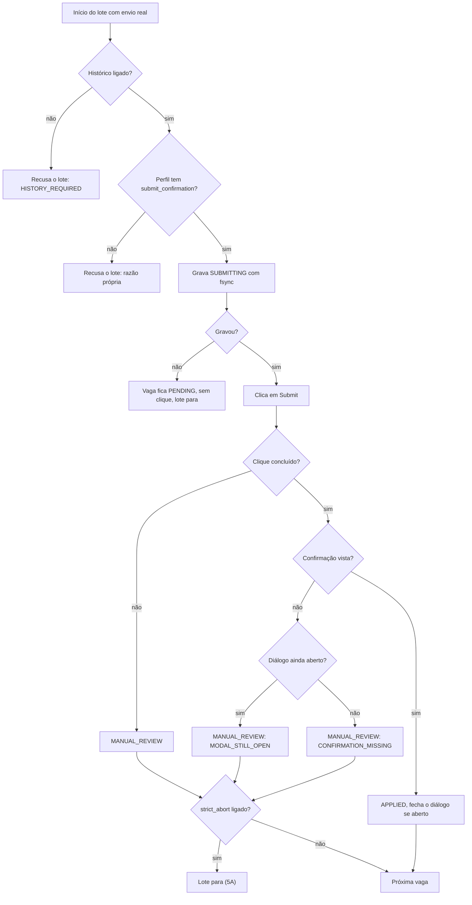

# NOTAS.md - Log de Handoff entre Agentes (AIHawk)

Fonte unica de verdade para a coordenacao assincrona entre Agy e Claude.

---

## 📬 COMUNICADO OFICIAL ATIVO NO TOPO (TURNO ATUAL)

**DE/PARA/TURNO:** Nicolas -> Claude (copia: Gemini Argon, Maestro, Agy) | Turno: Claude | 2026-11-03
**STATUS:** [PEDIDO] Bloco 1.1 (correcoes do GO com condicoes). Portao A segue aberto; o bloco 2 so comeca depois do fecho do 1.1. Branch 'feat/2.0-portao-a'. Sem LinkedIn real.
**ACEITE/RESUMO:** Claude corrige a regra de confirmacao (confirmacao vence dialogo aberto, sem palpite de "modal fechou"), a falha de gravacao do SUBMITTING, a parada apos MANUAL_REVIEW e o mutante 140, e passa `Turno: Agy`; o Agy restaura o prazo de 3 s, ancora cache e perfil na raiz do projeto, separa o perfil por motor, torna explicito o modo do Firefox, restaura o comportamento base do clone e refaz o relatorio, e passa `Turno: Nicolas`.

**ASSUNTO:** Bloco 1.1: correcoes do GO com condicoes do bloco 1 | commit anterior: 'e251373'

Claude (Dev), cc Gemini Argon (Tech Lead), Maestro (Revisor), Agy (QA/Infra),

Contexto: o Maestro aceitou o GO do bloco 1 com condicoes. Esta carta e somada ao PLANO OK: criterios do go/no-go, padrao de codigo, catraca de mutacao (95,0% e no maximo 29 sobreviventes), regras de territorio e de branch continuam valendo. Onde divergir, vale esta.

Decisoes do PO (regras de produto, nao opcoes):

* 4B. Chromium continua o motor padrao ate o resultado do Portao B. Firefox so com `BROWSER_ENGINE=firefox`. Nenhuma migracao definitiva neste bloco.
* 5A. Depois de um MANUAL_REVIEW o lote para; a vaga seguinte nao e tentada. A revisao e manual e a execucao seguinte recomeca.
* Consequencia da regra ja decidida (confirmacao visivel ou revisao manual): envio real exige `submit_confirmation` no perfil de seletores. Nao existe palpite de que "o dialogo fechou, entao enviou".

Evidencia que motivou esta carta (para ninguem precisar adivinhar):

* `DEFAULT_VISIBILITY_TIMEOUT_MS` passou de 3000 para 1200 e vale para todo `is_visible`. Num LinkedIn lento, o botao de candidatura aparece depois de 1,2 s, a vaga e marcada como sem Easy Apply e fica lembrada no historico para sempre.
* O cache padrao e `./.cache/jobs_history.json` e o perfil sai de `./sessions/<plataforma>` com `os.path.abspath`: os dois dependem da pasta onde o bot e executado. Rodar de outra pasta cria historico vazio (risco de candidatura duplicada, viola a 1A) e perfil vazio (sessao perdida). `.cache/` nao esta no `.gitignore`.
* O `profile_dir` do Firefox recebe o mesmo `user_data_dir` do Chromium (`browser_service.py`, linhas 114 e 183).
* Na maquina do Nicolas `which Xvfb` voltou vazio. Sem Xvfb, o codigo faz `os.environ.setdefault("INVPW_TRUE_HEADLESS", "1")` em silencio. Logo, as 3 execucoes verdes do Firefox provavelmente rodaram em headless de verdade, que nao e o modo que vamos usar (Xvfb), e a variavel de ambiente vaza para o processo inteiro.
* No diff do clone (`page.js`), `setIsModalOpen(false)` entrou como linha nova em `handleSubmit`, o banner de sucesso passou para o painel de detalhes e o tempo caiu de 1000 para 800 ms, para todas as vagas. O fluxo base do clone passou a ser "dialogo fecha e aviso aparece fora", que e justamente o que o fallback atual do Claude aceita. O seletor `submit_confirmation` nao esta no conjunto de seletores dos testes hostis, entao eles passam pelo fallback.

Itens do Claude (um commit por entrega; nao passe o turno antes de todos):

1. Confirmacao vence dialogo aberto. Regra no dominio (`SubmissionEvidence`), nao em try/except: sucesso se e somente se o clique foi concluido E a confirmacao foi vista, qualquer que seja o estado do dialogo. Sem confirmacao: dialogo ainda aberto = `MODAL_STILL_OPEN`; dialogo fechado = `CONFIRMATION_MISSING`; clique falho = razao propria. Em sucesso com dialogo ainda aberto, a aplicacao tenta fechar com o `close_button` do perfil; falhar ao fechar nao rebaixa o APPLIED, so registra.

2. Sem fallback "dialogo fechou". Remova-o. Envio real (nao simulado) com perfil sem `submit_confirmation` e recusado antes de abrir a primeira vaga, com razao propria em `AbortReason` e no mesmo molde da `HISTORY_REQUIRED`. Shadow Mode e simulacao nao exigem a chave. Testes: perfil sem a chave + envio real recusa; perfil sem a chave + Shadow segue.

3. Falha ao gravar o SUBMITTING. Sem gravacao confirmada nao existe clique. Se `record_submitting` falhar, nenhum estado em memoria fica em SUBMITTING, a vaga continua PENDING, o lote para com razao propria (`HISTORY_WRITE_FAILED` ou nome a criterio) e o sumario avisa. Teste com cache falso cuja gravacao levanta excecao: nenhum clique, status PENDING, lote parado.

4. Parada apos MANUAL_REVIEW (5A). Com `strict_abort` ligado (padrao), o lote para na primeira vaga que virar MANUAL_REVIEW, com razao propria e sumario pedindo revisao. Com `strict_abort` desligado (so teste) segue como hoje.

5. Mutante 140 (`app_controller`, `@staticmethod` de `_manual_review_lines`): ele so sobrevive porque os testes chamam pela classe. Chame pela instancia e mate-o. Se matar, proponha na carta apertar o teto para 28 sobreviventes; quem decide e o Nicolas. Equivalentes que nao der para matar: declare com diff e motivo.

6. Reporte a Mutation Score do zero no commit exato (por status, por arquivo, sobreviventes novos). Passe `Turno: Agy` com a lista abaixo.

Fora deste bloco (nao mexer): renomear `wait_for_loader_to_disappear`, que hoje espera o dialogo sumir (vai para o bloco 2 como `wait_until_hidden`, por carta do Claude ao Agy).

Itens do Agy (um commit por comportamento; nada de `src/domain`, `src/application`, `tests/domain`, `tests/application`):

A. Prazo de visibilidade volta a 3000 ms em producao. Testes que precisam de prazo menor injetam o valor por parametro ou variavel de ambiente de teste, e o valor injetado fica visivel no proprio teste. Teste de regressao: o padrao e 3000. O cenario `slow-modal` (600 ms) continua cobrindo "abre com atraso dentro do prazo"; para "estoura o prazo", use o prazo injetado, nao o padrao global.

B. Cache e perfil ancorados na raiz do projeto. Uma unica funcao de raiz do projeto, usada pelo `DEFAULT_CACHE_PATH` e pelo `SESSION_ROOT_DIR` padrao. Caminho relativo informado de proposito (CLI ou env) segue relativo a pasta atual, como todo CLI. Logar no inicio o caminho absoluto do historico e do perfil. `.cache/` e `sessions/` no `.gitignore` (mostre `git check-ignore -v .cache sessions`). Teste com `monkeypatch.chdir`: rodar de outra pasta resolve para os mesmos caminhos.

C. Perfil por motor. Chromium mantem o caminho de hoje (nenhuma sessao existente se perde); Firefox usa um diretorio irmao com o nome do motor. Teste: mesma plataforma, motores diferentes, diretorios diferentes. Perfil por identidade (conta temporaria) fica para o bloco 2; nao migre nada alem disso.

D. Modo do Firefox explicito. Em headless sem Xvfb: falhar com mensagem pedindo para instalar `xvfb`, a menos que exista opcao explicita de headless de verdade (nome a criterio), e nesse caso logar WARNING. Nao alterar `os.environ` do processo; se o driver so aceitar variavel de ambiente, restaurar no `close`. O relatorio passa a registrar, por execucao e por motor: modo efetivo (xvfb, headless-real ou headed), caminho do Xvfb, versao do navegador e `navigator.userAgent`. Depois que o Nicolas instalar o Xvfb, refaca as 3 execucoes seguidas em Firefox em modo Xvfb. O relatorio tem uma coluna por modo. Os criterios do PLANO OK nao mudam: o GO do bloco 1 vale "em headless real" e so fecha pleno com as 3 execucoes Xvfb verdes.

E. Clone: comportamento base restaurado. Confira com `git show eec3276:tests/real/linkedin_clone/app/page.js` e restaure o fluxo sem `scenario` ao da v1.5 (tempo de 1000 ms; dialogo nao fecha sozinho no Submit; confirmacao como antes). Os cenarios novos ficam explicitos por `?scenario=`: `close-on-submit` (dialogo fecha e aviso aparece fora; APPLIED), `no-confirm` (fecha sem aviso; MANUAL_REVIEW), `stuck-submit` (dialogo preso; MANUAL_REVIEW), mais os ja existentes (`broken-modal`, `slow-modal`, `job-challenge`). No `slow-modal`, passe pela mesma fase de carregamento do fluxo normal. Todo conjunto de seletores dos testes hostis passa a ter `submit_confirmation` apontando para o elemento de confirmacao do cenario.

F. Fixtures dos testes hostis. `hostile_clone_server` e `hostile_browser` sairam de `test_navigation_hostile.py`. Se foram movidas, diga para qual arquivo (`grep -rn "def hostile_browser\|def hostile_clone_server" tests/`) e mostre que mantem: diretorio de sessao isolado com limpeza, `HEADLESS` do ambiente e motor parametrizado, sem `channel="chromium"` fixo. Mostre tambem que nenhuma assercao original (honeypot, estado de sucesso) foi enfraquecida. Se for mudanca de comportamento, restaure.

G. Relatorio honesto. Cada numero de mutacao diz de qual commit e de quem vem ("medido pelo Claude em <hash>", ou rode voce). Diga na carta se os testes novos foram escritos a partir dos criterios antes de ler o codigo do Claude, ou depois.

H. Ao fechar: homologue no commit exato com `git diff --stat` provando que `src/domain`, `src/application`, `tests/domain` e `tests/application` ficaram intactos neste turno, e passe `Turno: Nicolas`. Nao altere o CI nem o `requirements.txt`.

---

## 1. Estado Atual da Squad

* **Turno Atual:** Claude (bloco 1.1).
* **Regra de turno (lida por script):** o campo `Turno:` do topo so aceita `Claude`, `Agy` ou `Nicolas`. Mudar o `Turno` no mesmo commit do seu trabalho e o sinal de passagem. Commit fora do seu turno e recusado por hook.
* **Versao Consolidada da Aplicacao:** v1.5 (`master` = 'e28da32', merge do PR #4, tag `v1.5`). Antes: v1.0 ('414e4f8', PR #2, tag `v1.0`).
* **Caminho:** Geracao 2.0 fecha na v2.0, com marcos intermediarios: v1.5 (feito) -> v1.6 (Portao A: motor e seguranca, sem LinkedIn) -> v1.7 (Portao B: Shadow Mode real com a conta temporaria, sem envio) -> v2.0 (Portao C: Burner Run de 5 vagas, primeiro envio real) -> Geracao 2.5 (LLM) -> Geracao 3.0. Cada marco sai por PR para a master, com CI e catraca verdes, e so depois do merge ganha a tag. Se um portao falha, o proximo nao comeca. Backlog definitivo: a planilha do Nicolas.
* **Versao Alvo da Squad:** v1.6 (Portao A). Bloco 1: homologado com GO com condicoes ('e251373'). Bloco 1.1 (correcoes): em curso. Bloco 2: so depois do fecho do 1.1. O Portao A so fecha a v1.6 quando os blocos 1, 1.1 e 2 terminarem.
* **Branch Ativa:** `feat/2.0-portao-a`. A `master` so recebe PR; as `feat/*` aceitam push normal (sem force push nem exclusao).
* **Placar do Pytest:** rapido (`tests/domain` + `tests/application`) = 341 PASSED em '8fa398f' (Mutation do zero em 03/11: 95,8%, 664/693, 29 sobreviventes; 1 deles e novo: o mutante 140, `@staticmethod` de `_manual_review_lines`, a matar no bloco 1.1; v1.5 era 95,1%, 562/591). Suite infra: 19 PASSED. Suite real (`tests/real/`): 32 PASSED em Chromium e 32 PASSED em 3 execucoes consecutivas no Firefox, em headless real (sem Xvfb); a rodada em Xvfb fica pendente no bloco 1.1. Total de testes automatizados do repo: 392 PASSED.
* **Proxima Acao Esperada:** Claude executa os itens 1 a 6 do bloco 1.1 (carta no topo) e passa `Turno: Agy`; o Agy executa os itens A a H e passa `Turno: Nicolas`; o Maestro revisa antes do fecho. O bloco 2 so e pedido depois disso.

### Roadmap tecnico do escopo atual (guardiao: Maestro)

```text
●  feito   ○  pendente   ◆  marco   →  passa o turno   ✖  parado

● [G2.0 - Bloco 1 CONCLUÍDO] entregue e homologado        e251373
│
○ [G2.0 - Bloco 1.1] Correções do GO (prazo de 3s para 1,2s, cache/perfil na raiz, Xvfb)
│ ├─○ C1 confirmação vale mesmo com diálogo aberto
│ ├─○ C2 envio real exige submit_confirmation, sem palpite
│ ├─○ C3 falha ao gravar SUBMITTING: sem clique, PENDING
│ ├─○ C4 lote para após MANUAL_REVIEW (decisão 5A)
│ ├─○ C5 mutante 140 morto, mutação medida do zero
│ │      → Turno: Agy
│ ├─○ A1 prazo de visibilidade VOLTA a 3000 ms
│ ├─○ A2 cache e perfil ancorados na raiz, .gitignore
│ ├─○ A3 perfil separado por motor
│ ├─○ A4 Firefox: Xvfb, ou headless real só explícito
│ ├─○ A5 clone: fluxo base da v1.5 + cenários explícitos
│ ├─○ A6 fixtures hostis: onde estão, nada enfraquecido
│ └─○ A7 3 execuções Firefox em Xvfb, relatório refeito
│        → Turno: Nicolas
│
◆ fecho do bloco 1.1 (revisão do Maestro)
```

Algoritmo do envio depois do bloco 1.1 (passos C1 a C4):



Detalhe de cada passo: carta do bloco 1.1 (topo deste arquivo). O proximo trecho do roadmap so entra aqui por carta do Maestro, depois do fecho.

---

## 2. Regras de Governanca e Etiquetas do NOTAS.md

1. **Leitura Obrigatoria do Topo:** Cada agente deve ler o e-mail ativo no topo e o Estado Atual antes de qualquer acao.
2. **Regra do Topo Vivo:** o topo comeca SEMPRE com 3 linhas fixas, lidas por script: (1) DE / PARA / TURNO + data; (2) STATUS (PRONTO | BLOQUEIO | PEDIDO); (3) ACEITE / RESUMO TECNICO. Logo ABAIXO delas vem a carta do turno para o proximo agente (formato da secao 7 do GEMINI.md: ASSUNTO, commit anterior, corpo). Nunca escreva nada acima das 3 linhas. Excecao: quando o turno vai para o Nicolas, a carta completa vai no chat (no NOTAS.md, so as 3 linhas e o Historico).
   Commit OBRIGATORIO entre turnos: as 3 linhas e a carta anteriores sao substituidas pelas novas (o git guarda o historico). Um resumo de ate 5 linhas vai para o Historico. A substituicao vale SO para o bloco do topo: as secoes 1 a 4 nunca sao apagadas.
3. **Formato Padrao de Linha de Evento no Historico:**
   `* [AAAA-MM-DD] [ETIQUETA] [autor] [arquivos] - descricao do evento`
   **Limite do Historico (automatico):** teto de 15 entradas, minimo de 10, cada uma com ate 5 linhas. Um hook de pre-commit
   (`.git/hooks/pre-commit`, local e NAO versionado) poda sozinho em todo commit que inclua o `NOTAS.md`: acima de 15 entradas,
   mantem so as 10 mais recentes. NUNCA toca no e-mail do topo nem em nada acima do Historico; em duvida ou erro nao faz nada e
   nao bloqueia o commit. O git guarda as entradas removidas. Se o repositorio for clonado de novo, o hook precisa ser reinstalado.
4. **Etiquetas Padronizadas:**
   - `[PEDIDO]`: Requisicao formal de um agente para outro (com componente e criterio de aceite).
   - `[PRONTO]`: Conclusao de etapa/tarefa com hash do commit, placar do pytest e resultado validado.
   - `[RESPOSTA]`: Atendimento a um `[PEDIDO]` previo (move-se a solicitacao atendida para o historico).
   - `[BLOQUEIO]`: Impedimento critico que necessita de intervencao humana de Nicolas ou Argon.
5. **Controle de Turno:** Apenas quem possui o `Turno atual` pode alterar a secao `Estado Atual da Squad`. Fora do seu turno, o agente so le o NOTAS.md: nao edita, nao commita e nao mexe na arvore de trabalho.
6. **Governanca de Git:**
   - NUNCA usar `git add .` ou `git commit -a`. Sempre usar `git add NOTAS.md` explicitamente com seus arquivos de territorio.
   - Commitar com caminhos explicitos: `git commit -m "..." -- <seus arquivos> NOTAS.md` (nao leva o que o outro agente deixou preparado).
   - Prefixos de commit obrigatorios: `[Agy] ...` ou `[Claude] ...` (sem versao na mensagem).
   - Agentes NAO fazem troca de branch (so o Nicolas), `git stash`, merge de PR, force push, push direto na `master` nem reescrita de historico (`rebase`, `--amend`, `filter-branch`, `--no-verify`).
   - Push, PR e tag: so o Claude, depois da revisao aprovada, com a linha `AUTORIZO: ...` do Nicolas no topo do NOTAS.md e confirmacao dele no terminal. O Agy nunca. O hook `pre-push` recusa qualquer push para `master`/`main`.
7. **Mutation Score:** todo score registrado traz a contagem por status e por arquivo, e foi medido do zero (`.mutmut-cache` movido para fora com `mv`, nunca `rm -rf`) e sem outro processo de teste rodando em paralelo. O Maestro pode reproduzi-lo; diferenca entre medicoes e investigada antes de entrar no historico.

8. **Versao e tag:** a revisao acontece antes do PR. Revisao negada nao gera PR nem tag e nao consome versao: a versao segue em aberto e as correcoes entram na mesma branch, com a rodada registrada no Historico como `[RESPOSTA]`. A tag so e criada depois do merge. Correcao depois do merge usa versao de correcao (v1.5.1). O numero seguinte so existe depois do merge da anterior.  Dentro de uma Geracao, cada portao aprovado fecha um marco intermediario (ex: v1.6, v1.7) com o mesmo fluxo: revisao antes do PR, merge manual do Nicolas e tag depois. Commit entre turnos nunca gera tag.

9. **Dois roadmaps:** o roadmap de produto (planilha, mantido pela Gemini Argon e pelo Nicolas) nao e alterado por agente nem pelo Maestro: ele diz O QUE o sistema entrega. O roadmap tecnico fica na secao 1, mostra so o que esta sendo feito agora e o Maestro e o guardiao: ele diz COMO. Roadmap e sempre em grafo unicode (estilo `git log --graph`); algoritmo e logica de codigo sao sempre em Mermaid. Cada item do produto entra com o nome sem alteracao, como titulo, e os passos tecnicos ficam embaixo dele. Claude e Agy trocam `○` por `●` nos proprios passos ao entregar e podem anexar Mermaid do algoritmo do proprio plano logo abaixo do roadmap. Incluir, remover ou reordenar passos do roadmap so por carta do Maestro. Detalhe tecnico nunca sobe para a planilha.

---

## 3. Papeis e Territorios de Escrita

| Papel | Agente | Territorio Permitido de Escrita |
|---|---|---|
| Decisor / Autorizacao / Merge do PR | Nicolas | `master` (PR manual via GitHub), `.claude/`, `.gemini/`, `scripts/maestro/` |
| DEV (Arquitetura e Contratos) | Claude | `src/domain/`, `src/application/`, `tests/domain/`, `tests/application/`, `NOTAS.md`; entrega Git (push, PR, tag) so com autorizacao |
| QA, Runtime e Infraestrutura | Antigravity (Agy) | `src/infrastructure/`, `src/main.py`, `tests/infrastructure/`, `tests/real/`, `tests/conftest.py`, `Makefile`, `requirements*.txt`, `docs/`, `.github/`, configs de ferramentas na raiz, `.env*`, `.gitignore`, `NOTAS.md` |
| Auditoria e Revisao | Argon | Somente leitura |

---

## 4. Historico de Handoffs
* [2026-11-03] [PEDIDO] [Nicolas -> Claude] NOTAS.md - Bloco 1.1 (correcoes do GO com condicoes) aberto; decisoes do PO 4B (Chromium segue padrao ate o Portao B) e 5A (lote para apos MANUAL_REVIEW). Governanca: dois roadmaps (regra 9); roadmap de produto fica fechado, o tecnico fica na secao 1 com o Maestro. Territorio do Agy explicita `requirements*.txt`, `docs/` e `.github/`. Turno: Claude.
* [2026-11-03] [PRONTO] [Agy] src/infrastructure/, src/main.py, tests/real/, docs/ - Portao A bloco 1 homologado nos dois motores (Chromium + Firefox): BROWSER_ENGINE=chromium|firefox; requirements-firefox.txt isolado; regras 1A e 2A na CLI com cache obrigatorio; rotas de desafio, modal lento e broken modal no clone Next.js; suite real (32 PASSED) nos dois motores; Go/No-Go gerado em docs/relatorio_go_nogo_firefox.md com veredito GO (6 criterios verdadeiros, tempo 1,05x). Turno: Nicolas.
* [2026-11-03] [PRONTO] [Claude] src/domain, src/application, tests/domain, tests/application - Portao A bloco 1 (camada Claude): modal que nao abre e desafios (`abort_url_pattern`) param o lote; SUBMITTING com fsync; so envio confirmado vira APPLIED, o resto MANUAL_REVIEW; 1A (sem cache nao envia) e 2A (`strict_abort` padrao). Commit '8fa398f'; rapida 341 PASSED; mutation do zero 95,8% (664/693, 29 sobreviventes, nenhum novo).
* [2026-11-03] [PEDIDO] [Nicolas -> Claude] NOTAS.md - PLANO OK do Portao A, bloco 1 (branch 'feat/2.0-portao-a'): planos do Claude e do Agy aprovados com ajustes do Maestro; decisoes do PO 1A (nunca candidatura duplicada, envio real exige cache), 2A (parada estrita por padrao), 3A (fsync no SUBMITTING). Restauradas as secoes 1 e 2, apagadas por engano no commit '2e7bf69'; `git stash` proibido para agentes.
* [2026-11-02] [PRONTO] [Claude] NOTAS.md - Autorizacao recebida: push da feat/v1.5 e PR para a master. Tag v1.5 so depois do merge (Nicolas avisa no chat). Limitacoes conhecidas vao na descricao do PR e no backlog da v2.0.
* [2026-11-02] [RESPOSTA] [Nicolas -> Claude] NOTAS.md - Revisao do ponto estavel '3276d90' aprovada (Nicolas, Argon, Maestro). AUTORIZO: push, PR e tag da feat/v1.5; tag so apos o merge.
* [2026-11-02] [PRONTO] [Agy] tests/real/, .github/workflows/ci.yml, NOTAS.md - Homologa ajustes do Maestro: parada estrita na listagem (zero vagas, 2a URL nao aberta), negativo da tabela restaurado, teste cego com max 10 e empresa vazia, CI endurecido com venv e catraca mutation (95,1%). Total: 206 PASSED (28 Chromium real). Carta no chat. Turno: Nicolas.
* [2026-11-02] [PEDIDO] [Claude] src/application, tests/application - Parada estrita na listagem e por desvio de dominio (`get_current_url` no BrowserPort); mutation do zero 95,1% (562/591), sobreviventes todos equivalentes; fluxo da tag corrigido. Pede 4 testes reais e homologacao ao Agy.
* [2026-11-02] [PEDIDO] [Diretoria -> Claude] NOTAS.md - Revisao do Maestro: v1.5 nao aprovada. Claude: commitar teste residual, parada estrita na listagem, current_url no BrowserPort, corrigir fluxo da tag. Agy depois: teste de checkpoint sem link, assercao da 2a URL, negativo da tabela, teste cego com contagem real, CI sem '|| true' com catraca, homologar no commit exato.
* [2026-11-02] [PEDIDO] [Claude] tests/application, NOTAS.md - Inclui `test_mutantes_residuais.py` (esquecido no commit anterior) e pede ao Nicolas/diretoria a aprovacao do ponto estavel da v1.5. Aguarda resposta antes de tag, push e PR.
* [2026-11-02] [PRONTO] [Agy] NOTAS.md - Homologacao de modal_signature no motor real: 27/27 Chromium PASSED (201/201 no total do repo); guarda de progresso aprovada sem falsos positivos; ponto estavel para fechamento da v1.5. Turno: Claude.
* [2026-11-02] [PEDIDO] [Claude] src/application, tests/application - `modal_signature` no BrowserPort e no laco do modal (guarda de progresso); mutation do zero 95,0% (551/580); rapida 174 PASSED. Pede infra+real ao Agy.