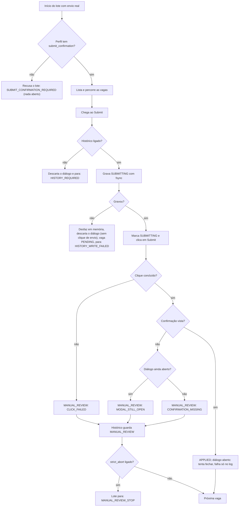
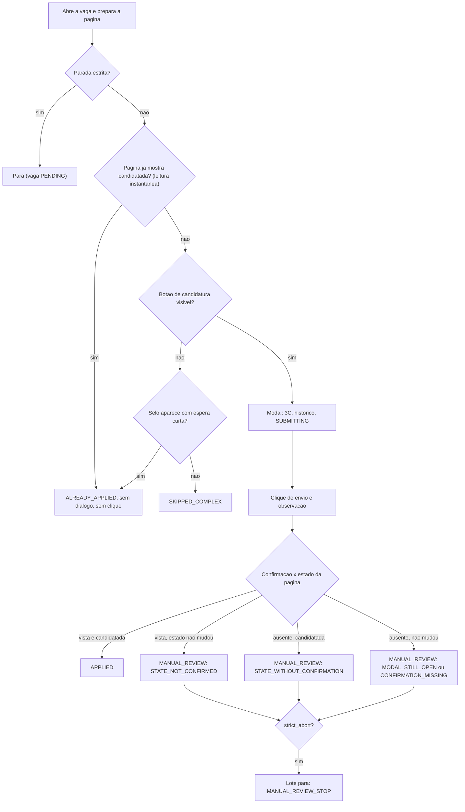

# ROADMAP.md - Roadmap tecnico do AIHawk (guardiao: Maestro)

Leia este arquivo junto com o topo do `NOTAS.md` antes de planejar ou executar: ele diz COMO o produto chega a cada marco, e onde o seu passo se encaixa.

* Claude e Agy: leitura incentivada, edicao negada nas permissoes. O andamento de cada passo vai na sua carta de entrega; o Maestro marca `●` no fecho, depois da revisao, e o Nicolas commita.
* Incluir, remover, reordenar ou renomear passos so por carta do Maestro. Se achar que falta ou sobra passo, faca `[PEDIDO]` ao Maestro no `NOTAS.md`.
* O roadmap de produto (O QUE) e a planilha da Gemini Argon e do Nicolas; cada titulo de produto entra aqui sem alteracao. Detalhe tecnico nunca sobe para a planilha.
* Roadmap sempre em grafo unicode; algoritmo e logica de codigo sempre em Mermaid.

## Roadmap

```text
●  entregue   ○  pendente   ◆  marco   →  passa o turno   ✖  impedimento   ?  depende de decisao do Nicolas   [técnico]  fora da planilha de produto

◆ v1.5  master e28da32
│
● [G2.0 - Bloco 1 CONCLUÍDO] Spike do motor Firefox (Chromium/Firefox, invisible-playwright)
● [G2.0 - Bloco 1 CONCLUÍDO] Detecção de checkpoint, captcha e verificação de telefone
● [G2.0 - Bloco 1 CONCLUÍDO] Intenção pré-clique mínima ("SUBMITTING" e proteção de repetidas)
● [G2.0 - Bloco 1 CONCLUÍDO] Parada estrita (cobrindo modais que não abrem)
│   GO com condições, e251373
│
● [G2.0 - Bloco 1.1] Correções do GO (prazo de 3s para 1,2s, cache/perfil na raiz, Xvfb)
│ └─● C1..C5 (Claude) → A1..A7 (Agy) → Nicolas     GO, 81ec6e4
│
○ [G2.0 - Portão A] Confirmação de envio obrigatória (exigindo aviso visível do Easy Apply)
│ ├─● regra no código e clone: entregue no bloco 1.1 (C1, C2, A5)
│ ├─● porta wait_until_hidden no lugar de wait_for_loader_to_disappear      (C3, A3, R4)
│ └─○ seletor de confirmação do perfil real, sem depender de texto
│        (hipótese até o Portão B)
│
○ [G2.0 - Portão A] Reconhecer vaga já candidatada pela página (segunda barreira anti-duplicada)
│ ├─● domínio: já candidatada pela página vira ALREADY_APPLIED sem abrir o diálogo   (C2)
│ ├─○ porta: ler o estado da vaga (Claude pede, Agy implementa)        (C2 ●, A3: R9)
│ ├─● pós-envio: reler o estado como segunda evidência do APPLIED                    (C2)
│ ├─● regra de combinação confirmação × estado: plano do Claude                      (C2)
│ ├─● clone: vaga já candidatada e vaga que muda de estado após envio           (A3, R4)
│ └─○ seletor do perfil real sem depender de texto (hipótese até o Portão B)
│
○ [G2.0 - Portão A] Resíduos da esteira (proibir git stash e mover mutmut-cache)
│ ├─○ git stash negado nas permissões dos dois (Claude: feito; Agy: Nicolas confirma)
│ ├─● regra 7: mover .mutmut-cache em vez de rm -rf
│ ├─● hooks versionados, script de instalação, AGENTS.md                             (A5)
│ ├─○ cota do modelo, "só Nicolas troca de branch", regras PR-only
│ └─○ magc: detector de ocioso com shell em segundo plano (Nicolas)
│
○ [técnico] Sobreviventes da mutação, um a um (teto só desce)                        (C1, A4)
│ ├─● lista dos 28: arquivo, linha, diff, causa, classificação     (Claude, 79cb102)
│ ├─● matar os matáveis: 24 mortos, 4 equivalentes                 (Claude, 79cb102)
│ ├─● laudo em docs/ conferido com a fonte                                      (R1)
│ ├─○ catraca provada rodando a regra real do CI, cada regra por si     (R5 → R7)
│ ├─● 1 dos 4 equivalentes eliminado (C4) → teto 3 gravado (R6)
│ └─● 3 equivalentes (61, 410, 433) aceitos pelo PO
│
○ [técnico] Trava de identidade: recusa iniciar se o navegador se denuncia           (A1, A2)
│ ├─● alvo ≠ clone local: Xvfb com janela real nos dois motores, nunca headless (R2)
│ ├─● levantamento dos sinais que denunciam automação, medidos no clone (Agy)
│ ├─○ recusa iniciar ou continuar se um sinal denunciar: prova sem brecha (R3 → R8)
│ └─● bateria real nos dois motores em Xvfb: base A/B com modo e UA por rodada  (R2)
│
○ [técnico] Fecho do Portão A: R7 a R9 (Agy) → revisão do Maestro com o Nicolas → AUTORIZO → PR
│
◆ v1.6  Portão A  (PR + tag depois do merge)
│
○ [técnico] Sinais que só se medem com rede externa, antes de qualquer conta (Portão B, 1º passo)
│ ├─○ refazer a base A/B com o log de identidade de cada rodada salvo junto
│ ├─○ medidos por motor em Xvfb, fora do LinkedIn
│ ├─○ documentar as chamadas de rede do motor ao iniciar (ipify, GitHub)
│ └─○ WebGL por motor como critério do A/B, sem viés (decisão 3 do PO)
│
○ [G2.0 - Portão B] Validação no LinkedIn real sem envio (conta temporária)
│ ├─○ (Nicolas) criar a conta temporária, idioma fixo, IP de saída separado
│ ├─○ perfil por identidade: .profiles/<identity_id>, proxy por env,
│ │      trava ^https?://, flush de disco ao fechar
│ ├─○ modo assistido: navegador visível, para e avisa no desafio, sem resolver
│ ├─○ PRIMEIRA RODADA À VISTA: o Nicolas assiste o bot logar, buscar,
│ │      abrir vagas e preencher o Easy Apply até o Submit, sem enviar
│ ├─○ capturar os seletores reais: confirmação e já candidatada
│ └─○ candidatar à mão a 1 vaga e confirmar que o bot a reconhece
│
○ [G2.0 - Portão B] Shadow Mode nos dois motores (Chromium vs Firefox em Xvfb)
│ ├─○ critérios de "vencer" escritos ANTES de rodar (como no GO)
│ ├─○ mesma conta, mesmos filtros, um motor por vez
│ ├─○ registrar checkpoints, desvios, sinais e tempos por motor
│ └─○ salvar offline as telas reais de bloqueio e virar fixtures do sandbox
│
○ [G2.0 - Portão B] Decisão de motor padrão pelo Nicolas com base no Shadow Mode
│ └─○ relatório comparativo dos dois motores para a decisão
│
◆ v1.7  Portão B  (PR + tag)
│
? [G2.0 - Portão C] [CONDICIONAL] Migração definitiva para o motor vencedor e re-homologação
○ [G2.0 - Portão C] Lote de Ignição / Burner Run (5 vagas reais na conta temporária e tag v2.0)
│
◆ v2.0  Portão C
```

## Algoritmo do envio (bloco 1.1; o bloco 2 acrescentou a leitura do estado da vaga, abaixo)




## Algoritmo da vaga ja candidatada (bloco 2, C2 do Claude)

